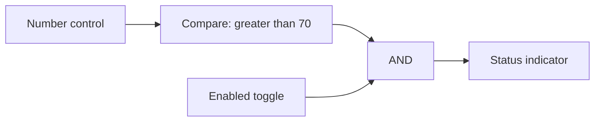
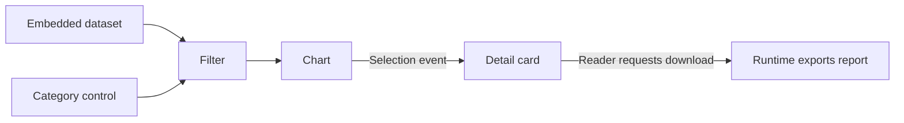
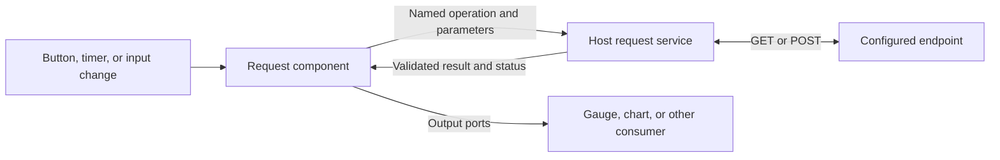
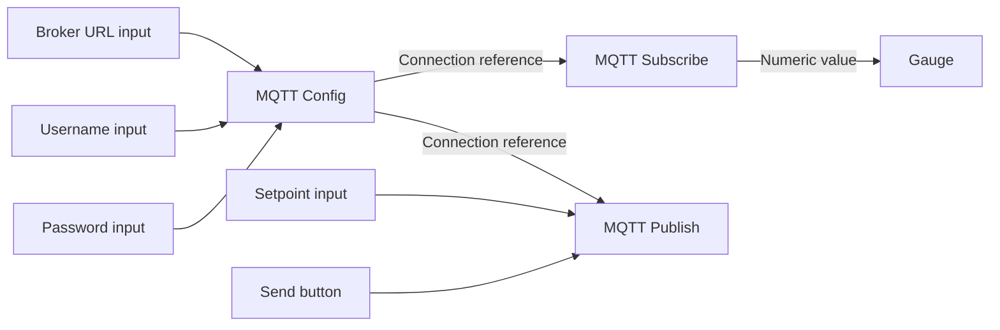

# From smart shapes to connected components

Status: stage 1 and its authoring setting are implemented on `feature/smart-components`,
based on `main`, updated 2026-10-16. They are not yet part of the main-branch baseline below.
Stages 2–6 remain proposals; the delivery tables define their intended order and prerequisites.
Original discussion baseline: `main` at [`2f534db`](https://github.com/oldwired/simplecanvas/commit/2f534db0f4d1424b5c6280c88ba9d06d0bd25be9).
For the maintainer and contributors deciding how far SimpleCanvas should grow.

## Direction

SimpleCanvas already creates portable interactive documents. An HTML export contains its
visuals, smart-shape scripts, saved state, and an isolated runtime; readers can use it offline.
On the feature branch, connected shapes can now exchange scalar values. The next step is to
make useful components easy to find, place, and combine; consuming datasets and requesting
explicit actions follow.

The proposed direction is a visual authoring tool for small, self-contained interactive
HTML documents. Preserve the ordinary drawing workflow and make component authoring optional.
The existing deployment switches and Really SimpleCanvas variant provide a way to offer
simpler interfaces without maintaining a separate application.

The first milestone is **one numeric control driving a separate gauge,
working in both the editor and an exported HTML file**. It is implemented with API v2,
an **Inputs…** source picker, saved bindings, and independent instance IDs. Open
[the connected example](../examples/connected-components.json) as a sketch to try it.
The next milestone adds a categorized library, ready-to-place default components, and logic
gates. This comes before data tables, events, downloads, and external integrations, so actual
composed documents can inform those later increments.

## Current baseline: main and the feature branch

The smart-shape work originally discussed as PR #5 landed through the sandboxed
[PR #7](https://github.com/oldwired/simplecanvas/pull/7) and subsequent integration fixes.
Live shapes and interactive HTML followed on October 15.
The table distinguishes those main-branch foundations from the additions on `feature/smart-components`.

| Capability | Current behavior |
| --- | --- |
| Programmable shapes | Each `smart` item carries a script, JSON state, dimensions, and styling. Scripts return drawing primitives and interactive handles. |
| Connected scalar values — feature branch | API v2 scripts declare typed ports and compute outputs from inputs and state. Number control and Gauge templates demonstrate saved bindings, undo/redo, independent copies, and offline HTML. |
| Isolated execution | Each instance runs in its own Worker, managed by an opaque-origin sandboxed frame. Network access is blocked, replies are validated, and hook timeouts terminate the offending Worker. HTML exports use the same isolation machinery. |
| Live readings | `refreshMs(state)` requests redraws at intervals clamped to 100–60,000 ms. Live clock and stopwatch templates derive readings from timestamps. Refreshes do not mutate saved state or create undo entries. |
| Interactive HTML | One offline file embeds the drawing, scripts, saved state, sandbox, and runtime. Controls work directly, without entering editor edit mode. An initial SVG remains visible before startup or when JavaScript is unavailable. |
| Author and reader controls | `editorOnly` removes marked visuals and handles from exports. `exportBehavior` independently permits moving, rotating, and resizing either dimension; the default layout stays fixed. |
| Library authoring | Existing library scripts can be edited and their previews regenerated. Each new placement initializes independently. Already-placed instances retain their own script and state. |
| Library previews | Bundled PNG previews display without executing scripts. Missing imported smart previews use placeholders and require approval before generation; authoring a definition already authorizes its preview. Placement still runs hooks in the sandbox. |
| Deployment variants | Settings can disable authoring, library management, workspace controls, and other features. Fixed libraries remain usable, and Really SimpleCanvas disables all optional features. |
| Component authoring switch — feature branch | `features.smartComponents:false` hides component templates, source editing, and Inputs, and blocks adding component library entries. Existing drawings, copies, deployed-library placements, and HTML exports keep working. This switch depends on `smartShapeAuthoring`; it does not disable execution. |
| Practical examples | Live clock, stopwatch, chart, ruler, drilling template, and sailing shapes exercise timing, stateful controls, and physical units. Actual-size and tiled printing support physical templates. |

The original, still-supported hook contract is:

```text
initState()
initStyle()
children(state, style, w, h, editing)
refreshMs(state)
exportBehavior or exportBehavior(state)
handles(state, w, h, style)
hitEdit(state, lx, ly, w, h, style)
dragEdit(state, handle, lx, ly, w, h, style)
```

API v2 adds `compute(inputs, state)`, resolved `io` on drawing/interaction hooks, and an
explicit `{state}` return from `dragEdit`. The [scripting reference](../SMART_SHAPES.md#connected-components-api-v2)
defines the implemented contract and budgets.

Hooks return synchronously inside the Worker; requests and replies cross an asynchronous
bridge. Globals and definition-local mutations are disposable because idle Workers can be
evicted. Durable interaction values belong in returned state.

The [scripting reference](../SMART_SHAPES.md#the-script-object),
[HTML behavior](../SMART_SHAPES.md#html-export-behavior), and
[sandbox constraints](../SMART_SHAPES.md#constraints-and-sandbox) describe the supported API.
The [browser regressions](../tests/README.md) cover offline HTML execution, controls, permissions,
tab state, timing, isolation, and export fidelity.

## Current boundaries

These boundaries describe the feature branch, including stage 1.

- **Connections carry scalar values within one sketch.** Number, string, and boolean ports are
  supported. Shared datasets, cross-tab connections, and routed events remain future work.
- **A handle action changes local state.** There is no component API for downloading results,
  navigating the document, or calling a service. Scripts cannot fetch data directly.
- **Reader changes are temporary.** Exported HTML retains changes across its tab switches, but
  reopening restores the exported state. There is no reader save-changes facility or HTML import
  path back into the editor. Sketch/workspace JSON remains the editable format.
- **Definitions are instance snapshots.** Library edits do not propagate to placed objects.
  Component API v2 is explicit and separate from document format 4. There is no state-migration
  or automatic definition-upgrade contract.
- **State is small.** Scripts are limited to 50,000 characters; state to 4,000 serialized JSON
  characters. Invalid state updates are rejected. Bulk datasets need a separate representation.
- **No nested smart children.** A library entry can preserve several connected items, but a
  smart shape cannot return nested smart shapes, tables, or asset-referencing images as children.
- **Library discovery is still basic.** The picker presents one flat collection, and importing
  a library replaces that collection. Number control and Gauge are authoring templates;
  a categorized built-in component collection remains to be implemented.
- **Editor interaction still uses edit mode.** Direct reader interaction exists in HTML; a
  document-wide Run/Preview mode inside the editor would be an additional feature.

## Stage 1 acceptance — implemented on the feature branch

The numeric control and separate Gauge exercise the actual runtime through a numeric binding.
Keep these checks as the regression baseline for subsequent stages.

- The connection updates in both the editor and a downloaded HTML opened directly from disk.
- Rapid input changes settle on the newest value; stale Worker replies cannot overwrite it.
- Undo/redo and JSON save/load restore local state and bindings; derived outputs recompute.
- Duplicate/copy/paste, source deletion, and colliding UIDs in different tabs cannot misroute data.
- Missing ports, invalid types, cycles, unsupported versions, and failed computations show useful
  errors and preserve recoverable source data.
- HTML contains the required scripts, bindings, and state, keeps author controls hidden, and
  retains the current fixed-layout defaults and reload semantics.
- Existing unversioned shapes, independent live clocks, static exports, and ordinary drawings
  keep their behavior. There are no new network dependencies or actions in this milestone.

## Delivery stages

Stage 1 is implemented on the feature branch; stage 2 is next. The stage numbers give the
proposed planning order, not a requirement to finish every earlier feature before starting
the next. Embedded tables, a full Run/Preview mode, and visible wires are not prerequisites
for scalar integrations. JSON downloads can precede table support; CSV outputs use stage 3.
Share runtime helpers between editor and export throughout.

| Stage | Deliverable | Evidence that it works |
| --- | --- | --- |
| 1. Connected values — implemented on branch | Versioned metadata, scalar producers/consumers, saved bindings, asynchronous computation, and optional authoring | A numeric control drives a separate Gauge in editor and offline HTML; undo, save/load, and independent copies preserve the relationship. Existing smart scripts keep working. |
| 2. Component library and logic | Categories/search, a built-in collection alongside user entries, controls/displays, boolean gates, and numeric comparison | An author builds the threshold-and-toggle indicator from the library without editing scripts; the document and independent copies work in the editor and offline HTML. |
| 3. Embedded data | Dataset schema and budgets first, then CSV/JSON import, typed table inputs, and simple filtering | A small table feeds a chart through a filter; export includes its data; invalid or oversized imports preserve the document. Reader-selected files are a subsequent extension. |
| 4. Events and local outputs | Explicit event reception and a validated download action | A reader chooses data and downloads the expected result exactly once. Refresh, reload, retries, and undo do not download or resend anything. |
| 5. Authoring and reader workflow | Run/Preview mode, clearer binding tools, reusable property controls, and an explicit results-saving policy | An author previews an existing example, operates its controls with layout tools hidden, and returns to authoring. State retention and any Save results action follow the chosen policy. |
| 6. External integrations | Shared host contracts, then separate HTTP and MQTT read/write increments | Both transports satisfy their own editor/export acceptance checks below, including credential modes, unavailable-network behavior, and explicit write intents. Component Workers remain isolated. |

Stage 6 is deliberately split into reviewable deliveries:

| Step | Prerequisites and deliverable | Evidence that it works |
| --- | --- | --- |
| 6.1 Shared integration foundation | Stage 1 value graph and stage 4's validated intent dispatch; add transient sources, reusable input fields, sensitive references, lifecycle, and execution/export policies | A simulated source and intent sink verify independent instances, stale-response rejection, no replay on restoration, and credential persistence choices in editor and HTML. |
| 6.2 Manual HTTP GET | 6.1; a configured bounded JSON GET mapped to scalar ports, initiated by Refresh | The newest accepted result drives a display; errors are visible; repeated instances stay independent. Downloaded HTML works with the test endpoint and remains readable offline. |
| 6.3 MQTT Config and Subscribe | 6.1; configured connections and a subscribed scalar reading, with both credential export modes | Independent Config instances and copied documents route correctly; reconnect and retained readings do not cause actions. Manual connection and explicitly enabled deployment startup work in downloaded HTML. |
| 6.4 Automated reads | 6.2; bounded HTTP timer, value-change, and edge triggers | One permitted trigger causes one request; initial/restored values do not replay edges, rapid changes settle correctly, and hidden documents pause polling. |
| 6.5 Explicit external writes | 6.1 and the relevant transport; user-triggered HTTP POST and MQTT Publish | One accepted Submit/Send produces one host intent; redraw, undo, reload, and reconnect do not replay it. Failure and duplicate handling distinguish host dispatch, transport delivery, and application acknowledgement. |

Implement 6.2 and 6.3 independently after 6.1; starting with manual GET is the proposed default.
Step 6.5 can proceed separately for each transport and does not depend on 6.4's polling.
Reorder those increments if a concrete document needs writes sooner, while keeping their own
acceptance checks. Do not call the whole integration stage complete after only one transport.

Keep nested components, a marketplace, automatic library upgrades, shared-definition migration,
and a complete visual programming editor outside these milestones unless actual examples justify them.
Every stage must work in the editor and self-contained HTML. Local behavior works offline;
live integrations additionally require reachable endpoints and preserve readable offline fallbacks.

## Next milestone: component library and logic

Make composing a useful connected document possible directly from the library, without opening
the script editor. This milestone builds on the existing scalar API and source picker; it does
not require datasets, events, or a new execution model.

Deliver this as three steps: **2.1** define library-entry identity, category/tag serialization,
and built-in/user collection behavior; **2.2** build the picker and supply the scalar controls,
gates, and displays; **2.3** verify the complete example, library roundtrips, and offline HTML.
Keep the existing input picker sufficient for this milestone; visible wires are optional later work.

### Categories and discovery

Start with one category per library entry, optional search tags, and a search field. Use
**categories** for library organization; canvas **groups** continue to mean objects selected
and transformed together. Nested folders can follow if real collections need them.

| Category | Initial contents |
| --- | --- |
| Controls | Number control, toggle, typed constant values |
| Logic | AND, OR, NOT, XOR, numeric comparison |
| Displays | Gauge, value label, boolean indicator |
| Tools & time | Ruler, clock, stopwatch |
| Drawing | Existing shapes and imported icons |

Category and tag metadata should survive library import/export. Existing flat libraries remain
valid and appear under an uncategorized section. Keep library-entry identity separate from
display names and from the UIDs of placed instances, so naming and organization do not change
existing connections. Cataloguing clocks here does not make their presentation refreshes into
connected time sources.

### Built-in and user collections

Offer a built-in collection alongside the user's collection. Collection origin and category
serve different purposes: an author can find Logic components across both collections, while
still seeing which entries are built in and which are their own.

Default components should be ready to place, with descriptions and bundled previews. Include
their definitions in the standalone app so they remain available without a hosted library file
or network connection. Importing a user library must not replace the built-in collection.
Authors can copy a built-in definition into their own collection to customize it. Preserve
existing instance snapshots: changing a library entry never silently updates placed components.

The library and authoring deployment switches still apply, including `smartComponents` and the
Really SimpleCanvas variant. A fixed deployed library remains placeable when component authoring
is disabled. Exported documents carry the definitions they use and remain independent of the
author's library. Browser persistence for user library edits is a separate decision; this
milestone must keep the existing explicit library export workflow clear.

### Logic components

Implement gates as normal API v2 components with declared boolean ports and pure `compute()`
hooks. AND, OR, and XOR start with two inputs; NOT has one. A numeric Compare component bridges
controls and boolean logic, with its comparison operation and threshold configured explicitly.
Use declared types throughout: invalid or missing required inputs produce connection errors,
and an unavailable upstream value must not silently become `false`.

Show readable gate names and current input/output values on the blocks. Distinguish an
unavailable value from a valid false result, so an author can understand a composed document
without inspecting scripts. Reader exports initially retain the blocks and their values;
an authoring-only display policy can be considered separately from computation.

The acceptance example is **an indicator that turns on only when a number exceeds 70 and an
Enabled toggle is on**:



Authors place these components from the library and connect them through **Inputs…**. Repeated
instances retain their own names, state, and bindings; duplicating the complete example creates
an independent working copy. One output may also feed several consumers.

Keep this increment to combinational logic: outputs derive from current inputs and state.
Feedback loops, latches, delays, and scheduled signals need explicit state and time semantics
before they can extend the current acyclic graph. A boolean value is also distinct from an
event or request trigger; remaining true must not imply repeated actions in later stages.

### Stage 2 acceptance

- Categories and search make the default controls, gates, and displays discoverable. They are
  ready to place in the standalone app without importing a file or editing a script.
- Importing a user library retains the built-in collection. Older flat libraries still load;
  category/tag metadata survives export and reimport, and placed instances remain unchanged.
- The complete threshold-and-toggle example can be composed through the library and **Inputs…**.
  With Enabled on, 70 produces false and 71 produces true; Enabled off always produces false.
- AND, OR, NOT, and XOR satisfy their boolean truth tables. Type errors and unavailable inputs
  remain visible and do not masquerade as valid false outputs.
- State and wiring survive undo/redo and sketch/workspace save/load. Duplicated examples remain
  independent, and one source can correctly feed several consumers.
- The example works in downloaded HTML without network access. Static exports capture its
  current result, and all existing sandbox and deployment restrictions remain in effect.
- Disabling component authoring hides creation/editing controls while existing drawings,
  copies, fixed-library placements, and exports continue working.

## The connected document

This is the target model. Stage 1 implements scalar inputs/outputs and persistent instance
state; datasets, events, and actions enter in the later stages below.

| Part | Purpose | Example |
| --- | --- | --- |
| Inputs | Values received from another component or a document dataset | Selected category, budget, rows |
| Outputs | Values derived from inputs and local state | Calculated total, filtered rows |
| Events | A discrete occurrence with a payload | Record selected, button pressed |
| Actions | Operations requested explicitly and performed by the host | Download CSV, navigate to a sketch |
| State | Small, persistent interaction values owned by an instance | Current selection, entered amount |
| Runtime values — proposed | Host-owned session data, separate from saved interaction state | Live readings, pending-request status, sensitive input values |

A later example could connect these parts:



The runtime owns the connections and executes operations. Components receive validated data
and return values or requests; they do not locate siblings or mutate another instance directly.
The document remains usable offline when it relies only on embedded data and local actions.

## Component contract and future extensions

### Versioned extension

API v2 is recorded as `apiVersion:2` in the script and `componentApi:2` on the saved item,
and validated by the runtime. Existing unversioned scripts retain their original contract.

V2 adds declared `inputs` and `outputs`, a `compute(inputs, state)` hook, and an extra `io`
argument on drawing and interaction hooks containing resolved inputs and outputs. It starts
with `number`, `string`, and `boolean`. Table types can follow with the dataset model.
Metadata crosses the same validated sandbox boundary as hook results. `compute` is required
when outputs are declared; an input-only display is valid. `io` also reaches `exportBehavior`.

For a gauge, the contract looks like this excerpt:

```js
inputs: { value: { type: 'number', default: 0 } },
outputs: { percentage: { type: 'number' } },
compute(inputs, state) {
  return { percentage: Math.max(0, Math.min(100, inputs.value)) };
},
children(state, style, w, h, editing, io) {
  // Draw using io.outputs.percentage and the existing primitive descriptors.
}
```

The first milestone is limited to values. V2 `dragEdit` requires an explicit `{state}` envelope
from its first release, while legacy `dragEdit` continues to return bare state. Later `emit`
and `effects` fields would require an explicitly supported contract revision. Never infer an
envelope from its keys: an existing valid state object can already contain fields named
`state`, `emit`, or `effects`.

Format 4 preserves unsupported versions and bounded source/state/metadata for recovery, and the
runtime reports incompatibility rather than silently downgrading the script. Older app versions
cannot be assumed to preserve the new fields.

Tables, event/effect envelopes, transient host sources, sensitive values, and connection references
need explicit supported schema/API extensions before implementation. Do not add them implicitly
to v2's scalar values or `{state}` envelope; retain compatibility with existing scripts.

### Change-driven evaluation

Inputs and state determine computed outputs. Changes to component state, scripts, bindings, or
literal inputs invalidate the sketch's component graph, which is evaluated in dependency order.
Stage 1 reevaluates the graph as a whole; selective downstream recomputation is a future
optimization. Cycles are rejected. Each input accepts one source or a literal/default, and
multiple consumers may use an output.

Computation crosses the existing asynchronous Worker bridge. The host waits for upstream results
and uses document/item ownership and graph signatures to discard replies superseded by edits,
undo, deletion, or tab changes. Preserve these guarantees and accepted interaction order when
adding new sources or optimizing evaluation. Do not depend on all Workers being resident at once.

Treat `compute` as a pure value-producing hook. Rendering and recomputation must not trigger
external actions. Keep `refreshMs` as presentation refresh: a clock driving other components
would need an explicit time-source contract, rather than treating every redraw as a graph change.

Apply execution and value-size budgets to computations as well as drawing hooks. If a producer
fails, mark its outputs unavailable and identify affected bindings. A last valid drawing may
remain visible, but stale values must not silently drive further actions.

### Connections and authoring

Bindings are semantic records on each receiving item, for example:

```json
{
  "uid": "capacity-gauge",
  "componentApi": 2,
  "bindings": { "value": { "uid": "amount-control", "port": "value" } }
}
```

IDs and bindings are scoped to one sketch. Cross-tab connections remain future work.
A future visible wire is an authoring view of a binding; ordinary drawing
arrows keep their existing meaning. Existing snapping provides useful geometry, but it does
not yet store component identity or port attachment.

Stage 1 provides the **Inputs…** source picker. Internal bindings follow duplicated or copied
selections with remapped IDs; references outside a copied selection remain explicitly unresolved.
Deleting a source reports an unavailable binding, and undo restores it. Keep these behaviors
when adding visible wires, new reference types, or richer port editing.

An editor Run/Preview mode can later reuse the exported reader interaction behavior. Wiring
and authoring controls stay hidden there. Existing smart editing remains usable in the first slice.

### Embedded data and persistence — proposed stage 3

Add a bounded document-level dataset store for embedded CSV/JSON and, later, reader-selected
files. Keep row data out of the 4,000-character interaction state; state should hold selections,
filters, and stable references. The existing asset pool and pruning logic are image-specific,
so generic data requires explicit schema, reference tracking, validation, and save/export changes.

Set document, dataset, computed-output, and transfer budgets before accepting tables. Resolve
references through the host, with bounded data passed into Workers; avoid copying a full dataset
into every instance's saved state or every redraw. Unsupported data must produce a recoverable
error without destroying the surrounding drawing.

Extend sketch/workspace JSON and offline HTML together. Derived outputs can be recomputed;
a saved document must retain the definitions, state, datasets, and bindings needed to do so.
Static PNG/SVG/print should capture the settled visible result without running actions.

Reader persistence is a separate product decision. A later explicit **Save results** action
could export JSON or CSV. A new HTML snapshot or full HTML-to-editor round trip requires a
complete editable document model in the export and a defined import path; the present playback
model is not sufficient on its own.

### Definition identity and updates

Stage 1 retains snapshot semantics: inline scripts carry API versions and ports without a
shared definition registry. Stage 2's library-entry IDs organize the catalog; they do not make
placed instances live references to shared definitions.

If deduplication or shared editing becomes useful, introduce document-local definition IDs,
versions, and source fingerprints. Each exported document must retain the exact definitions
it uses. Library changes should become explicit upgrades with compatible state migrations;
they must not silently change existing drawings. Source fingerprints identify content, not trust.

## Events and local actions — proposed stage 4

Add events after value propagation works. An event needs a declared name/payload and a receiving
contract, such as `onEvent(name, payload, state, io)`. The receiver returns a validated state
transition and optional further events or action requests. Bound propagation depth and work per
interaction so event cycles cannot run indefinitely.

In this stage, user interactions originate events and action intents. Dispatch each accepted
intent at most once; Worker retries, redraws, recomputation, undo/redo, opening a document,
and restoring an HTML snapshot must not replay it. Stage 6 adds separately enabled host triggers
for reads and connection lifecycle. Track their cause and revision so an input change can
produce one authorized request without treating every derived recomputation as a new action.
Pending actions need document/instance ownership checks just like pending state changes.

Start with a narrow host-owned action such as downloading prepared JSON; CSV can use stage 3's
table representation when available. The script returns a validated intent; the runtime checks
the action type, payload, and originating interaction and performs it. Browser user-activation
rules may require a host download control after asynchronous
preparation. Downloads and navigation should not receive unrestricted permission simply because
they are local operations.

Preserve the current network restriction. Remote data and service calls belong to a later,
explicit integration design covering allowed destinations, credentials, consent, failures, and
offline behavior. Credentials are session-only by default; an author may explicitly include
selected credentials in a saved document or HTML export for a ready-to-use deployment, under
the shared policy below. Importing a document does not enable its external operations. Prepared
deployment exports need a separate, explicit startup policy. Component scripts keep their
current lack of direct DOM, storage, and network access.

## Authoring and reader workflow — proposed stage 5

Use the library-and-logic example to improve binding discovery and reusable property controls.
Add a document-wide Run/Preview mode that reuses exported reader interaction, with layout and
authoring controls hidden. Visible wires are optional; the source picker remains sufficient
to connect a document.

Decide how preview state is retained or discarded on return to authoring before implementing
the mode, and make that choice visible. Distinguish this editor behavior from reader persistence:
HTML currently keeps changes only for its open session. If Save results is offered, build it on
stage 4's validated local actions and define the exported result format. Do not imply that a
result download is an editable HTML round trip. Acceptance covers entering preview, operating
the example, returning to authoring, and verifying the chosen state/result-saving policy.

## Shared integration foundations — proposed step 6.1

Define these contracts before implementing HTTP or MQTT, and share them between the editor and
the exported runtime. The transport adapters can then be built independently. Neither scalar
transport requires table datasets, visible wires, or the full Run/Preview workflow.

- **Transient sources and status.** Host results and incoming messages live outside saved
  interaction state. Define how validated scalar readings enter the graph, invalidate consumers,
  and carry document/instance/revision ownership without adding undo entries or autosaving each
  reading. Availability and freshness must be enforced by the runtime, not depend on authors
  wiring an optional status output correctly. A labelled last-known display may remain visible;
  an unavailable or stale reading cannot silently become an input to an external write.
- **Intents and triggers.** Reuse stage 4's validated intent dispatch. Record whether a change
  came from a user, an enabled timer/input trigger, a live response, or restoration. Initialization,
  undo, reconnection, and retained readings establish baselines rather than replay actions.
  Define the supported API/schema extensions before exposing host sources or new trigger types.
- **Configuration and references.** Persist operation definitions and instance-scoped references,
  never live clients or request handles. Define copy/remapping, deletion, and missing-reference
  behavior. Reference validity does not itself authorize an operation.
- **Reusable input fields.** Text, number, toggle, and password fields need shared focus, keyboard,
  commit/cancel, and validation behavior in editor and exported HTML. This small field-control
  capability is required before configurable connections; it need not wait for full Run/Preview.
  Sensitive values use a host-managed session store and restricted references to approved
  configuration consumers, not ordinary persisted string outputs visible to arbitrary scripts.
- **Execution policy.** Keep network execution separate from `smartComponents`, which only hides
  authoring. Define disabled, interactive, and explicitly prepared deployment behavior before
  allowing automatic startup. Opening/importing a sketch must not enable network operations.
  A deployment may connect on opening only when its host execution policy allows the configured
  operations and its author/deployer explicitly selected that startup behavior. Credential
  inclusion, field visibility, and auto-connect are separate choices.

Before adding either transport, verify these contracts with a simulated source and a recorded
intent sink: repeated instances stay isolated, stale responses are rejected, restoration causes
no actions, and sensitive inputs obey every persistence path. Real endpoint tests then validate
each transport's own behavior.

### Shared credential and deployment export policy

For HTTP and MQTT, support both interactive configuration and deployment to an HMI-like device
that should work as soon as its HTML document opens.

| Export mode | Credential values | Reader behavior |
| --- | --- | --- |
| **Ask on use** (default) | Credential fields are exported empty. | The reader enters the required values and connects. |
| **Ready to use** | The author explicitly selects which configured credentials to include in the HTML. | The document can connect automatically; configuration fields may remain visible or be hidden in the reader presentation. |

A password input needs both masked presentation and a persistence policy. By default its
value exists only for the current session and is excluded from autosave, sketch/workspace
JSON, clipboard/library copies, and HTML export. Binding it to configuration must not silently
copy it into ordinary persisted state. Sensitive runtime values must also stay out of saved
previews, status messages, and diagnostic output.

Allow an explicit **Include configured credentials** choice when saving a document or exporting
HTML. The choice identifies the credential fields and the artifact receiving their values;
including them in an HTML export must not silently enable their inclusion in ordinary autosave.
On loading an explicitly credential-bearing artifact, restore those values through the host's
sensitive configuration path, never into ordinary script state. For an HMI deployment, the
resulting file can carry the chosen configuration defaults and an explicit auto-connect policy.
Hiding the input fields changes their reader presentation while preserving
their configuration and bindings. Embedded credentials remain readable from the file even if
their fields are masked or hidden; the export UI should state this plainly. Re-exporting or
copying a credential-bearing document must preserve or explicitly change its inclusion policy,
rather than accidentally exposing session-only values.

## HTTP requests and triggers — proposed steps 6.2, 6.4, and 6.5

Components should be able to consume HTTP data and request external actions through a service
built into the canvas runtime. This service would be shared with exported HTML and would not
depend on deployment plugins, which are a separate project. This is future work, not part of
the implemented component API v2.

Keep direct network access blocked inside component Workers. A component requests a named
operation; the host checks the configured operation, performs the GET or POST, validates the
response, and delivers the result to that component instance. Endpoint definitions specify the
URL, method, allowed parameters or body fields, response mapping, and request limits. Scripts
receive only the data they need. A document can declare required operations; the shared execution
policy decides whether they may run. Importing it does not itself grant that permission.



### Explicit triggers

The author selects a request trigger in the component's properties, separately from its data
inputs and output bindings. Each instance owns its trigger configuration and pending requests,
even when several instances use the same script or endpoint.

| Trigger | Example | Semantics |
| --- | --- | --- |
| Button press | A reader clicks **Refresh weather** | One request intent per accepted press. |
| Timer | Refresh every 30 seconds | A host-owned schedule with bounded frequency and no overlapping polls for the same instance. |
| Input value changes | The selected city changes | Request using the new value, optionally after a configured debounce. |
| Input signal | `refresh` changes from false to true | Request once on the specified transition; remaining true does not retrigger. |

A signal transition is different from a value being present. Loading a saved `true` value
establishes the initial baseline; it does not replay an edge. Initial loading of remote data
is a separate opt-in startup policy. A permitted input change may produce a request after its
values settle; the host uses its cause/revision to avoid treating intermediate recomputations
as additional triggers. Repainting, static export, undo, and restoration must not accidentally
fire requests. Undo restores local configuration and values; it cannot undo a request already
processed by a remote service.

`compute()` stays a pure function. The existing `refreshMs` hook remains a presentation refresh
and does not schedule network traffic. Timers belong to the host and start only when document
execution and the requested operation are enabled. Pause polling for hidden or inactive
documents, cancel obsolete work when possible, and avoid a burst of missed polls on resume.
Bound requests and propagation so a response feeding a trigger cannot create an uncontrolled loop.

### Results and asynchronous behavior

A request component publishes mapped transient result values under step 6.1's source contract,
with explicit status outputs such as `loading`, `error`, and a last-updated timestamp.
Begin with bounded JSON responses mapped to
scalar ports; full response objects and tables require their own supported data contract.
For example, a selector could feed a request whose bounded numeric reading drives a display.
The existing Gauge clamps to 0–100; use values in that range for the first acceptance example,
or use a value label for readings with other units/ranges.

Capture the instance, document, parameters, and request revision when starting a GET. If a
parameter changes while the request is pending, cancel or supersede it; an older response must
not replace the newer result. Deletion, tab changes, and document replacement also invalidate
delivery. Apply timeouts, response-size limits, validation, and bounded retry/backoff in the host.
On failure, a last-known value may remain visible with an explicit stale/error status.

Treat POST as an explicit action with a separately configured trigger and payload. Start with
a user-operated **Submit** button. Permission to poll with GET does not authorize automatic
submissions on every input change. Do not blindly retry writes: where the endpoint supports it,
use an idempotency key to prevent duplicate submissions. Cancelling a local request or ignoring
its late response does not guarantee that the server cancelled the action.

### Export, authentication, and first delivery

Export the request definitions, trigger configuration, and required host runtime together.
Keep credentials out of persisted component state and downloadable documents by default.
Use the shared credential-inclusion policy above when preparing a ready-to-use HTML file.
Authenticated operations can also use a backend that holds service credentials or a
reader-authenticated session. Direct browser requests still depend on the endpoint's CORS and
authentication policy; the host service does not bypass those
[browser constraints](https://developer.mozilla.org/en-US/docs/Web/API/Fetch_API/Using_Fetch#making_cross-origin_requests).

An exported document should remain readable offline. It may include an explicitly saved
last-known data snapshot, labelled with its timestamp and stale status. Network controls should
explain when requests are unavailable; going back online must not replay queued submissions
without a defined policy. A reader's execution permissions are separate from the author's.

Step **6.2** connects **one configured JSON GET endpoint to the existing Gauge**,
with a manual Refresh button, loading/error outputs, stale-response protection, and an optional
offline snapshot. Step **6.4** adds timer and input-based read triggers; step **6.5** adds an
explicit POST action. These are separate increments: a manual POST does not depend on polling,
and HTTP completion is not required before starting MQTT Subscribe after the shared foundation.
Verify each increment in both the editor and exported HTML. The same test endpoint should
demonstrate that rapid parameter changes settle on the newest result, repeated instances stay
independent, and redraws or restored state never produce extra requests.

## MQTT and configurable connections — proposed steps 6.3 and 6.5

Support MQTT as another transport in the host-managed integration service. This belongs to
the component runtime shared by the editor and exported HTML; the separate deployment-plugin
experiment is not a dependency. MQTT uses the shared input, transient-value, credential, and
execution contracts from step 6.1. It is future work, beyond the implemented scalar API v2.

Browser clients require MQTT over WebSockets: a broker must expose a `ws://` or `wss://`
endpoint, or be reachable through a gateway providing one. Prefer secure WebSockets for hosted
deployments. A normal MQTT TCP endpoint alone is insufficient for a browser client. A client
such as MQTT.js can supply the protocol implementation; see its
[browser transport documentation](https://github.com/mqttjs/MQTT.js#browser).

### Components and wiring

| Component | Inputs or configuration | Result |
| --- | --- | --- |
| Shared input fields | Author-supplied defaults or values entered by the reader | Ordinary typed values can use scalar bindings; sensitive fields supply restricted host references to credential configuration. |
| **MQTT Config** | Broker URL, username, password, optional client ID, and connection policy | A host-owned connection referenced by Subscribe/Publish components, with connection status and errors. |
| **MQTT Subscribe** | An MQTT Config instance, topic/filter, and payload mapping | A validated scalar `value`, last-message timestamp, and availability/error status. |
| **MQTT Publish** | An MQTT Config instance, topic, payload value, and an explicit trigger | A publish request and its completion/error status. Broker acknowledgement is distinct from a device applying a command. |



The author can supply literal non-sensitive connection values or link shared input fields to
MQTT Config. The same controls and policies apply to HTTP. Credential values use the sensitive
configuration path from step 6.1 rather than ordinary saved literals. They are consumed by the
host connection service; connection/status outputs do not expose passwords or a live client
object to component scripts.

Subscribe and Publish reference a specific Config instance. The host can share its connection
and subscriptions among those consumers. Separate Config instances remain independent, even
when they use the same broker or script. Connection references need explicit serialization,
copy/remapping, and missing-reference behavior; the current scalar-port contract does not yet
define them. Keep references document-scoped and remap them when copying a complete connected
selection, just like existing component bindings. Generate a fresh default MQTT client ID for
each Config instance in each opened document session; independent Config instances and exported
copies must not accidentally reuse one client ID. Explicit IDs need a defined collision policy.

### Connection lifecycle and live values

Use **Apply / Connect** to commit edited connection inputs. Typing into a URL or password
field should not reconnect after every character. Support **Connect automatically on opening**
as a separate policy for unattended displays, subject to step 6.1's deployment execution rules.
Configuration changes retire the old connection generation; messages arriving from it must not
update the replacement configuration or another
document. Start with connections active only for the visible, active document: retire pending
delivery when switching away or closing it, and reconnect under the chosen policy on return.
Use bounded reconnect backoff and visible connected/reconnecting/error status; background
telemetry for inactive documents needs a separate later policy.

Incoming messages use the shared transient-source contract and invalidate downstream computations.
They do not add undo entries or autosave the sketch on every message. Start with bounded text
or JSON payloads mapped to number, string, or boolean ports, with payload-size and update-rate
limits. Separate a current reading from its availability and age; disconnection must not make
a stale measurement look current. An initial or retained reading establishes the current value
and must not be treated as a fresh reader action that publishes a command.

Keep `compute()` pure and preserve the Worker network restriction. Start publishing with an
explicit **Send** action. Opening, redrawing, undoing, restoring state, and reconnecting must not
publish or replay queued commands. Later input-based publishing needs an explicit trigger
policy, loop prevention, and a clear distinction between updating a displayed value and
requesting an external action. Define QoS, retained-message, and retry policies separately for
readings and commands; do not infer application-level exactly-once behavior from transport
acknowledgements.

Bundle the required MQTT client and host adapter into the exported HTML so it does not depend
on deployment plugins or a CDN. Live telemetry still requires broker access. Offline, the
document can show an explicitly saved last-known snapshot with a timestamp and stale status.
Connection controls should explain when a broker is unavailable, and reconnecting must not
replay earlier Send actions. Keep the integration optional through a dedicated runtime setting,
separate from whether component authoring controls are visible.

### Step 6.3 delivery and acceptance

Step **6.3** starts with **one subscribed numeric topic driving the existing Gauge**, using MQTT Config
and reusable credential input fields. Support manual connection, connection status, reconnect
handling, and both credential export modes in the editor and exported HTML. Add explicit
publishing in step **6.5**. Use a 0–100 payload for the existing Gauge; other measurements can
use a value label. Neither subscription nor manual publishing depends on HTTP polling.

- A broker message updates the gauge without changing undo history or repeatedly saving the
  drawing; malformed or oversized messages leave a clear error and preserve the document.
- Repeated Subscribe instances route values independently, while consumers of the same Config
  instance share its connection. Copying a whole example remaps its Config references.
- Applying new configuration or closing a document prevents late messages from the old
  connection from reaching the new one. Opening two exported copies uses distinct default
  client IDs.
- **Ask on use** omits credential values from every saved representation. **Ready to use**
  includes only the explicitly selected values, supports hidden configuration fields, and
  connects automatically only when that policy is enabled.
- An exported HTML file contains its MQTT runtime and works when its configured broker is
  reachable. Offline snapshots remain readable and clearly stale.

For step **6.5**, one accepted Send action produces one host publish intent. Redraw, reload,
undo, retained readings, and reconnect do not replay it; device acknowledgement and duplicate
handling are tested separately from broker delivery.

## Decisions before each stage

1. **Stage 2:** Define category/tag serialization, library-entry identity, and collection behavior
   before implementing the expanded picker; preserve existing flat library imports.
2. **Stage 3:** Define the table contract and dataset storage, transfer, and computation budgets
   before accepting embedded tables. Preserve recoverable unsupported data.
3. **Stage 4:** Define a supported revision for event/action envelopes, receiving hooks, dispatch
   identity, and propagation limits before adding handlers or download controls.
4. **Stage 5:** Use the library example to choose binding/control improvements and define preview
   state retention and reader result saving. A full HTML-to-editor round trip remains separate.
5. **Step 6.1:** Define transient sources, freshness, trigger provenance, sensitive references,
   connection identity, and artifact-specific credential/startup policy before either transport.
   These require explicit contract extensions, not implicit additions to scalar API v2.
6. **Transport steps:** Fix HTTP response mapping and request limits before 6.2; MQTT client-ID,
   reconnect, QoS, and retained-reading rules before 6.3; trigger baselines before 6.4; write retry,
   duplicate, and acknowledgement policies before 6.5. Keep execution settings separate from
   optional authoring, and the runtime independent of the deployment-plugin experiment.
