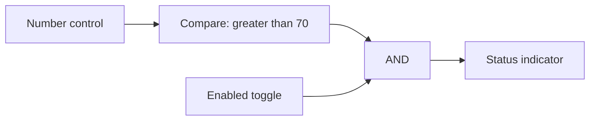
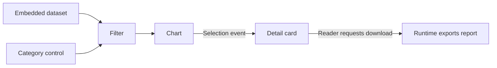
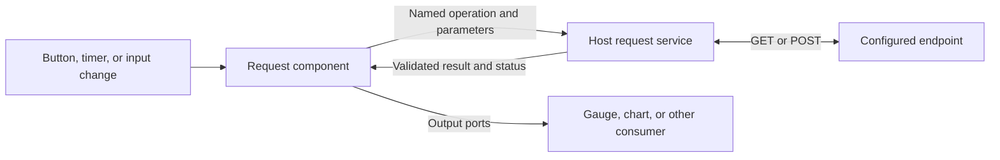
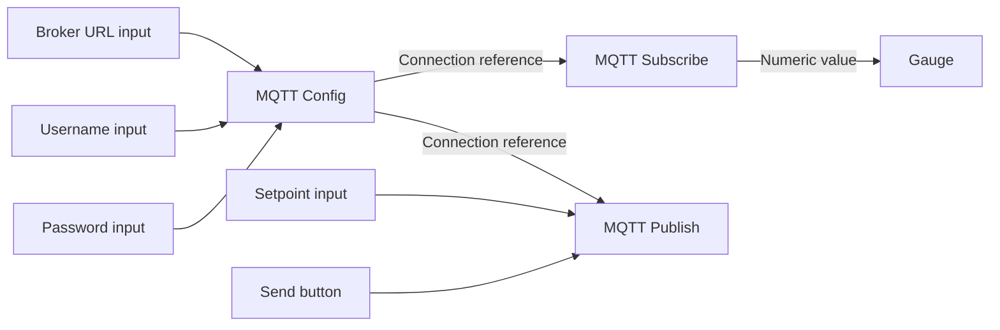

# From smart shapes to connected components

Status: stages 1 and 2 are complete on `feature/smart-components`, based on `main`,
validated 2026-10-17. Stage 2 includes the expanded library, logic, routing, timed signals,
an editable eight-tab example workspace, offline HTML reader, and the final authoring pass.
These additions are not yet part of the main-branch baseline below.
Stage 3's embedded-data workflow is implemented on the branch, including reader imports, sorting,
aggregation, optional transform switches, editable/dataset-driven choices and text lookup, a connected
spreadsheet with live dataset cells and editable imports, and a shared dataset model with bound-cell
editing, pulse-triggered row capture, and explicit Dataset ownership with source Replace/Append.
Dataset editor provides record editing and paging; Spreadsheet publishes evaluated table ranges.
Datasets can follow source publications in Live mode, overwriting local records on refresh.
Reload, source updates, capture, and downloads use narrow host-owned actions.
General routed events and stages 5–6 remain proposals.
Stage 3 remains active; the shared dataset milestone does not close it.
The delivery tables define their intended order and prerequisites.
The feedback and sequential-logic milestone is implemented on the same branch: bounded settling,
Pause/Step/Resume, gate-built memory, eight new storage/sequencing built-ins, and an expanded
fifteen-tab workspace. A subsequent text-passing milestone adds Text input, Number input, Text label,
Memo, and a sixteenth example tab before stage 3. Embedded data adds a seventeenth tab with
CSV/TSV/JSON imports, filtering, and a connected table/chart in the offline reader. An eighteenth
tab adds reader-selected data, aggregation, sorting, and explicit CSV/JSON downloads. A nineteenth
tab adds manual choices, automatic selection, and reverse text lookup using shared data. A twentieth
tab demonstrates spreadsheet formulas consuming and publishing signals. A twenty-first tab connects datasets
to the formula grid and demonstrates the editable-copy workflow. A twenty-second tab demonstrates
capture, editing, and several views of one shared dataset. A twenty-third tab separates incoming sources
from owned data with explicit Replace/Append pulses. The twenty-fourth tab demonstrates Live dataset
editing; the twenty-fifth separates an authored formula grid from its stored result table.
Shared buses and multiple drivers are deferred;
each input retains one source.
Original discussion baseline: `main` at [`2f534db`](https://github.com/oldwired/simplecanvas/commit/2f534db0f4d1424b5c6280c88ba9d06d0bd25be9).
For the maintainer and contributors deciding how far SimpleCanvas should grow.

## Direction

SimpleCanvas already creates portable interactive documents. An HTML export contains its
visuals, smart-shape scripts, saved state, and an isolated runtime; readers can use it offline.
On the feature branch, connected shapes exchange scalar values and table references, and a categorized browser makes
components easy to find, place, and combine. Embedded datasets support offline data tools and explicit result downloads.

The proposed direction is a visual authoring tool for small, self-contained interactive
HTML documents. Preserve the ordinary drawing workflow and make component authoring optional.
The existing deployment switches and Really SimpleCanvas variant provide a way to offer
simpler interfaces without maintaining a separate application.

The first milestone is **one numeric control driving a separate gauge,
working in both the editor and an exported HTML file**. It is implemented with API v2,
an **Inputs…** source picker, saved bindings, and independent instance IDs. Open
[the connected example](../examples/connected-components.json) as a sketch to try it.
The second milestone adds a categorized library, ready-to-place default components, logic gates,
numeric helpers, typed routing, and bounded timed signals. This comes before data tables, events, downloads, and external integrations, so actual
composed documents can inform those later increments.
The [smart-components workspace](../examples/smart-components-workspace.json) and its
[offline HTML reader](../examples/smart-components-workspace.html) demonstrate these compositions.

## Current baseline: main and the feature branch

The smart-shape work originally discussed as PR #5 landed through the sandboxed
[PR #7](https://github.com/oldwired/simplecanvas/pull/7) and subsequent integration fixes.
Live shapes and interactive HTML followed on October 15.
The table distinguishes those main-branch foundations from the additions on `feature/smart-components`.

| Capability | Current behavior |
| --- | --- |
| Programmable shapes | Each `smart` item carries a script, JSON state, dimensions, and styling. Scripts return drawing primitives and interactive handles. |
| Connected scalar values — feature branch | API v2 scripts declare typed ports and compute outputs from inputs and state. Number control and Gauge templates demonstrate saved bindings, undo/redo, independent copies, and offline HTML. |
| Isolated execution | Each instance runs in its own Worker, managed by an opaque-origin sandboxed frame. Network access is blocked, replies are validated, and hook timeouts terminate the offending Worker. HTML exports use the same isolation machinery. |
| Live readings | `refreshMs(state)` requests redraws at intervals clamped to 100–60,000 ms. Timestamp-based presentation, such as Stopwatch, does not mutate saved state or create undo entries. |
| Connected wall clock — feature branch | Live clock uses API v2 transitions to synchronize timezone-aware hands/readout, four boundary-pulse outputs, and a string time output. Pure computation reads its settled snapshot. |
| Connected stopwatch — feature branch | Stopwatch accepts run/reset commands and publishes elapsed seconds on pause/reset. Its live display independently follows saved wall timestamps without updating the output on each refresh. |
| Interactive HTML | One offline file embeds the drawing, scripts, saved state, sandbox, and runtime. Controls work directly, without entering editor edit mode. An initial SVG remains visible before startup or when JavaScript is unavailable. |
| Author and reader controls | `editorOnly` removes marked visuals and handles from exports. `exportBehavior` independently permits moving, rotating, and resizing either dimension; the default layout stays fixed. |
| Library authoring | Existing library scripts can be edited and their previews regenerated. Each new placement initializes independently. Already-placed instances retain their own script and state. |
| Library previews | Bundled PNG previews display without executing scripts. Missing imported smart previews use placeholders and require approval before generation; authoring a definition already authorizes its preview. Placement still runs hooks in the sandbox. |
| Deployment variants | Settings can disable authoring, library management, workspace controls, and other features. Fixed libraries remain usable, and Really SimpleCanvas disables all optional features. |
| Component authoring switch — feature branch | `features.smartComponents:false` hides component templates, source editing, and Inputs, and blocks adding component library entries. Existing drawings, copies, deployed-library placements, and HTML exports keep working. This switch depends on `smartShapeAuthoring`; it does not disable execution. |
| Library browser — feature branch | The compact Working collection shows pinned shortcuts. An optional adjacent browser provides search, multiple category memberships, a Built-in/My shapes Source filter, and direct placement. Shared Library actions manage entries and category tags; format 2 preserves IDs, metadata, category organization, and pins. |
| Practical examples | Live clock, stopwatch, chart, ruler, drilling template, and sailing shapes exercise timing, stateful controls, and physical units. Actual-size and tiled printing support physical templates. |

The original, still-supported hook contract is:

```text
initState()
initStyle()
children(state, style, w, h, editing)
refreshMs(state)
exportBehavior or exportBehavior(state)
handles(state, w, h, style)
hitEdit(state, lx, ly, w, h, style)
dragEdit(state, handle, lx, ly, w, h, style)
```

API v2 adds pure `compute(inputs, state)` and optional `publish(state)`, the stateful `transition` hook, resolved `io`
on drawing/interaction hooks, and an explicit `{state}` return from `dragEdit`. The [scripting reference](../SMART_SHAPES.md#connected-components-api-v2)
defines the implemented contract and budgets.

Hooks return synchronously inside the Worker; requests and replies cross an asynchronous
bridge. Globals and definition-local mutations are disposable because Workers expire or can be
evicted. Durable interaction values belong in returned state.

The [scripting reference](../SMART_SHAPES.md#the-script-object),
[HTML behavior](../SMART_SHAPES.md#html-export-behavior), and
[sandbox constraints](../SMART_SHAPES.md#constraints-and-sandbox) describe the supported API.
The [browser regressions](../tests/README.md) cover offline HTML execution, controls, permissions,
tab state, timing, isolation, and export fidelity.

## Current boundaries

These boundaries describe the feature branch, including feedback, text passing, and shared datasets.

- **Connections stay within one sketch.** Number, string, boolean, and table-reference ports are
  supported. Tables resolve through a bounded per-document pool. Cross-tab connections and routed
  events remain future work. Combinational table cycles are rejected; a Dataset owner can explicitly
  apply a transformed view of its own records through a Replace or Append pulse.
- **Actions are explicit and bounded.** Validated host actions support file import/reload, table
  downloads, row capture, and source-table updates. General routed events, document navigation,
  and service calls remain future work. Scripts cannot fetch data directly.
- **Reader changes are temporary.** Exported HTML retains changes across its tab switches, but
  reopening restores the exported state. There is no reader save-changes facility or HTML import
  path back into the editor. Sketch/workspace JSON remains the editable format.
- **Definitions are instance snapshots.** Library edits do not propagate to placed objects.
  Component API v2 is explicit and separate from document format 5. There is no state-migration
  or automatic definition-upgrade contract.
- **State is small.** Scripts are limited to 50,000 characters; state to 4,000 serialized JSON
  characters. Invalid state updates are rejected. Bulk data lives in the document dataset pool.
- **No nested smart children.** A library entry can preserve several connected items, but a
  smart shape cannot return nested smart shapes, tables, or asset-referencing images as children.
- **The library saves separately in this browser.** IndexedDB retains the modified/imported personal
  library, Working collection pins, scripts, inert previews, categories, and built-in overrides for
  this browser/profile and site/application URL path. Import replaces personal entries,
  organization, and pins; built-in definitions remain. Export is for backups and sharing.
  Workspace saves/autosave retain sketch tabs and placed scripts, state, and connections, but
  exclude the library, pins, and category organization.
- **Ports remain explicitly typed.** Text input and Text label carry strings; Number input,
  Constant, and Value label carry numbers. Compare accepts two numbers and a selectable relation;
  routing has separate numeric and Boolean variants with fixed channel types.
- **Editor interaction still uses edit mode.** Direct reader interaction exists in HTML; a
  document-wide Run/Preview mode inside the editor would be an additional feature.

## Component index convention

All component indices are zero-based (`0…N−1`), consistently in signals, port names, controls,
and examples. Dropdown selects index 0 by default. A missing selection or lookup returns index −1
with false Valid/Found; it never aliases the first choice. Stepped switches reset to channel 0,
use `in0`/`out0` onwards, and wrap N−1 → 0. Shift, ring, and Johnson taps start at `q0`;
`value` aliases `q(N−1)` where a final-stage output exists. The LED matrix starts at `row0`,
`col0`, and `r0`; row 0 is topmost and column 0 leftmost, with bit 7 (128) still at the left.
Counts, stage/channel quantities, durations, and ordinary tab/instruction numbering keep their
existing meanings. Stable keys survive reordered indices. There is one convention, with no
per-component base setting. The unmerged branch and bundled examples are rewritten directly;
compatibility aliases and migrations are unnecessary.
Spreadsheet notation is an explicit exception: A1 row references, VLOOKUP column numbers, and
MID character positions retain their familiar one-based meanings. This does not change signal indices.

## Stage 1 acceptance — implemented on the feature branch

The numeric control and separate Gauge exercise the actual runtime through a numeric binding.
Keep these checks as the regression baseline for subsequent stages.

- The connection updates in both the editor and a downloaded HTML opened directly from disk.
- Rapid input changes settle on the newest value; stale Worker replies cannot overwrite it.
- Undo/redo and JSON save/load restore local state and bindings; derived outputs recompute.
- Duplicate/copy/paste, source deletion, and colliding UIDs in different tabs cannot misroute data.
- Missing ports, invalid types, non-settling loops, unsupported versions, and failed computations show useful
  errors and preserve recoverable source data.
- HTML contains the required scripts, bindings, and state, keeps author controls hidden, and
  retains the current fixed-layout defaults and reload semantics.
- Existing unversioned shapes, independent live clocks, static exports, and ordinary drawings
  keep their behavior. There are no new network dependencies or actions in this milestone.

## Delivery stages

Stages 1 and 2, including the example workspace and authoring closeout, are complete on the feature
branch. The feedback milestone below follows stage 2; the text-passing milestone follows feedback.
Both precede stage 3 and reuse the scalar graph.
Stage 3 implements the agreed data workflow and now includes a connected formula sheet and shared
dataset editing/capture, while
remaining open for testing and follow-up. Stage 4 has a narrow host-owned download
action plus explicitly declared dataset reloads and row capture; general events and stages 5–6 remain proposals. Shared buses are
explicitly outside the feedback milestone.
The stage numbers give the proposed planning order, not a requirement to finish every earlier feature before starting
the next. Embedded tables, a full Run/Preview mode, and visible wires are not prerequisites
for scalar integrations. JSON downloads can precede table support; CSV outputs use stage 3.
Share runtime helpers between editor and export throughout.

| Stage | Deliverable | Evidence that it works |
| --- | --- | --- |
| 1. Connected values — implemented on branch | Versioned metadata, scalar producers/consumers, saved bindings, asynchronous computation, and optional authoring | A numeric control drives a separate Gauge in editor and offline HTML; undo, save/load, and independent copies preserve the relationship. Existing smart scripts keep working. |
| 2. Component library and logic — complete on branch | Preserved working popup, expandable catalog, pins, categories/search, built-in/user entries, configurable scalar controls, displays, gates, numeric helpers, typed routing, bounded timed signals, an eight-tab example workspace, and clear Inputs feedback | An author builds, copies, saves, and repairs the threshold-and-toggle example without editing scripts; repeated sources are distinguishable, proposed outputs/errors update before Save, library data roundtrips, and the examples work offline. |
| 2F. Feedback and sequential logic — implemented on branch | Bounded settling, simultaneous transition rounds, practical counter feedback, gate-built and dedicated latches, clocked registers, and sequencing examples | Self-reset, stop-at-zero, reset-and-latched-stop, NOR/NAND latches, shared-edge storage, and ring/Johnson/4017-style sequences work in the editor and offline HTML; non-settling loops fail visibly. |
| 2T. Text passing — implemented on branch | Text and numeric entry with accepted-submission pulses, literal text displays, and a triggered Memo | Repeated identical entries append once each, queued entries retain their values, bounded memo actions work in editor and offline HTML, and restoration never replays submissions. |
| 3. Embedded data — active; agreed workflow and shared model implemented | Bounded datasets, CSV/TSV/JSON import, empty typed tables, stable row identities and revisions, filtering/sorting/aggregation, table/chart built-ins, choice mappings, spreadsheet formulas, and optional bound-cell editing | One accepted capture or cell edit updates all views of the shared data in editor and opted-in HTML. Filtered/sorted edits reach the intended source row; invalid or oversized changes preserve accepted data. |
| 4. Events and local outputs — narrow data actions implemented | Host-owned CSV/JSON downloads, session-file reload triggers, and declared row-capture pulses; general event routing remains proposed | A reader downloads a result, reloads an accepted session file, or captures one sampled row. Page refresh, restoration, retries, and Undo do not replay actions. |
| 5. Authoring and reader workflow | Run/Preview mode, clearer binding tools, reusable property controls, and an explicit results-saving policy | An author previews an existing example, operates its controls with layout tools hidden, and returns to authoring. State retention and any Save results action follow the chosen policy. |
| 6. External integrations | Shared host contracts, then separate HTTP and MQTT read/write increments | Both transports satisfy their own editor/export acceptance checks below, including credential modes, unavailable-network behavior, and explicit write intents. Component Workers remain isolated. |

Stage 6 is deliberately split into reviewable deliveries:

| Step | Prerequisites and deliverable | Evidence that it works |
| --- | --- | --- |
| 6.1 Shared integration foundation | Stage 1 value graph and stage 4's proposed general intent dispatch; add transient sources, reusable input fields, sensitive references, lifecycle, and execution/export policies | A simulated source and intent sink verify independent instances, stale-response rejection, no replay on restoration, and credential persistence choices in editor and HTML. |
| 6.2 Manual HTTP GET | 6.1; a configured bounded JSON GET mapped to scalar ports, initiated by Refresh | The newest accepted result drives a display; errors are visible; repeated instances stay independent. Downloaded HTML works with the test endpoint and remains readable offline. |
| 6.3 MQTT Config and Subscribe | 6.1; configured connections and a subscribed scalar reading, with both credential export modes | Independent Config instances and copied documents route correctly; reconnect and retained readings do not cause actions. Manual connection and explicitly enabled deployment startup work in downloaded HTML. |
| 6.4 Automated reads | 6.2; bounded HTTP timer, value-change, and edge triggers | One permitted trigger causes one request; initial/restored values do not replay edges, rapid changes settle correctly, and hidden documents pause polling. |
| 6.5 Explicit external writes | 6.1 and the relevant transport; user-triggered HTTP POST and MQTT Publish | One accepted Submit/Send produces one host intent; redraw, undo, reload, and reconnect do not replay it. Failure and duplicate handling distinguish host dispatch, transport delivery, and application acknowledgement. |

Implement 6.2 and 6.3 independently after 6.1; starting with manual GET is the proposed default.
Step 6.5 can proceed separately for each transport and does not depend on 6.4's polling.
Reorder those increments if a concrete document needs writes sooner, while keeping their own
acceptance checks. Do not call the whole integration stage complete after only one transport.

Keep nested components, a marketplace, automatic library upgrades, shared-definition migration,
and a complete visual programming editor outside these milestones unless actual examples justify them.
Every stage must work in the editor and self-contained HTML. Local behavior works offline;
live integrations additionally require reachable endpoints and preserve readable offline fallbacks.

## Stage 2: component library and logic

Make composing a useful connected document possible directly from the library, without opening
the script editor. This milestone builds on the existing scalar API and source picker; it does
not require datasets, events, or a new execution model.

The delivery follows three steps: **2.1** library-entry identity, category/keyword serialization,
and built-in/personal entry behavior; **2.2** the expandable browser and scalar controls,
gates, and displays; **2.3** the complete example, library roundtrips, and offline HTML checks.
The existing input picker is sufficient; visible wires remain optional later work.

### Shipped example workspace

The [editable workspace](../examples/smart-components-workspace.json) covers **Basics**, **Threshold
logic**, **Numeric tools**, **Countdown**, **Delayed pulses**, **Routing**, **Shift memory**, and
**LED patterns**, plus seven feedback/sequential tabs: **Self-reset**, **Stop at zero**,
**Reset and stop**, **Latch laboratory**, **Shared-edge storage**, **Sequences**, and
**Delayed feedback**, followed by **Text and notes**, **Embedded data**, and **Reader data and results**. Open it with **File → Open workspace…**; this replaces all open tabs, so save
the current workspace first if it should be retained. The matching
[self-contained HTML reader](../examples/smart-components-workspace.html) works offline.

Double-click controls in the editor; use them directly in HTML. Number controls also accept typed
values by clicking their displayed number. **Inputs…** exposes the actual saved bindings, while
illustrative arrows are ordinary drawing objects. Countdown starts at 9 with **Run** off. Each
tab has independent state and timing pauses while it is inactive. Reader tab switches retain
changes; reloading restores the exported snapshot. JSON remains the editable source.

Step 2.3 and the focused authoring pass are complete. Component discovery, placement, input
configuration, and error recovery have been checked through the workflow recorded below.
The feedback milestone extends these examples and adds Pause/Step/Resume; the text milestone
adds typed entry and stored notes. Neither requires the proposed full Run/Preview authoring mode.

### Preserve the working popup

The existing popup keeps its dimensions, grid, and Add selection/Add icon footer. Its stable
**Working collection** heading identifies pinned shortcuts. **Actions** buttons in the compact
picker and expanded browser open the same **Library actions** surface on desktop and mobile.
A Browse control expands a single popover with the library browser alongside it. On narrow screens,
the browser occupies the popover. **Collapse library** closes the expanded browser.

Every browser entry supports direct placement and a separate pin. A filled pin includes the entry
in the working collection; an outlined pin leaves it in the catalog only. Unpinning removes membership,
not the definition or placed instances. Both panes use the same canonical entries. Keeping a built-in
does not create a personal duplicate; built-ins offer **Copy to My shapes**, while personal entries
offer **Duplicate**. Both create an editable personal definition. **Pin to working collection**
and **Unpin from working collection** have the same scope
as the pin icon. Info opens details without starting placement. Browsing and placing do not require
opening Library actions.

### Categories and discovery

Categories are named tags: each library entry may have several memberships. Users can create,
rename, and remove categories and organize both built-in and personal entries. Removing a category
removes its memberships, preserving shapes, pins, and other categories. Empty categories remain
registered; entries with no category tags appear under **Uncategorized**. Separate **Keywords**
support search. Canvas **groups** continue to mean objects selected and transformed together.

| Default category | Built-in examples |
| --- | --- |
| Controls | Number control, Text input, Number input, Dropdown, Spreadsheet, Toggle, numeric Constant, Trigger |
| Logic | AND, OR, NOT, NAND, NOR, XOR, XNOR, Buffer, Tri-state buffer, Compare, numeric Inverter (×−1), Math, Clamp, Range mapper, Number function, numeric/Boolean Selector, Stepped switch, Stepped distributor, and Shift register |
| Displays | Gauge, numeric Value label, Text label, Memo, Status indicator, Seven-segment display, LED matrix (8×8), Chart |
| Tools & time | Clock, Live clock, Stopwatch, Timer, Ruler, Delay, Counter, Random integer, Sample & hold (integer/Boolean), Pulse generator, Edge to pulse |
| Data | Dataset, Capture row, Table filter, Table sort, Table aggregate, Dataset editor, Data bar chart, Download table, Text lookup |
| Drawing | Rectangle, Ellipse, Arrow, Arc, Minimal, Blank, and categorized user shapes/icons |

The latest stage 2 extension adds fifteen API v2 entries: Pulse generator, Edge to pulse, two
Selectors, four stepped switches, two Shift registers, Clamp, Range mapper, Number function,
Seven-segment display, and LED matrix (8×8). Upgrading the existing Live clock, Stopwatch, and Timer to
API v2 brings the catalog to 42 API v2 components. The extension also expands Compare, Number
control, Math, and Counter without adding another delivery stage.

All smart-shape templates are also available as built-in library entries. Adding Clock, Arrow,
Arc, Timer, Chart, Minimal, and Blank brought the stage 2 catalog to 51 entries. The feedback
milestone adds eight storage/sequencing entries, bringing that catalog to 59 entries,
including 50 API v2 components. Text input, Number input, Text label, and Memo bring that
catalog to **63 entries**, including **54 API v2 components**. Stage 3 adds Dataset, Table filter,
Data table, and Data bar chart, initially bringing the catalog to 67 entries / 58 API v2 components.
Table sort, Table aggregate, and Download table bring the catalog to 70 entries / 61 API v2 components.
Dropdown and Text lookup bring it to 72 entries / 63 API v2 components. Spreadsheet brings it to
73 entries / 64 API v2 components; Capture row brings the current catalog to **74 entries / 65 API v2 components**. The additional Countdown timer source
remains a standalone example, outside the built-in catalog and demo library.
Timer now uses API v2; the other six retain their existing
API v1 behavior. Minimal is the circle starter and Blank is intentionally
empty. Authors can place or pin them offline, and the template authoring dialog remains available.
Drill template and Race start timer remain standalone examples and entries in the importable
demo library. Its thirteen-entry working collection combines eight demo-specific definitions
with five pinned canonical built-ins: Clock, Chart, Live clock, Stopwatch, and Ruler. Full snapshots
preserve portability without duplicate browser entries; category overrides preserve demo grouping.

Format 2 stores category memberships in each entry's `categoryTags` string array, a top-level
`categories` registry that retains empty categories, and `builtinCategoryTags` organization
overrides. Existing `tags` remain search Keywords. Legacy single `category` fields migrate on
import; flat libraries remain valid, and unassigned entries appear under Uncategorized.
All category organization survives browser reloads and library export/import. Keep library-entry identity separate from
display names and from the UIDs of placed instances, so naming and organization do not change
existing connections. Live clock's connected signals use explicit state transitions; presentation
refreshes alone do not create connected time sources.

### Built-in and personal entries

The **Source** filter distinguishes **Built-in** and **My shapes**. Source and category serve
different purposes: an author can find Logic components from either source. Built-in definitions
stay read-only while their category memberships can be organized through user overrides.

Default components are ready to place, with descriptions and bundled previews. Their definitions
are included in the standalone app, available without a hosted library file or network connection.
Importing a user library does not replace built-in definitions. Format 2 exports include full
snapshots of pinned built-ins, all personal entries, ordered working-collection IDs, the category
registry, and built-in category overrides. A matching
built-in snapshot can reuse its installed definition; changed snapshots remain personal entries.
Authors can copy a built-in definition into My shapes to customize it. Preserve
existing instance snapshots: changing a library entry never silently updates placed components.

Individual entries transfer through **Export shape…** in entry details or compact Actions and
**Import shape…** under Library actions. The `name.shape.json` envelope is
`{app:'SimpleCanvasShape', version:1, shape:<complete entry snapshot>}`. It retains regular and
smart/component items, grouped internal connections, categories, keywords, description, preview,
and source metadata. Import adds and pins a personal copy with a fresh ID and unique name, even
for a built-in snapshot. **Import library…** replaces the user library; individual import adds to it.
Single-shape export does not clear the whole library’s unexported-change indicator. Transfers retain
existing authoring guards and script-preview consent; successful imports join browser persistence.

The library and authoring deployment switches still apply, including `smartComponents` and the
Really SimpleCanvas variant. A fixed deployed library remains placeable when component authoring
is disabled. Exported documents carry the definitions they use and remain independent of the
author's library. Personal library persistence is an improvement to the existing library workflow;
it does not advance phases 3–6 or add shared definitions between placed instances.

### Browser persistence for the library and Working collection

Save the full modified/imported personal library automatically in IndexedDB: definitions and
scripts, inert PNG previews, personal entries, ordered Working collection pins, the category
registry, and built-in category overrides. Store built-ins by canonical ID so restore uses the
installed definitions, while retaining actual personal scripts. Scope the record to the current browser/profile and
site/application URL path, so it survives reloads and closing the tab without mixing separate
deployments. Workspace/sketch serialization continues to exclude library data.

Restore a saved personal collection before using a hosted starter. A changed `shapes-library.json`
seed must not overwrite a restored library. An unchanged hosted seed is not cached merely by
loading it; editing/importing the library establishes the personal saved copy. With
`shapeLibraryManagement:false`, bypass personal storage and retain the fixed deployment starter;
with `shapeLibrary:false`, skip the library and its storage altogether.

Restore stored definitions and thumbnails without running scripts. Missing smart previews keep
the existing consent flow. Browser persistence must never convert an import/restore into execution
consent or regenerate a smart preview automatically.

Keep the unexported-change indicator independent of browser-save status. Leaving the page warns
only while saving is pending or has failed. A visible storage-failure banner offers Retry and
Export library, preserving the usable in-memory collection. Export remains important for backups
and sharing: site-data deletion or private browsing can remove the browser copy. It is no longer
required merely to retain a collection for the next visit.

Acceptance is covered by [library persistence](../tests/library-persistence.test.cjs): full
collection reload, category/built-in overrides and pins, inert scripts/previews, starter precedence,
URL-path isolation, fixed/disabled deployment behavior, and save-failure recovery. Keep this within
the completed library milestone; the feedback and later-phase boundaries stay unchanged.

### Logic components

Gates are normal API v2 components with declared boolean ports and pure `compute()` hooks.
AND, OR, NAND, NOR, XOR, and XNOR have two inputs; NOT and Buffer have one. NOT inverts a boolean,
while the numeric Inverter multiplies a number by −1. These remain separate typed definitions.
Tri-state buffer adds boolean data and an active-high enable input. When disabled, its output is
explicitly undriven (Z); when enabled, it follows the data. Boolean output metadata opts into this
third state with `triState:true`; ordinary booleans remain strict. A disabled buffer stays healthy,
and dependent boolean components wait without inventing false. Authors can connect a source while
it is Z, and enabling it restores the dependent chain. The triangle has a distinct enable pin and
purple Z indicator; amber still means a missing or invalid input. One source per input remains the
connection model; bus resolution and electrical effects are not included.
Compare bridges numeric controls and boolean logic with two live operands (`value` and `b`) and
selectable >, ≥, <, ≤, =, or ≠. Defaults remain > and B = 70; equality compares numbers exactly.
String/boolean constants can be added as later catalog extensions.
Math combines two required numeric inputs with a selectable +, −, ×, ÷, min, or max operation and one
numeric output. Configure the operation in Inputs alongside the bindings; each instance saves
its own choice. Subtraction and division preserve operand order, and division by zero or overflow
make the result unavailable until corrected. The same computation runs in exported HTML.
Clamp limits a number to inclusive bounds. Range mapper converts an increasing input range into an
output range, supports reversed output bounds, and clamps by default; disabling clamping enables
extrapolation. Number function offers abs, round, floor, and ceil, with Math.round's half-toward-
positive-infinity rule. Invalid ranges or nonfinite results become unavailable.

Number control exposes min/max/step inputs (defaults 0/100/1), a slider, step buttons, and direct
number entry. Negative and fractional values work. All interactions share a bounded step grid
anchored at min, with max also reachable. Direct entry uses a host-owned number dialog in the
editor and offline HTML, and creates one accepted state change.

Use declared types throughout: invalid or missing required inputs produce connection errors,
and an unavailable upstream value must not silently become `false`.

Use traditional curved gate silhouettes, including inversion bubbles, with readable names and
current input/output values. Built-in API v2 controls display their instance name as the caption,
including Number control, Constant, Gauge, and the gates. Captions fit within the shape; operation
symbols, readouts, and state labels remain separate. Spreadsheet deliberately fills its box with
cells and omits a caption; its instance name remains available in Inputs and wiring. Optional
per-instance LEDs default on: green means true, grey false,
blue an available numeric value, and amber unavailable. The editor-only Indicators control toggles
the LEDs without changing computation, port stubs, or inversion bubbles; its setting survives saves
and exports. Unconnected logic components retain their silhouettes and show “—” plus an input-status
message. Other components use a named host status card when they cannot render a valid value.
Reader exports initially retain the blocks and their values;
an authoring-only display policy can be considered separately from computation.

The acceptance example is **an indicator that turns on only when a number exceeds 70 and an
Enabled toggle is on**:



Authors place these components from the library and connect them through **Inputs…**. Repeated
instances retain their own names, state, and bindings; duplicating the complete example creates
an independent working copy. One output may also feed several consumers.
Toggle, Value label, and Status indicator display the instance name from Inputs as their caption,
separately from the current value or state. Renaming redraws the caption without changing wiring
or computation, and the caption remains visible in exports.

Visual input pins sit on the left and outputs on the right. Future physical attachment points
should occupy those same positions, so wires meet the logical symbol and its indicator directly.
That later interaction needs named port anchors in component-local coordinates, transformed with
the instance when moved, resized, or rotated. Bindings should continue to reference instance UID
and port name; screen coordinates must never become connection identity. Inputs remains the
current connection editor.

### Segment and matrix displays

Seven-segment display has an authoring **Input mode** setting: `number` (default) or `segments`.
Number mode takes required integer `value` in 0–9. Segments mode instead exposes boolean inputs
`a`…`g`, each default false. Both modes have boolean `decimalPoint` (default false) and `enable`
(default true). Its fixed boolean outputs `a`…`g` and `decimalPoint` reflect the segments actually
shown after applying enable; disabled outputs are all false. Switching modes changes input ports
while retaining the output contract. The drawing shows the conventional segment diagram and
instance name, with dim off segments and amber unavailable values rather than a fabricated zero.

LED matrix (8×8) has an authoring **Input mode** setting: `boolean` (default) or `rows`.
Boolean mode exposes `row0`…`row7` and `col0`…`col7`, each default false. Row 0 is at
the top and column 0 at the left. An LED lights only when its row and column are both true;
all active crossings are shown together, without simulated scanning or retained illumination.

Rows mode instead takes numeric `r0`…`r7`, each default 0 and restricted to integers 0–255.
`r0` is the top row, with bit positions 7–0 ordered left to right (values 128–1): 129 lights both ends, 255
lights the full row, and 0 lights none.

Both modes have boolean `enable` (default true) and fixed numeric outputs `r0`…`r7` reflecting
the visible row bytes; disabling publishes eight zero rows. Mode changes expose distinct input
names and must not reinterpret old Boolean row/column assignments as numeric row bytes. Outputs
keep their names and types across modes, and the instance name remains visible.

Both are pure displays of current scalar inputs in editor and offline HTML. They introduce no
scanning clock, frame persistence, or feedback behavior, and do not depend on the deferred
sequential-logic backlog below. Missing/invalid inputs remain visibly unavailable.

### Typed routing and stepped switches

Selector has separate number and Boolean entries. `select=false` routes A to `value`;
`select=true` routes B. Both data inputs must be valid. Evaluation eagerly resolves every declared
input, so an unselected unavailable branch still makes the selector unavailable; selectors do
not suspend upstream work.

Stepped switch and Stepped distributor each have number and Boolean entries. Authors choose
2–16 Channels (initially 4) in **Inputs…**. Channel count is saved authoring configuration that
changes declared ports, rather than a live data input. The selector routes `in0`…`in(N−1)` to `value`,
with unbound channels defaulting to 0/false. The distributor routes required `value` to one of
`out0`…`out(N−1)`; inactive outputs are numeric 0 or Boolean false. These are separate outputs, not
shared bus drivers or high-impedance outputs.

Every false → true `pulse` advances the selected channel, wraps N−1 → 0, and publishes a numeric
`position`. Holding high does not repeat. Held `reset` selects 0 while tracking the pulse, so
releasing reset during high does not step. Saved position survives reload, copy, and undo, while
fresh pulse memory prevents phantom steps. Changing Channels resets to 0 and re-primes, including
when runtime observations were cleared. Selected data remains live between pulses.

Switch visuals show the selected contact, channel values, instance name, and optional LEDs.
A Trigger or Pulse generator can drive several independent switches. Channel removal can leave
consumers referencing removed outputs unavailable until rewired; no connection is silently moved
to a different channel. All declared inputs still follow the ordinary typed availability rules.

### Shift registers

Shift register has separate Boolean and number entries in Logic. Authors set 1–16 Stages
(initially 4) in **Inputs…**. Stages is durable authoring configuration that defines outputs
`q0`…`q(N−1)`; it is not a live input. The required `value` input supplies typed data; boolean `pulse`
and `reset` default to false. Number cells accept finite numbers, including fractions.

Each false → true pulse shifts one snapshot of the previous cells: input data enters `q0`, old
`q0` moves to `q1`, and so on. No value advances through multiple cells during a single shift.
The `value` output aliases current `q(N−1)`. A separate `shiftedOut` output captures old `q(N−1)`, the
value removed by the accepted edge, and holds that value between edges.

For cascades sharing one pulse, connect current `value` (or `q(N−1)`) to the next register's `value`
and share pulse/reset. All registers sample the pre-edge snapshot before any publishes its next
state, so one edge moves data exactly one cell across the boundary. `shiftedOut` remains an
observation of the last removed cell; it is not used to compensate for producer-first evaluation.
This replaces the original stage 2 cascade wiring; the bundled workspace is rewritten accordingly.

Initial high and held-high pulses do not shift repeatedly. Held reset clears every cell and
`shiftedOut` to false/0 while tracking pulse, so releasing reset during high does not shift.
Manual Reset has the same clearing behavior in editor and HTML. Changing Stages clears the
stored sequence and re-primes observation. Reload/copy/undo preserve the saved cells and last
shifted-out value while starting fresh pulse observation; fresh library placement starts empty.
Rewiring or recovery from unavailable inputs re-primes observation without shifting stored data.
Reducing Stages leaves references to removed outputs visibly unavailable until rewired.

The drawing shows each stage's value, instance name, and optional indicators. Stored outputs
are published independently of current inputs, supporting bounded feedback and shared-clock
compositions alongside the dedicated latches, flip-flops, and registers below.

### Stateful and timed signals

Stage 2 introduced the following bounded temporal components. The feedback milestone preserves
their user-facing timing behavior while giving all of them the shared settling contract:

- **Live clock:** string `timezone` input, default `local`, accepts IANA names such as
  `Europe/Berlin`, `America/New_York`, and `UTC`; invalid zones show a visible error. Five fixed
  outputs are boolean `second`, `minute`, `hour`, and `halfDay`, plus string `time` in `HH:mm:ss`
  format. On observed consecutive wall seconds, nominal 100 ms pulses mark every second,
  second 00 of each minute, minute/second 00 of each hour, and noon/midnight respectively.
  Hands, digital readout, and outputs share the same per-second transition snapshot. Fresh
  placement, reload, and timezone changes prime pulses false; missed boundaries and clock jumps
  never replay pulses. The named clock has optional LEDs labelled 1s, 1m, 1h, and 12h.
  Connect `second` to Counter's `value` through **Inputs…** to count observed seconds. `time`
  is a string and cannot feed the existing numeric Value label.
- **Stopwatch:** boolean `run` and `reset` inputs, and one numeric `elapsed` output in seconds
  including milliseconds. A change of run to true starts/resumes, and to false pauses and
  publishes the accumulated duration. While running, the output holds the previous paused
  total; reset clears it to zero and stops. Manual Start/Pause and Reset remain available in
  editor and reader; the most recent action stays effective until run changes, with held reset
  taking priority. A `HH:mm:ss.mmm` display refreshes every 100 ms while running and uses saved
  wall timestamps, retaining elapsed time across tabs, backgrounding, and reload. Pure compute
  reads the stored stopped result; there is no live output, periodic transition, or tick autosave.
  A fresh placement supplies these ports and starts stopped; older instances keep their source.
- **Timer:** the red-wedge countdown retains its template/built-in identity and gains API v2.
  Unit is minutes (default) or seconds; Starting duration is 0–60, default 45. Dial-hand edits
  also set starting duration, refill, and stop; top means 0, with 60 entered through Inputs.
  Unit/duration setting changes refill and stop. Boolean run/reset inputs default false; run
  changes start/resume or pause. Manual Start/Pause and Reset remain available, with the latest
  action effective until run changes; held reset overrides and refills/stops, and releasing it
  alone never starts. At zero, the timer stops with `reached=true`. Explicit Start or a new run
  rising edge refills/restarts once; held run never loops. `tick` emits a nominal 100 ms boolean
  pulse for each observed whole configured unit elapsed. Running wall time survives inactivity
  and reload; missed ticks never replay, stale tick state clears on fresh observation, and hidden
  expiry becomes reached on return. Pure compute/rendering keep the last settled snapshot;
  transitions update the dial roughly once per second without `refreshMs`. The name caption and
  optional LEDs remain visible in editor and HTML.
- **Trigger:** a pushbutton in Controls with a boolean `value` output, normally false. Each
  completed click emits a 100 ms high pulse. Holding does not repeat; rapid clicks queue up to
  64 waiting presses with at least a 10 ms low gap between pulses, preserving each rising edge.
  Its transient queue never replays after reload, copying, or undo. It is a scalar signal source,
  not an external-action/event API, and works directly in offline HTML.
- **Pulse generator:** boolean output with period `seconds` (default 1, range 0.02–3,600), high
  `width` (default 0.1), and `enable` (default true). High and low time are each at least 0.01 seconds.
  Starts low, with first pulse after a full period; disabling forces low, and enabling or changing
  timing starts fresh. Late wakes advance one phase and schedule from that wake without catch-up bursts.
- **Edge to pulse:** rising, falling, or either observed boolean edge produces a configured high pulse
  (0.01–3,600 seconds, default 0.1). The initial level never triggers. Up to 64 waiting pulses have
  at least 10 ms low between them. Edge-mode or duration changes discard the queue and re-prime.
- **Delay:** boolean input/output, configured seconds (0–3,600), transport delay preserving every
  transition. Each instance queues at most 64 transitions, reports overflow, and emits at most one
  due transition per propagation round so downstream counters observe short pulses. Changing seconds resets
  the pending queue and schedules the current input relative to the current output.
- **Counter:** counts false → true edges in a selected `direction` (`up` by default, or `down`).
  Inputs include boolean `value`/`reset` and nonnegative safe integer `start`/`threshold` (both
  default 3). Up starts/resets at zero and increments; `reached` means `count >= threshold`.
  Down starts/resets at start and decrements, stops at zero, and uses `count === 0` for `reached`;
  threshold only determines completion in up mode. Initial high inputs do not count. Held reset
  keeps the mode's baseline and tracks the input, so releasing reset during high does not count.
  Manual Reset also works in HTML. Direction changes, or start changes while down, restart and
  re-prime; threshold changes and start changes while up preserve count. Reload/copy/undo retain
  saved count without phantom edges. The drawing shows an up/down arrow, the relevant target,
  and the configured start in down mode.
- **Random integer:** configurable inclusive integer bounds; produces a value immediately and
  once per second thereafter. Values may repeat; bounds and inclusive span must be safe integers.
- **Sample & hold:** separate Integer and Boolean library entries with fixed typed ports. Both
  sample at the start of each hold, beginning immediately, and hold for a configured 0.01–3,600
  seconds. Changing the duration starts a fresh hold. Integer inputs must be safe integers.

The optional v2 `transition(inputs, state, memory, {now, historical})` hook returns staged durable state,
transient per-instance memory, and an optional next-wake deadline. The host owns bounded scheduling,
validation, and ordered commits. `compute()` remains pure and sees the staged state. State and memory
have the same 4 KB limit. Only current successful nodes commit; failed branches stay unavailable.
An accepted control change settles before the next accepted change; drag previews do not consume
edges until released. Timed changes do not create an undo entry for every tick.

Interval clocks use active-document time and pause for hidden/inactive documents and the Inputs dialog.
Delay preserves its pending queue across those pauses. Random and Sample & hold sample once after
a late wake, without replaying missed intervals. For these interval and edge components, current
outputs/counts persist, while queues, deadlines, and previous-input observations do not. Reload,
copy, undo, script/binding replacement,
or unavailable-input recovery re-primes observations without creating a false initial count.
Static exports and previews use pure computation; offline HTML uses the same temporal contract.
Live clock updates while active and realigns to current wall time after inactivity. Its pure
computation keeps the last settled snapshot for static exports; the HTML reader runs it live.
Stopwatch likewise follows wall time while running, but only commands change its durable timing
state and published result. It saves the last observed `run` level so reopening preserves manual
overrides. Its display refreshes do not advance the connected `elapsed` output.
Timer also preserves wall-time progress, including expiry during inactivity. Its transitions
settle the countdown and outputs together; static paths never advance that saved snapshot.

The feedback milestone below extends this timing foundation with loops, latches, and flip-flops.
A Boolean value remains distinct from a routed event or external-action request; remaining true
must not imply repeated external actions in later stages.

### Stage 2 acceptance

- The ordinary popup retains its placement and management flow. The expanded browser places
  entries directly; pinning/unpinning changes only working membership and survives export/import.
- Categories and search make the default controls, gates, and displays discoverable. They are
  ready to place in the standalone app without importing a file or editing a script.
- Importing a user library retains the built-in definitions. Older flat libraries still load;
  category memberships and Keywords survive export and reimport, and placed instances remain unchanged.
  Multiple memberships, built-in overrides, and empty categories roundtrip. Renaming/removing
  categories preserves entries and pins; removal leaves unrelated memberships intact.
- The complete threshold-and-toggle example can be composed through the library and **Inputs…**.
  With Enabled on, 70 produces false and 71 produces true; Enabled off always produces false.
- Same-named sources are distinguishable in the input picker without changing instance names
  or UID/port bindings. Proposed source/literal changes refresh output previews and error feedback;
  rapid edits retain the latest result and keyboard focus. Cancel leaves saved state and bindings
  unchanged, while Save validates and commits. Preview never advances temporal state or consumes edges.
- AND, NAND, OR, NOR, XOR, XNOR, NOT, and Buffer satisfy their boolean truth tables; the numeric
  Inverter switches the sign of finite numbers. Type errors and unavailable inputs
  remain visible and do not masquerade as valid false outputs.
- State and wiring survive undo/redo and sketch/workspace save/load. Duplicated examples remain
  independent, and one source can correctly feed several consumers.
- Number control accepts negative/fractional ranges and direct entry in the editor and reader.
  Compare supports all six relations, Math includes min/max, and numeric helpers validate ranges.
- Seven-segment display accepts decimal digits or direct segment inputs according to its mode,
  includes the decimal point, and keeps fixed outputs consistent with its enabled visible pattern.
  LED matrix defaults to Boolean row/column intersections and validates all eight bytes in Rows
  mode. Its fixed row-byte outputs match the visible pattern across both input modes.
  Disabled displays publish dark patterns; unavailable inputs remain distinct from valid off
  states. Instance names, mode/configuration, and connections survive save/load and offline HTML.
- Typed selectors route valid values; all declared inputs retain eager availability checks.
  Stepped switches expose the selected channel, advance once per pulse, wrap, hold reset, preserve
  independent saved positions, and re-prime on restoration or channel-count changes. Inactive
  distributor outputs are 0/false, including after copy, save/load, and offline HTML startup.
- Boolean and numeric shift registers expose each stored cell and shift once per rising pulse.
  Two cascaded two-stage registers using current `value` match a single four-stage register,
  independently of scene order. Held/reset-release-high inputs and restoration create no shifts;
  reset and stage-count changes clear storage. Saved contents survive reload/copy/undo, fresh
  library placements start empty, and the same behavior works in offline HTML.
- Trigger emits one distinct pulse per accepted click without replay on restoration.
  Pulse generator retains observable high/low phases on late wakes; Edge to pulse preserves queued
  qualifying edges without replaying initial levels or stale queues after reconfiguration.
- Live clock accepts local/IANA timezones and keeps its hands, readout, and `time` output in sync.
  Its four boundary pulses drive boolean consumers such as Counter; fresh observation, timezone
  changes, missed boundaries, and clock jumps create no replay. Invalid zones remain visible.
  Returning to a tab realigns wall time, while static export/inspection never advances the snapshot.
- Stopwatch run/reset inputs and manual controls start, pause, resume, and clear independently
  per instance; held reset wins. Its millisecond display continues while running, including
  elapsed wall time across inactive tabs and reloads, while the sole `elapsed` output updates
  only on pause/reset. Pure inspection and display refreshes do not alter state or autosave;
  bindings, stopped results, and manual/command behavior work in offline HTML.
- Timer supports minute/second configuration and dial-hand duration edits, manual and run/reset
  commands, pause/resume, and explicit restart at zero. Held run never loops; held reset and
  configuration changes refill/stop, and reset release alone never starts. Unit ticks remain
  short and do not replay after inactivity/reload; reached stays true at expiry. Static inspection
  is pure, and the settled dial, independent instances, and commands work in offline HTML.
- Delay preserves pulse order. Counter increments or decrements once per rising edge, stops at
  zero in down mode, and publishes the direction's completion condition. Reset uses the mode's
  baseline; initial high, reset release during high, restoration, and configuration restarts
  never create phantom counts. Threshold changes and start changes while up retain count.
  Repeated instances remain independent. Random stays within its inclusive bounds; both
  Sample & hold variants retain values until the next sampling boundary.
- Temporal signals pause/resume across visibility and tabs, re-prime correctly after restoration,
  and do not advance during static export, thumbnails, or Inputs inspection.
- The example works in downloaded HTML without network access. Static exports capture its
  current result, and all existing sandbox and deployment restrictions remain in effect.
- Disabling component authoring hides creation/editing controls while existing drawings,
  copies, fixed-library placements, and exports continue working.

### Stage 2 closeout evidence — 2026-10-17

The phase 2 suites passed **237/237 in Chromium and 237/237 in WebKit**, with no failures or skips.
The final authoring walkthrough also passed in both engines; desktop and narrow-screen Inputs
layouts were visually checked.

- [x] Build the threshold-and-toggle example from a blank canvas, distinguish repeated sources,
  and inspect proposed outputs/errors before Save. Cancel preserves the drawing; rapid edits and
  dynamic ports retain correct feedback. Coverage: [Inputs](../tests/components-inputs.test.cjs)
  and [library browser](../tests/library-browser.test.cjs).
- [x] Duplicate the connected group, change one copy independently, download/reload JSON, delete
  a source, and repair its binding. Both copies respond in downloaded HTML without HTTP requests.
  The [component regressions](../tests/components.test.cjs) retain the wiring and persistence baseline.
- [x] Roundtrip category memberships, pins, library definitions, and individual grouped shapes.
  Coverage: [library organization](../tests/library-organization.test.cjs) and
  [shape transfer](../tests/library-transfer.test.cjs).
- [x] Exercise all eight shipped workspace tabs in the editor and offline reader.
  Coverage: [example workspace](../tests/example-workspace.test.cjs).

Stage 2 is complete on the feature branch. Its original acyclic execution contract is the
baseline for the implemented feedback milestone below; phase 3 remains separate.

## Feedback and sequential logic: implemented milestone before stage 3

The post-stage-2 discussion is complete and all three approved increments are implemented on the
feature branch, ready for testing together. Shared buses and multiple-output input bindings remain
deferred. This is an unmerged development branch with no users: the bundled scripts and examples
use one rewritten contract, without compatibility modes or migrations. The increment descriptions
below record the agreed design and acceptance scope.

The motivating examples are practical control loops:

| Desired behavior | Connection and expected result |
| --- | --- |
| Count down, reset, repeat | Counter `reached → reset`: one pulse takes 1 to 0, `reached` becomes true, reset restores the start value, and `reached` returns false. Every connected observer sees the completion edge. |
| Count down and stop at zero | `NOT reached → Pulse generator.enable`: reaching zero turns the generator off, including any pending high phase, and the counter remains at zero. |
| Reset the counter and remain stopped | `reached → reset` and set a Stop latch; `NOT Stop → Pulse generator.enable`. Resetting the count clears `reached` but the latch retains the stop command until explicitly cleared. |

### Increment 1: feedback runtime and counter examples

Replace unconditional cycle rejection with bounded, change-driven settling. Components read one
consistent input snapshot in a round; all accepted state/output changes become visible together
in the next round. Worker completion order and drawing order must never choose the result.
The host records every observed Boolean transition, including a high that returns low before the
next screen redraw. Settling rounds advance no simulation time; timed wakes are separate events.

A pure optional `publish(state)` hook exposes stored outputs before current inputs are resolved.
Stateful components use this to break the dependency between reading their stored value and
reacting to their current inputs. `transition` computes next state from the round snapshot; it
must not commit another component's state. Ordinary `compute` remains pure. Numeric/Boolean
controls, counters, timers, delays, registers, and editor/export execution share this model.
An unavailable input, including Z, prevents state advancement but does not hide independently
published stored outputs. Downstream consumers follow the actual published value.

A held-high pulse counts once. Reset has priority over a simultaneous clock edge. Initial
observation and restoration re-prime edge memory without creating a pulse. A disabled pulse
generator cancels its pending output activity. Positive Delay schedules changes at later active
document times; zero Delay remains part of the same bounded settling calculation.

Detect a circuit that does not settle within a finite round budget, highlight the affected loop,
stop that loop, and keep unrelated components and the editor usable. A self-connected NOT gate
must never hang the app or quietly depend on item order. Bring forward minimal **Pause / Step /
Resume** simulation controls so otherwise invisible feedback transitions can be inspected. These
controls are not the later full Run/Preview authoring mode.
Pause and simulation time belong to the tab and survive Undo/Redo; restored objects re-prime
transient edge/deadline observation. Dependency tracking retains each script definition once and
uses compact revision keys for transitive wiring changes.

Acceptance includes the three counter circuits above, delayed feedback, visible non-settling
failure, reset priority, stale-result cancellation, save/reload/undo behavior, tab lifecycle, and
identical offline HTML behavior. Pure Inputs previews and static exports must not consume edges
or advance timers.

### Increment 2: dedicated and gate-built latches

Add a dedicated SR latch and corresponding cross-connected NOR and NAND examples using the same
settling runtime. Distinguish unknown startup/conflicting state **X** from high impedance **Z** and
from missing/failed connections. Boolean ports explicitly opt into X using `unknown:true`;
unknown-aware gate truth tables propagate uncertainty but still resolve controlling values
(for example `false AND X = false`, `true OR X = true`). Never coerce X to truthy Boolean true.

A gate-built latch starts unknown when neither input establishes a state. A definite set/reset
command initializes it; releasing that command retains the result. Simultaneous conflicting
controls and their release cannot choose a state based on which gate evaluates first. Document
the dedicated latch's conflict/priority rule and test the gate-built circuit's behavior explicitly.

Acceptance includes set, reset, hold, unknown initialization, conflicting controls, release from
conflict, independent copies, and the reset-and-latched-stop counter example. Both editor and
exported HTML display X visibly rather than inventing a stored bit.

### Increment 3: clocked storage and sequencing examples

Add dedicated D storage/flip-flops and registers with explicit clock, reset, and enable behavior.
Registers receiving one shared clock edge all sample the same settled pre-edge data before any
of them publishes its next state. Update the existing Boolean/number Shift registers and their
examples to that rule: cascade the current final stage into the next register's data input.
The `shiftedOut` output may remain an observation of the last removed value, but it must not be
needed to compensate for producer-first evaluation.

Add practical ring and Johnson sequences and a 4017-style decoded decade example, with explicit
seed/reset patterns, clock inhibit/enable behavior, and visible outputs. Prefer inspectable
compositions where they demonstrate feedback; built-ins may provide convenient dedicated forms.
Define invalid/unknown-state behavior instead of silently fabricating a one-hot seed. The decoded
decade model has ten selected outputs and an explicit carry contract, rather than claiming to be
an identical transistor-level model of a hardware device.

Acceptance includes shared-edge order independence, no multi-stage ripple on one edge,
reset-over-clock priority, held-high behavior, storage restoration, ring/Johnson periods, decoded
decade output sequence, and editor/offline HTML parity. Regenerate the existing eight-tab workspace
with current scripts, correct its shift cascade, and add focused feedback/sequential examples.

### Feedback delivery evidence — 2026-10-17

All three increments are implemented together. The catalog adds **SR latch**, **D latch**,
**D flip-flop**, **Register (Boolean)**, **Register (number)**, **Ring counter**, **Johnson counter**,
and **Decoded decade counter (4017-style)**. Existing timed components publish stored outputs;
Boolean gates support X; both Shift registers use simultaneous shared-edge sampling. Canvas
copies, save/reload, and exported readers retain the chosen feedback state without inventing edges.

The feedback milestone contributed fifteen tabs to the [current twenty-five-tab workspace](../examples/smart-components-workspace.json):
the original eight examples and the seven feedback/sequential tabs described above. That subset includes all three
practical counter loops, dedicated and gate-built latches, a shared-edge flip-flop chain, a resettable
ring, an inspectable Johnson feedback register, a decoded decade, and positive-delay feedback.
Its [HTML reader](../examples/smart-components-workspace.html) is regenerated through the real editor
exporter by [the update tool](../tools/update-example-workspace.cjs); it has no HTTP dependencies.

- [Feedback runtime](../tests/feedback-runtime.test.cjs): bounded settling, observed intermediate
  signals, unknown logic, feedback memory/restoration, ordering, and independent-branch recovery.
- [Simulation controls](../tests/feedback-controls.test.cjs): editor and offline Pause/Step/Resume.
- [Review regressions](../tests/feedback-review.test.cjs): bounded retained wiring keys, stored
  outputs through Z, offline and Inputs preview parity, and Pause/time preservation across Undo/Redo.
- [Deadline ordering](../tests/feedback-deadlines.test.cjs): overdue signals settle chronologically,
  so an earlier clock edge samples earlier data after a late wake; cancellation is atomic and
  positive-time feedback has a separate bounded-backlog error/recovery path.
- [Wake policies](../tests/temporal-wake-policies.test.cjs): queued/latest validation and the nine
  periodic/phase/wall-clock components preserve their no-catch-up behavior during replay.
- [Sequential contracts](../tests/sequential-components.test.cjs): all eight new built-ins,
  three-valued gate truth tables, priorities, bounded ports, source parity, and rendering.
- [Workspace](../tests/example-workspace.test.cjs) and
  [feedback examples](../tests/feedback-workspace.test.cjs): the fifteen feedback-milestone tabs, current source snapshots,
  local bindings, the original eight control workflows, counter feedback, latch initialization/hold,
  shared-edge storage, sequences, delayed feedback, and actual offline interaction.

After review fixes, the full regression run passes **470/470 in Chromium**. The WebKit full run
records **468 passes, zero failures, and two skips** for Chromium-only raw touch injection.
The four earlier WebKit geometry failures were test precision errors: native pointer injection
quantizes fractional screen positions. The tests now compare the exported drawing with delivered
pointer coordinates, preserving strict movement, rotation, anchoring, scale, and cancellation
assertions. The runtime already handled those coordinates correctly. The final import/history
checks, including the extreme-angle regression, pass **10/10 in each engine**. Worker lifecycle checks
pass **7/7 in each engine**, covering background timers, Promise/async continuations, and standalone
HTML. The eight workspace checks also pass in both browsers. Pages and tagged releases now require
both browser suites to pass, and the workspace generator stages both artifacts before publication,
with rollback on failure. Review fixes also bind sketch imports to their initiating tab and bound
imported geometry before rounding.
Visual inspection covers the new examples, including the latch laboratory layout, readable mobile
tabs, and reader controls. That feedback delivery precedes the separate phase 3 milestone below; shared buses and the later
component backlog remain outside its scope.

### Remaining component backlog

These candidates remain later work; they are not acceptance requirements for this milestone or
for stage 3. The milestone above covers the agreed practical feedback and storage scope.

| Candidate family | Decisions still needed |
| --- | --- |
| Additional latch/flip-flop variants such as JK and T | Decide active levels/edges, asynchronous control priorities, and how their observable contracts extend the implemented SR and D storage. |
| Binary/decade counters with bit outputs; ripple, synchronous, and up/down variants | Define overflow/wrap, carry/borrow, and asynchronous ripple versus simultaneous clocks. |
| Small memory blocks and register files; bounded FIFO memory | Set capacity/address limits, read/write timing and same-address collisions, reset/clear rules, and persistence. |
| Additional oscillators and timers constructed with feedback | Establish startup conditions, time boundaries, useful frequency limits, and inspection controls for real examples. |
| LFSR sequence/pseudorandom generator | Choose bounded register width, taps/seed rules, repeatability, and serial versus numeric outputs. |
| Consistent floating-point support | Generalize Sample & hold (integer), add floating random values, and agree decimal formatting and optional equality tolerance; counts and bit patterns remain integer-only. |
| Function generator | Define waveforms, sampling rate, frequency/amplitude/offset/phase controls, late updates, and reset/enable behavior. |
| Scope / oscilloscope | Define timestamped channels, trigger and pause, bounded history, unavailable values, and missed samples. |
| FFT / spectrogram display | Define sample rate, windows, overlap, scales, bounded histories, startup, gaps, and processing limits. |
| Audio components — even later | Define streams versus scalar controls, playback/device ownership, latency, channel formats, and saved assets. |

These floating-point improvements and signal instruments are explicitly deferred. A useful order
is component consistency, then a shared sampling/time model, then Function generator and Scope,
followed by FFT/spectrogram views. Sampling must be independent of canvas redraws, with a clear
policy for late updates, pause/resume, and changes to the sample rate. Decide whether analysis
consumes scalar samples or bounded sample blocks before extending the existing port contract.
Keep sample histories and analysis buffers bounded and separate from ordinary saved component
state; agree what, if anything, is saved or exported. Editor and offline HTML should use the same
time and sample semantics. These decisions can be discussed alongside feedback without making
all these components depend on feedback support or turning them into prerequisites for stage 3.

Schedule audio components after the Function generator, Scope, and FFT/spectrogram work. Revisit
their execution model then: audio processing needs its own timing contract, with an explicit
bridge to scalar component controls and the analysis displays. Preserve the component sandbox;
the host should own audio start/stop, device access, and document lifecycle behavior. This is a
longer-term candidate family, not an extension of the current delivery.

Terminology reference: the CD4017B is a five-stage Johnson counter with ten decoded outputs,
so “4017-style decoded decade counter” is the precise candidate label here. The user-requested
ring-counter analogy describes its sequencing role, not an identical internal design.
[Texas Instruments CD4017B documentation](https://www.ti.com/product/CD4017B).

Shared-bus support and multiple drivers on one input are explicitly deferred. They are not
needed for the approved feedback examples or a prerequisite for stage 3. Each input retains one
source or literal/default; selectors choose among sources, gates combine Boolean values, and
arithmetic components combine numbers. Revisit a Bus only when a drawing needs shared tri-state
wiring and contention diagnosis. Its potential no-driver Z / one-driver value / multiple-driver
error policy remains a proposal, not an implicit behavior of ordinary connections.

## Text passing: implemented milestone before stage 3

String ports already belonged to API v2; this milestone makes them useful through ready-to-place
controls and displays. It follows feedback and precedes embedded datasets. Text passing does not
introduce routed events, downloads, or network effects: submission is an ordinary bounded Boolean
pulse connected through the existing graph.

- **Text input** exposes string `value` and Boolean `submitted`. Its host-owned field appears directly
  on the control and accepts Enter or Submit, with maximum length, required-value, and placeholder settings. It preserves
  strings such as `0012`; masks, regular-expression validation, and password input remain later work.
  Its Boolean `clear` input (default false) empties the value on a rising edge, cancels pending
  submissions, and lowers Submitted without emitting a new submission. Initial high Clear primes
  the detector without erasing stored text. A self-connection from Submitted to Clear empties the
  field after consumers such as Memo have captured the accepted value.
- **Number input** exposes numeric `value` and Boolean `submitted`, with inclusive min/max and a
  positive step anchored at min. Invalid, non-finite, off-grid, and out-of-range entries are rejected.
  It uses the same inline entry interaction. The existing Number control retains its slider,
  step buttons, and dialog-based direct entry.
- **Submit-mode inline editing** keeps focus after Enter/Submit for repeated entries. Tab submits
  and follows normal focus movement. Escape or clicking outside discards an unsubmitted draft and
  exits. The simulation continues while typing,
  with an existing user pause respected. Tab changes and stale gestures close the field. Optional
  Show submission state and Show hints settings start off on both input controls; validation errors
  remain visible.
- **Submission** normally emits one 100 ms high pulse per accepted entry, with at least 10 ms low
  between queued pulses, even for repeated equal values. Clear can end a pulse early and cancel
  the remaining queue. Each pulse retains its own associated value. Up to 64
  pending submissions fit within the existing state budget; a full queue rejects further entries
  visibly. Paused submissions wait for Step or Resume. Reopening, copying, or undo restoration
  preserves the latest value without replaying pending actions. Canceled drafts and failed validation emit nothing.
- **Text label** displays and republishes its string `value` input. Wrapping/truncation affects only
  the drawing; the complete output remains available. Connected text renders literally as a plain
  label without a frame. The normal stroke controls can add an outline with the selected color,
  thickness, and line style. Show name and Show hints are optional and start off.
- **Memo** takes string `content` and `line`, plus Boolean `set`, `append`, and `clear` commands.
  Commands act on rising edges, with Clear > Set > Append priority when several rise together.
  Set replaces the stored content; Append adds a logical line/block; Clear empties it. Its outputs
  are complete string `text` and numeric `lineCount`. An empty buffer has zero lines; appending an
  empty line creates one blank line. CRLF and lone CR normalize to LF. Initial high commands
  establish baselines without changing saved contents. A compact inset leaves most of its area
  for the stored text. Show counts and Show hints start off; rejected-update notices and input
  errors always remain visible.
- **Bounds** remain explicit: strings use at most 2,000 UTF-16 code units and state at most 4,000
  serialized JSON characters. Memo defaults to 100 lines and 2,000 characters. Rejected updates
  preserve the old buffer atomically and show a notice; lowering limits never truncates existing
  content. Long buffers show their latest wrapped lines while retaining the complete output.

The **Text and notes** workspace tab connects Text input `value` to Text label `value` and Memo
`line`, and Text input `submitted` to Memo `append`. Separate buttons demonstrate Set and Clear;
a line-count readout and a separate Number input/Gauge pair show the two output types. It belongs
to the same editable workspace and offline HTML reader as the earlier examples.

Acceptance covers literal rendering, independent instances, accepted versus rejected submissions,
repeated equal values, queued ordering, Pause/Step/Resume, restoration without replay, Text input
Clear and clear-after-submit, Memo command priority, blank lines, and budget rejection. Inline entry
shares commit/cancel behavior between the editor and reader. Sensitive input handling for external
integrations remains part of step 6.1 rather than an implied capability of ordinary text ports.

## The connected document

This is the target model. Stage 1 implements scalar inputs/outputs and persistent instance
state; datasets, events, and actions enter in the later stages below.

| Part | Purpose | Example |
| --- | --- | --- |
| Inputs | Values received from another component or a document dataset | Selected category, budget, rows |
| Outputs | Values derived from inputs and local state | Calculated total, filtered rows |
| Events | A discrete occurrence with a payload | Record selected, button pressed |
| Actions | Operations requested explicitly and performed by the host | Download CSV, navigate to a sketch |
| State | Small, persistent interaction values owned by an instance | Current selection, entered amount |
| Runtime values — proposed | Host-owned session data, separate from saved interaction state | Live readings, pending-request status, sensitive input values |

A later example could connect these parts:



The runtime owns the connections and executes operations. Components receive validated data
and return values or requests; they do not locate siblings or mutate another instance directly.
The document remains usable offline when it relies only on embedded data and local actions.

## Component contract and future extensions

### Versioned extension

API v2 is recorded as `apiVersion:2` in the script and `componentApi:2` on the saved item,
and validated by the runtime. Existing unversioned scripts retain their original contract.

V2 adds declared `inputs` and `outputs`, a `compute(inputs, state)` hook, and an extra `io`
argument on drawing and interaction hooks containing resolved inputs and outputs plus the instance
`name` for presentation. It starts
with `number`, `string`, and `boolean`, now extended with compact `table` references in stage 3.
Metadata crosses the same validated sandbox boundary as hook results. A component declaring
outputs must provide `compute`, `publish`, or both; an input-only display is valid. `io` also reaches `exportBehavior`.

`inputs` and `outputs` can be static descriptor maps or pure `inputs(state)` / `outputs(state)`
functions. Optional `settings` metadata describes authoring fields stored in state: scalar type,
required default, optional label, numeric min/max/positive step, and string options. Inputs edits
these fields and rebuilds port choices. Port-defining settings are not live ports; transitions
and reader interactions must not change the declared port layout. This supports a bounded channel
count while retaining stable names (`in0`, `out0`, etc.) for connection identity.

A `kind:'number'` handle declares a finite value and optional min/max/step. A `kind:'text'` handle
declares a string and optional maxLength/required/placeholder. The host owns the entry dialog,
validates acceptance, and invokes `dragEdit` with the accepted typed value in `lx`; cancellation
makes no state change. Editor and offline HTML use this same contract. Text children can set
`plainText:true` to render connected/user-entered content literally rather than enabling Markdown.

An optional `unavailableChildren(state, style, w, h, editing, io)` view hook can retain a component's
recognizable silhouette before its inputs are connected. The host supplies empty inputs/outputs
and an `io.error` string, validates the returned primitives like ordinary children, and keeps
interaction disabled. It never calls `compute` with fabricated values. Missing or failed view
hooks fall back to a host-rendered status card in the editor and exports.

For a gauge, the contract looks like this excerpt:

```js
inputs: { value: { type: 'number', default: 0 } },
outputs: { percentage: { type: 'number' } },
compute(inputs, state) {
  return { percentage: Math.max(0, Math.min(100, inputs.value)) };
},
children(state, style, w, h, editing, io) {
  // Draw using io.outputs.percentage and the existing primitive descriptors.
}
```

The first milestone is limited to values. V2 `dragEdit` requires an explicit `{state}` envelope
from its first release, while legacy `dragEdit` continues to return bare state. Later `emit`
and `effects` fields would require an explicitly supported contract revision. Never infer an
envelope from its keys: an existing valid state object can already contain fields named
`state`, `emit`, or `effects`.

Format 4 preserves unsupported versions and bounded source/state/metadata for recovery, and the
runtime reports incompatibility rather than silently downgrading the script. Older app versions
cannot be assumed to preserve the new fields.

Stage 3 explicitly extends port types with compact table references and bounded runtime tables.
The narrow local-action slice adds declared host action handles. General event/effect envelopes,
transient host sources, sensitive values, and connection references still need supported schema/API
extensions before implementation; do not infer them from v2 scalar values or the `{state}` envelope.

### Change-driven evaluation

Inputs and state determine computed outputs. Changes to component state, scripts, bindings, or
literal inputs invalidate the sketch's graph. Stored-output `publish(state)` hooks expose state
without first resolving current inputs; pure combinational `compute` hooks resolve the remaining
signals. Each transition round reads one consistent snapshot and commits all accepted changes
together. Shared-clock storage therefore samples old values together. Every observed output change
reaches downstream transitions, including short highs within one zero-time settling event.

Queued timed events replay chronologically against the last committed scene before a later
external edit is applied. A delayed clock scheduled for 100 ms must sample the 100 ms data even
if the browser also finds a data update due at 200 ms when it wakes at 250 ms. Each timestamp
settles atomically before the next. Top-level `wakePolicy` is `'queued'` by default or `'latest'`
for periodic/phase/wall-clock sources that retain their no-catch-up behavior. Transition context
includes `historical`: true at replayed timestamps, false at current observed time. A latest-policy
component still reacts to changed inputs during replay but suppresses autonomous expiration.
At most 128 historical timestamps replay per run; a larger backlog reports a visible error on
the affected branch and can recover after an input/configuration change.

Each input accepts one source or a literal/default; multiple consumers may use an output. Bounded
feedback is supported. Unknown-aware Boolean gate cycles start X until definite inputs establish
a result; accepted combinational feedback signals are saved separately as host-owned `signalState`
to preserve gate-built memory on reload, copy, and undo. This is not a new user-script state hook.
A loop that does not settle within 256 rounds reports an error for its path/dependents without
blocking unrelated branches. Positive delays schedule later active-document events; zero-delay
loops remain subject to the settling budget.

Computation crosses the asynchronous Worker bridge. Document/item ownership, graph signatures,
and timeline revisions discard replies superseded by edits, undo, deletion, or tab changes.
Preserve these guarantees and accepted interaction order when optimizing evaluation. Do not
depend on Worker residency or completion order. `compute` and `publish` stay pure; rendering,
Inputs previews, and static exports do not consume edges or trigger external actions.
`refreshMs` remains presentation refresh. Stateful/timed execution belongs in `transition`.

**Pause / Step / Resume** is per document and lasts for the current session. Pause retains the
current signal snapshot and stops active simulation time. Step advances one propagation round;
when already settled, it advances to the next scheduled signal event. The status reports active
simulation time, the settling round, and a recent signal change. Resume settles pending work and
continues scheduling. Step advances logical active-document time; Live clock, Stopwatch, and Timer
still read actual wall time and are not fast-forwarded. Editor and exported HTML share the same
behavior; this is smaller than the later full Run/Preview workflow.

Apply execution and value-size budgets to all hooks. If a producer fails, mark its outputs
unavailable and identify affected bindings. A last valid drawing may remain visible, but stale
values must not silently drive later behavior. Shared-bus resolution, multiple drivers, external
actions, and a routed-event API remain outside this milestone.

### Connections and authoring

Bindings are semantic records on each receiving item, for example:

```json
{
  "uid": "capacity-gauge",
  "componentApi": 2,
  "bindings": { "value": { "uid": "amount-control", "port": "value" } }
}
```

IDs and bindings are scoped to one sketch. Cross-tab connections remain future work.
A future signal wire is an authoring view of a binding; ordinary drawing arrows keep their existing
meaning. Shared-state associations must have a distinct visual treatment when wiring is introduced:
use line style or symbols as well as color, with clear read, write, and read/write markers. A value
flow, a command trigger, and access to one shared dataset must remain distinguishable. Existing
snapping provides useful geometry, but it does not yet store component identity or port attachment.
This milestone does not add visible signal or state wiring.

Stage 1 provides the **Inputs…** source picker. Internal bindings follow duplicated or copied
selections with remapped IDs; references outside a copied selection remain explicitly unresolved.
Deleting a source reports an unavailable binding, and undo restores it. Keep these behaviors
when adding visible wires, new reference types, or richer port editing.

The stage 2 authoring pass distinguishes same-named sources with drawing-order and world-position
qualifiers, such as `#1 (left)` and `#2 (right)`. These labels do not rename instances or alter
UID/port identity. Source and literal edits refresh proposed outputs and graph/validation errors
after a short debounce; stale replies cannot replace the latest edit, and the fields retain focus.
Pending or unavailable results replace stale output values. Preview is bounded,
pure inspection of a temporary proposal: it does not run transitions, consume edges, advance
timed state, or mutate the drawing. Save validates and commits; Cancel discards the proposal.
This does not add the future document-wide Run/Preview mode.

An editor Run/Preview mode can later reuse the exported reader interaction behavior. Wiring
and authoring controls stay hidden there. Existing smart editing remains usable in the first slice.

### Embedded data and persistence — stage 3 implemented workflow

The initial slice is **Dataset → Table filter → Dataset editor + Data bar chart**, controlled
by a Text input and shipped as the **Embedded data** workspace tab. Import the matching
[sailing-results CSV](../examples/sailing-results.csv) or [JSON](../examples/sailing-results.json) through
**Inputs…** on a table port. The same drawing and its data work in the offline HTML export.

- Each sketch stores one current immutable revision per table in `datasets`, separate from 4,000-character component
  state. A table has a name, ordered typed columns (`key`, `name`, `type`), and scalar/null cells.
  Ports carry `{datasetId, rows?}`; row selections retain source indices rather than copying data.
  Stored row IDs and revisions allow accepted edits to update all consumers without confusing row identity with position.
- CSV and TSV use a unique header row and column-wide type inference; quotes, escaped quotes, and embedded
  line breaks are supported. The import delimiter is configurable as Automatic (default), Comma,
  Semicolon, or Tab. Detection respects quoted cells and warns on ambiguity; changing the choice refreshes
  the preview before Save. Delimiters do not change type inference: decimal-comma values remain text.
  Empty cells become null, and leading-zero/unsafe-integer identifiers
  remain strings. JSON accepts flat row objects with consistent non-null column types and null for
  missing fields. Unsupported structures and malformed rows reject the whole import.
- Limits are 16 active datasets per sketch, 32 columns, 1,000 rows, 2,000 characters per string cell,
  500,000 serialized characters per dataset, 2,000,000 per active pool, and 1,000,000 input-file
  characters. Worker table transfers are bounded to 2,000,000 characters per call and 16,000,000
  per evaluation. Limit errors preserve the surrounding drawing and accepted data.
- Computation receives full resolved inputs through `context.tables`. Rendering receives by default at most
  24 rows per input/output and 160 characters per text cell through `io.tables`; full row counts
  remain available. `tablePresentation:'full'` opts into complete input snapshots under the same transfer
  budget. Presentation refreshes reuse the settled graph. Tables inside feedback cycles
  remain unsupported.
- **Inputs…** previews imported column types and initial rows before Save. **New dataset…** creates
  an empty table with named, nullable typed columns. Cancel discards pending data; tab/session changes
  cancel stale imports. Existing datasets can be selected directly.
- Format 5 sketch/workspace JSON and offline HTML retain the data and references together. Copy,
  paste, and library transfer carry referenced datasets with collision-safe IDs. Undo/redo keeps
  immutable prior data; exported files omit data reachable only from history.

Table filter supports text contains/equality, typed equality/inequality, numeric ordering, and
empty/nonempty checks. Dataset editor and Data bar chart show bounded views and disclose omissions;
filtering evaluates all accepted rows. The chart draws one bar per row with a shared zero baseline.
The earlier manually editable **Chart** template remains separate.

The **Reader data and results** tab extends this with **Dataset → Table sort → Table aggregate →
Dataset editor + Data bar chart + Download table**. It orders source rows by Boat A–Z, then totals Points
per Boat into an alphabetical report. Readers can replace the results with the matching
[CSV](../examples/sailing-results-updated.csv) or [TSV](../examples/sailing-results-updated.tsv), then
download the calculated `sailing-report`. Both transform switches can be bypassed: the table
adapts to the available columns and the chart selects its columns automatically. A **Reload file**
Trigger connects to Dataset's reload input.

- **Reader imports** are enabled per Dataset through **Allow file import and reload**. A reader deliberately
  chooses a local file, inspects delimiter/type/row previews, and accepts it. Replacement data must
  contain the previous column keys with the same types; extra columns are permitted. It keeps the
  dataset ID and updates all consumers of that dataset in the sketch. Failure,
  cancellation, or a stale dialog leaves accepted data unchanged. Replacements stay within that
  document's reader session, survive tab switches, and are discarded when the HTML page reloads.
- **Dataset reload** uses a declared Boolean input, default false. A fresh false → true pulse can
  reread the last accepted Load data file using its remembered delimiter, with the same schema and
  size validation. It requires Allow file import and reload and a reusable browser file handle. Safari or
  ordinary file-input imports require reselection; missing/revoked access keeps existing data and
  explains how to choose the updated file. Handles and permissions are never persisted or exported.
  First-high, opening, Undo, rewiring, unavailable recovery, historical replay, and pure evaluation
  never replay a read. A transient queue holds at most 64 requests and dispatches only after a live
  evaluation fully settles; canceled work and unfinished Step rounds do not dispatch.
- **Table sort** uses one selected column, ascending or descending. Ties retain their input order;
  nulls sort last in both directions. Blank Column preserves the incoming order. String comparison
  is case-insensitive by default, with an optional Case sensitive setting.
- **Table aggregate** optionally groups by one column and computes Count, Sum, Average, Minimum,
  or Maximum. Count includes null rows; numeric operations ignore null values. Sum of an all-null
  group is zero, while the other numeric operations return null. Blank Group produces one summary
  row, including an empty input. Groups retain first-appearance order, with case-sensitive text keys.
  Output columns are `group` (when grouped, retaining the selected column's type and label) and
  numeric `result`.
- **Transform switches** edit the same `enabled` Boolean input used by connections; it defaults true.
  The optional Show on/off switch setting defaults on. With no binding, clicking changes the literal
  input and creates one editor undo step. With a binding, it reflects the signal and is read-only.
  Hiding it affects only presentation. Off passes through the exact incoming table, including its
  original columns; downstream configuration must handle the schema change when Aggregate is bypassed.
- Aggregate output is a bounded runtime table, carried outside component state. It participates in
  downstream filtering/sorting/rendering and downloads without becoming a saved source dataset.
  Opening or exporting a document recomputes it from the saved sources and settings. Changed
  content receives a new immutable runtime reference; prior versions remain only while current
  outputs, previous-round input snapshots, or their producing output still reference them. This
  preserves consistent snapshots through Step and replay. The runtime allows 128 distinct
  table-producing outputs and 2,000,000 serialized characters across all live versions, including
  temporary old/new overlap. Per-table limits and the 500,000-byte UTF-8 output-transfer limit also
  apply. Source and derived pools have separate budgets; budget failures remain recoverable.
- **Download table** offers explicit CSV and JSON buttons for its connected table. The host snapshots
  the current selected rows and order, validates ownership, and prepares the file. A paused graph
  must finish any incomplete propagation step before downloading. No computation,
  repaint, restore, retry, Undo, or automatic trigger requests a download. This is the narrow stage 4
  local-action slice; it does not introduce generic events or unrestricted file/network access.

**Dropdown and Text lookup** extend the data workflow with a shared choice-list model:

- Both offer authoring **Choices from: list / dataset**. List rows have editable text and an optional key;
  the Inputs dialog supports adding, removing, and reordering rows. The list is stored in instance
  state as a JSON string, bounded to 64 rows and 2,000 serialized characters, with no JSON authoring
  required. Switching to Dataset keeps the list available for switching back.
- Dataset mode declares table `data`, string `textColumn`, and optional string `keyColumn` inputs.
  It reads the whole selected table in its current order; null text becomes an empty string. Text
  and key columns must be strings. Blank Key column produces empty keys. Nonempty keys must be
  unique in either source; repeated labels are allowed. Keys identify a choice independently of
  row position.
- Dropdown declares numeric `select` (default 0), outputs numeric `index`, string `key`/`text`, and
  Boolean `valid`. A manual native dropdown edits the same unbound Select input; when connected,
  it displays the selected value read-only. **Show dropdown** can hide the interactive affordance
  to make an automatic text display. Indices start at 0; noninteger, negative, or out-of-range selections
  produce index −1, empty text/key, and false Valid, without clamping to another choice.
- Text lookup takes string `text` and outputs numeric `index`, string `key`, and Boolean `found`.
  Case sensitive defaults true and Ignore surrounding whitespace defaults false. Normalization applies
  to both the incoming value and labels, then the first matching row wins. No match returns index −1,
  empty key, and false Found. Empty text can match an empty label.
- The **Choices and text lookup** example combines an editable manual list, visible result readouts,
  and a shared state-name dataset. A Number control drives automatic selection and a Text input
  drives reverse lookup; Valid and Found indicators demonstrate missing selections/matches.
  JSON and HTML retain the lists and referenced dataset, and all three workflows work offline.

**Connected spreadsheet** adds a small authored formula grid with typed signal ports:

- `INPUT("name")` declares a numeric input; `INPUT("name","boolean"|"string")` declares Boolean or text inputs.
  `OUTPUT(value,"name")` publishes that argument as a numeric, Boolean, or string signal. Multiple
  OUTPUT calls in one cell publish independently, even when the cell combines their results.
- Arithmetic, comparisons, Boolean, aggregate, lookup, and text functions are evaluated by the
  bounded formula interpreter. Reference errors remain evaluable error values, so IFERROR can
  recover after a referenced row/column is deleted. Type inference caches dependency results to
  keep small shared lookup graphs within the Worker budget; unsupported/ambiguous output types
  produce clear errors. Formula declarations also populate the library's port metadata.
- Editor cell controls use the shared `inline` API in `edit` mode. Enter saves and finishes;
  clicking away saves; Escape cancels. Horizontal navigation enables Tab/Shift+Tab between cells,
  and optional reference picking inserts a clicked cell or dragged range. Context menus edit
  structure, functions, number formatting, alignment, and widths. Touch long-press interception
  applies only to components with a context menu, preserving ordinary click controls.
- Text and Number input retain `submit` mode: Enter submits and keeps focus for repeated entries,
  Tab submits and follows normal focus, and clicking away discards unsubmitted text. Both modes
  share host placement, validation, stale-edit cancellation, and editor/HTML behavior. A successful
  submission can emit a pulse even for an unchanged value; saving an unchanged cell is a no-op.
- Ordinary spreadsheet cells are editor-only authoring controls. HTML displays those cells read-only while
  connected controls continue to recalculate it offline. The **Connected spreadsheet** workspace
  tab drives a sheet from Number control and Toggle, with numeric, Boolean, and text readouts.
  Authors can change its multiplier in B3 to see a saved cell edit feed the same live graph.

**Dataset spreadsheets** support two distinct authoring workflows:

- **Grid source: Dataset** adds table `data` and zero-based numeric `startRow` inputs. A configured
  top-left rectangle displays dataset headers and rows read-only by default; the remaining cells hold editable
  values and formulas. References to dataset cells use their actual scalar values. Row/column edits
  cannot move or delete the reserved data area. Formatting, column widths, copying cell text, and
  formula reference picking still work there. Source changes flow through in the editor and HTML.
- `DATA("port",row,"column",type?)`, `COLUMN("port","column")`, and `ROWS("port")` declare named
  table inputs and read the complete selected table, including rows outside the visible area.
  Dataset row positions start at zero and follow the current filtered/sorted order. DATA defaults
  to numeric values, with explicit string/Boolean types available. COLUMN supplies a range to
  aggregate functions. These functions also work in Cells mode and can read multiple datasets.
  `OUTPUT(value,"name",type)` gives runtime-dependent dataset cell references a stable scalar port
  type, checked against the actual result. Schema reloads do not silently change output types.
- **Copy dataset to editable cells** in Inputs copies the selected or connected table, or a file
  imported through the existing CSV/TSV/JSON preview. Connected tables capture their published live
  snapshot when Inputs opens, including stored and derived results. This is a one-time copy, not
  continuous recording. It replaces the sheet grid, disconnects inputs
  removed by the new state, and switches to Cells mode. Save applies the staged copy as one undoable
  change; Cancel discards it. Copied text remains literal even when it starts with `=` or resembles
  a number or Boolean. Authors can then change values and add formulas. The source remains unchanged.
- Editable copies must fit the existing bounded grid and 4,000-character state budget. Oversized
  copies fail clearly without truncation. Live tables retain the full dataset limits; their data is
  not stored in component state. Spreadsheet opts into full input snapshots for presentation so
  displayed formulas and published outputs agree beyond the usual 24-row/160-character preview.
- The **Dataset spreadsheet** example shows live rows, a zero-based page control, whole-column
  calculations, and connected readouts. Its instructions also cover making an editable copy.

**Shared dataset model — implemented milestone**

The **Dataset** component explicitly owns one stored table. Records live once in the document's
dataset pool; Spreadsheet, table, chart, and choice components consume the owner's output. A provider
supplies incoming data and is separate from its destination owner. Services for validation, editing,
capture, replacement, and graph invalidation are shared by the editor and offline HTML; views do not
keep separate copies.
Shared state is separate from signal flow: sibling views update through their common dataset without
a direct wire between them. Compute remains read-only, and explicit host commands commit writes.
When visible wiring is added, state associations must be visually distinct from signal bindings,
including read/write direction markers and a difference beyond color alone.

- Stored datasets have stable IDs and stable row IDs. Each accepted append/update/delete/replace
  operation increments the revision and creates a validated immutable table. Update
  and delete address row IDs; replacement retains the dataset ID but allocates new row IDs.
  Current values, undo snapshots, and historical signal replay retain the correct revision separately.
  A stale edit cannot overwrite a later accepted change, and Undo preserves the tab's simulation time
  and Pause state. The Dataset editor uses the same commands for typed cell editing and adding/deleting records.
- Dataset's **Owned dataset** is configuration, not a wireable input. One live Dataset owns each stored
  table; multiple consumers share its output. Duplicating or pasting an owner creates independent stored data; a consumer-only copy within the same
  document keeps its shared reference. Cross-document and library placement carry the required tables.
  The optional **source** connection supplies incoming data. **Replace** copies selected incoming rows; **Append** adds them,
  only on explicit false → true pulses. Sources may be filtered, sorted, or derived tables. In the default **Manual** update mode, changing
  a source alone does not write to the destination. **Live** mode is specified below. Editing the destination never writes upstream.
  Missing source/action inputs do not hide already stored output. An owner → transform → source path
  samples a snapshot after that pulse's simulation instant settles, including when advancing with Step.
  Later source edits cannot change an accepted snapshot. Simultaneous Replace and Append pulses are
  rejected together. This explicit update path does not form a combinational table feedback loop.
- Source updates validate ownership, schema, revisions, and budgets atomically. Replacement preserves
  the dataset ID and assigns fresh row IDs; append preserves existing identities and allocates new ones.
  **Allow source updates in HTML export** (`allowReaderUpdates`, default false) is independent of file
  import/reload, capture, and bound-cell permissions. File import remains an owner convenience; dedicated
  providers can follow the future HTTP work.
- **Edit dataset cells** (`editDataset`, default false) makes existing source rows editable in the
  Spreadsheet's dataset area. **Allow reader edits** (`allowReaderEdit`, default false) separately
  enables those edits in HTML. A live, unique Dataset owner is required. Headers, absent rows,
  ownerless tables, and aggregate/derived results stay read-only.
  Filters and sorts preserve source row identity, so editing a reordered view updates the intended
  record. Typed validation applies at commit. Strings remain literal, including a leading `=`;
  formulas and formatting belong to the sheet's ordinary cells.
- **Capture row** takes a whole stored dataset with a live owner, a Boolean `capture` input, and up to 24 typed scalar
  fields. Authors enter one `column:type` mapping per line; the corresponding inputs are `field0`
  through `field23`. Every mapped key/type must match the destination; omitted columns receive null.
  Each accepted false → true pulse queues one sampled row for a host commit after propagation settles.
  Holding the trigger high, reopening, rewiring, Undo, and historical replay do not append again.
  Capturing through a row selection or into an aggregate result is rejected. The destination keeps
  its normal table limits and rejected appends preserve accepted rows.
- **Allow capture in HTML export** (`allowReaderCapture`, default false) controls reader capture.
  Editor changes autosave and are undoable. Reader edits, captures, and replacements remain local to
  that reader session, survive its tab switches, and reset on page reload. **Download table** saves
  current rows as CSV or JSON. File access, queued commands, and reader permissions are not inferred
  from a computation; scripts cannot write directly to the data pool.
- Tab 22, **Shared dataset**, demonstrates capture, a bound editable sheet, and connected views.
  Tab 21 continues to demonstrate the default read-only grid and independent editable-copy workflow.
  Tab 23, **Source to dataset**, separates an editable incoming table/filter from a destination Dataset;
  Replace/Append controls explicitly copy rows, then independent bound edits update its chart and totals.

**Dataset editor and Spreadsheet — implemented milestone**

The existing **Data table** becomes **Dataset editor**. Its grid follows the connected table's
schema and records, with bounded row/column pages. Read-only display remains the default; enabling
**Edit dataset records** allows typed record edits, adding a blank record, and deleting a displayed
record. A unique healthy Dataset owner is required. Filtered/sorted views preserve source row IDs:
editing or deleting acts on that source record, while adding requires the whole stored table.
Derived results remain read-only until copied into a Dataset. **Allow reader edits** separately
permits record changes in the HTML export. Each view owns its paging inputs; no shared global cursor
moves unrelated views. Counts and navigation disclose records/columns outside the current page.

**Spreadsheet** remains an authored cell layout. Its rows, columns, formulas, formatting, and
optional bounded dataset rectangle belong to the sheet instance. Incoming records do not resize or
rearrange the layout. Formulas may read the full dataset with DATA/COLUMN/ROWS, or address visible
linked cells. An A1 reference is positional: a sort, page change, or source replacement can change
which record occupies A2. Formula cells next to that area do not become record-attached calculated
fields. Dataset editor cells contain typed literal data, never spreadsheet formulas.

**Spreadsheet table output** publishes a configured cell rectangle as a `table` output. Authors
explicitly define the result columns and their scalar types; the rectangle contains body rows, with
column names supplied by this schema. Only evaluated values are published. Blank cells become null;
formula errors, incompatible types, or invalid ranges reject the result rather than publishing
partial/error-text data. Existing scalar OUTPUT ports remain available, with `table` reserved only
when this feature is enabled. A Dataset can materialize that result via Replace/Append or Live mode,
and charts, downloads, and other consumers can read it directly. Formulas and formatting remain on
the Spreadsheet, including when its result is stored elsewhere.

**Live source updates** are a Dataset policy: **Source update mode: Manual / Live**, default Manual.
Live accepts a settled publication from the connected Source and replaces the destination records,
so source refresh overwrites local edits. Destination edits themselves are not a source refresh;
ordinary redraws, unrelated component edits, and opening/Undo/history replay must not erase them.
A successful same-data file reload counts as a new publication, including through filters, sorts,
and Spreadsheet result tables. Deliberately enabling Live or changing Source accepts its current
settled result once. Source failures, invalid schema, stale authority, and budget failures preserve
the last accepted destination data. Failed publications are not retried indefinitely. Self-feedback
and cycles among Live datasets are rejected; explicit manual snapshot workflows remain supported.
Live writes use the same atomic host commands and **Allow source updates in HTML export** gate as
manual source actions. Editor writes are undoable; HTML changes stay local to that reader session.

Tab 24, **Live dataset editor**, demonstrates independent source and working records, typed editing,
and refresh overwriting edits. Tab 25, **Spreadsheet result tables**, keeps formulas beside a linked
rectangle and publishes their values into a separate editable Dataset with downloads. Both work in
the editor and offline HTML.

These components share validation, stable row identity, ownership, and mutation services. They do
not share cell formulas or duplicate record stores. Spreadsheet imports remain independent cell
copies; shared bound-cell editing changes the Dataset, while copying does not. Later work may add
per-view selection/current-record controls, record-wise calculated fields, and further chart types.
HTTP GET/POST providers stay in the external-integration plan; this milestone adds no network access
or general routed events.

Result downloads contain data, not the full editable workspace. A new HTML snapshot or full
HTML-to-editor round trip still requires a complete editable document model in the export and a
defined import path.

### Definition identity and updates

Stage 1 retains snapshot semantics: inline scripts carry API versions and ports without a
shared definition registry. Stage 2's library-entry IDs organize the catalog; they do not make
placed instances live references to shared definitions.

If deduplication or shared editing becomes useful, introduce document-local definition IDs,
versions, and source fingerprints. Each exported document must retain the exact definitions
it uses. Library changes should become explicit upgrades with compatible state migrations;
they must not silently change existing drawings. Source fingerprints identify content, not trust.

## Events and local actions — narrow stage 4 data actions implemented

The implemented Download table control provides a narrow local action from an explicit click.
Dataset additionally declares a bounded reload trigger for a file chosen in the current session,
explicit Replace/Append actions for an incoming table, and Capture row declares an append action
for sampled scalar fields driven by a Boolean edge. Bound dataset cell edits use
the same host command service. These do not introduce general script effects; routed events and
other actions remain proposed. An event needs a declared name/payload and a receiving
contract, such as `onEvent(name, payload, state, io)`. The receiver returns a validated state
transition and optional further events or action requests. Bound propagation depth and work per
interaction so event cycles cannot run indefinitely.

In this stage, user interactions originate events and action intents. Dispatch each accepted
intent at most once; Worker retries, redraws, recomputation, undo/redo, opening a document,
and restoring an HTML snapshot must not replay it. Stage 6 adds separately enabled host triggers
for network reads and connection lifecycle. Track their cause and revision so an input change can
produce one authorized request without treating every derived recomputation as a new action.
Pending actions need document/instance ownership checks just like pending state changes.

The implemented host-owned action downloads a connected table as JSON or CSV. The runtime checks
the declared action, current table, instance ownership, and originating click before preparing it.
General script-returned intents require the separate event/action contract described above. Browser user-activation
rules may require a host download control after asynchronous
preparation. Downloads and navigation should not receive unrestricted permission simply because
they are local operations.

Preserve the current network restriction. Remote data and service calls belong to a later,
explicit integration design covering allowed destinations, credentials, consent, failures, and
offline behavior. Credentials are session-only by default; an author may explicitly include
selected credentials in a saved document or HTML export for a ready-to-use deployment, under
the shared policy below. Importing a document does not enable its external operations. Prepared
deployment exports need a separate, explicit startup policy. Component scripts keep their
current lack of direct DOM, storage, and network access.

## Authoring and reader workflow — proposed stage 5

Use the library-and-logic example to improve binding discovery and reusable property controls.
Add a document-wide Run/Preview mode that reuses exported reader interaction, with layout and
authoring controls hidden. Visible wires are optional; the source picker remains sufficient
to connect a document.

If this stage introduces visible wiring, acceptance must show both ordinary signal flow and shared
state access in the same example without confusing them. Give state associations a distinct line
style or symbol, plus read, write, or read/write markers; color is an additional cue. A table and
chart attached to one dataset must visibly communicate that shared association without implying a
direct value-flow connection between the two views. This is a future authoring requirement, not
implemented wiring UI.

Decide how preview state is retained or discarded on return to authoring before implementing
the mode, and make that choice visible. Distinguish this editor behavior from reader persistence:
HTML currently keeps changes only for its open session. The implemented result controls export table rows as
CSV or JSON through stage 4's host-owned actions. Do not imply that a
result download is an editable HTML round trip. Acceptance covers entering preview, operating
the example, returning to authoring, and verifying the chosen state/result-saving policy.

## Shared integration foundations — proposed step 6.1

Define these contracts before implementing HTTP or MQTT, and share them between the editor and
the exported runtime. The transport adapters can then be built independently. Neither scalar
transport requires table datasets, visible wires, or the full Run/Preview workflow.

- **Transient sources and status.** Host results and incoming messages live outside saved
  interaction state. Define how validated scalar readings enter the graph, invalidate consumers,
  and carry document/instance/revision ownership without adding undo entries or autosaving each
  reading. Availability and freshness must be enforced by the runtime, not depend on authors
  wiring an optional status output correctly. A labelled last-known display may remain visible;
  an unavailable or stale reading cannot silently become an input to an external write.
- **Intents and triggers.** Extend stage 4 beyond its implemented download/reload controls with the
  proposed general intent dispatch before reusing it here. Record whether a change
  came from a user, an enabled timer/input trigger, a live response, or restoration. Initialization,
  undo, reconnection, and retained readings establish baselines rather than replay actions.
  Define the supported API/schema extensions before exposing host sources or new trigger types.
- **Configuration and references.** Persist operation definitions and instance-scoped references,
  never live clients or request handles. Define copy/remapping, deletion, and missing-reference
  behavior. Reference validity does not itself authorize an operation.
- **Reusable input fields.** Text and number entry already share host-owned keyboard, commit/cancel,
  and validation behavior in editor and exported HTML; Toggle is also available. Reuse those
  contracts for configurable connections, and design password entry and sensitive-value handling
  separately. This does not need to wait for full Run/Preview.
  Sensitive values use a host-managed session store and restricted references to approved
  configuration consumers, not ordinary persisted string outputs visible to arbitrary scripts.
- **Execution policy.** Keep network execution separate from `smartComponents`, which only hides
  authoring. Define disabled, interactive, and explicitly prepared deployment behavior before
  allowing automatic startup. Opening/importing a sketch must not enable network operations.
  A deployment may connect on opening only when its host execution policy allows the configured
  operations and its author/deployer explicitly selected that startup behavior. Credential
  inclusion, field visibility, and auto-connect are separate choices.

Before adding either transport, verify these contracts with a simulated source and a recorded
intent sink: repeated instances stay isolated, stale responses are rejected, restoration causes
no actions, and sensitive inputs obey every persistence path. Real endpoint tests then validate
each transport's own behavior.

### Shared credential and deployment export policy

For HTTP and MQTT, support both interactive configuration and deployment to an HMI-like device
that should work as soon as its HTML document opens.

| Export mode | Credential values | Reader behavior |
| --- | --- | --- |
| **Ask on use** (default) | Credential fields are exported empty. | The reader enters the required values and connects. |
| **Ready to use** | The author explicitly selects which configured credentials to include in the HTML. | The document can connect automatically; configuration fields may remain visible or be hidden in the reader presentation. |

A password input needs both masked presentation and a persistence policy. By default its
value exists only for the current session and is excluded from autosave, sketch/workspace
JSON, clipboard/library copies, and HTML export. Binding it to configuration must not silently
copy it into ordinary persisted state. Sensitive runtime values must also stay out of saved
previews, status messages, and diagnostic output.

Allow an explicit **Include configured credentials** choice when saving a document or exporting
HTML. The choice identifies the credential fields and the artifact receiving their values;
including them in an HTML export must not silently enable their inclusion in ordinary autosave.
On loading an explicitly credential-bearing artifact, restore those values through the host's
sensitive configuration path, never into ordinary script state. For an HMI deployment, the
resulting file can carry the chosen configuration defaults and an explicit auto-connect policy.
Hiding the input fields changes their reader presentation while preserving
their configuration and bindings. Embedded credentials remain readable from the file even if
their fields are masked or hidden; the export UI should state this plainly. Re-exporting or
copying a credential-bearing document must preserve or explicitly change its inclusion policy,
rather than accidentally exposing session-only values.

## HTTP requests and triggers — proposed steps 6.2, 6.4, and 6.5

Components should be able to consume HTTP data and request external actions through a service
built into the canvas runtime. This service would be shared with exported HTML and would not
depend on deployment plugins, which are a separate project. This is future work, not part of
the implemented component API v2.

Keep direct network access blocked inside component Workers. A component requests a named
operation; the host checks the configured operation, performs the GET or POST, validates the
response, and delivers the result to that component instance. Endpoint definitions specify the
URL, method, allowed parameters or body fields, response mapping, and request limits. Scripts
receive only the data they need. A document can declare required operations; the shared execution
policy decides whether they may run. Importing it does not itself grant that permission.



### Explicit triggers

The author selects a request trigger in the component's properties, separately from its data
inputs and output bindings. Each instance owns its trigger configuration and pending requests,
even when several instances use the same script or endpoint.

| Trigger | Example | Semantics |
| --- | --- | --- |
| Button press | A reader clicks **Refresh weather** | One request intent per accepted press. |
| Timer | Refresh every 30 seconds | A host-owned schedule with bounded frequency and no overlapping polls for the same instance. |
| Input value changes | The selected city changes | Request using the new value, optionally after a configured debounce. |
| Input signal | `refresh` changes from false to true | Request once on the specified transition; remaining true does not retrigger. |

A signal transition is different from a value being present. Loading a saved `true` value
establishes the initial baseline; it does not replay an edge. Initial loading of remote data
is a separate opt-in startup policy. A permitted input change may produce a request after its
values settle; the host uses its cause/revision to avoid treating intermediate recomputations
as additional triggers. Repainting, static export, undo, and restoration must not accidentally
fire requests. Undo restores local configuration and values; it cannot undo a request already
processed by a remote service.

`compute()` stays a pure function. The existing `refreshMs` hook remains a presentation refresh
and does not schedule network traffic. Timers belong to the host and start only when document
execution and the requested operation are enabled. Pause polling for hidden or inactive
documents, cancel obsolete work when possible, and avoid a burst of missed polls on resume.
Bound requests and propagation so a response feeding a trigger cannot create an uncontrolled loop.

### Results and asynchronous behavior

A request component publishes mapped transient result values under step 6.1's source contract,
with explicit status outputs such as `loading`, `error`, and a last-updated timestamp.
Begin with bounded JSON responses mapped to
scalar ports; full response objects and tables require their own supported data contract.
For example, a selector could feed a request whose bounded numeric reading drives a display.
The existing Gauge clamps to 0–100; use values in that range for the first acceptance example,
or use a value label for readings with other units/ranges.

Capture the instance, document, parameters, and request revision when starting a GET. If a
parameter changes while the request is pending, cancel or supersede it; an older response must
not replace the newer result. Deletion, tab changes, and document replacement also invalidate
delivery. Apply timeouts, response-size limits, validation, and bounded retry/backoff in the host.
On failure, a last-known value may remain visible with an explicit stale/error status.

Treat POST as an explicit action with a separately configured trigger and payload. Start with
a user-operated **Submit** button. Permission to poll with GET does not authorize automatic
submissions on every input change. Do not blindly retry writes: where the endpoint supports it,
use an idempotency key to prevent duplicate submissions. Cancelling a local request or ignoring
its late response does not guarantee that the server cancelled the action.

### Export, authentication, and first delivery

Export the request definitions, trigger configuration, and required host runtime together.
Keep credentials out of persisted component state and downloadable documents by default.
Use the shared credential-inclusion policy above when preparing a ready-to-use HTML file.
Authenticated operations can also use a backend that holds service credentials or a
reader-authenticated session. Direct browser requests still depend on the endpoint's CORS and
authentication policy; the host service does not bypass those
[browser constraints](https://developer.mozilla.org/en-US/docs/Web/API/Fetch_API/Using_Fetch#making_cross-origin_requests).

An exported document should remain readable offline. It may include an explicitly saved
last-known data snapshot, labelled with its timestamp and stale status. Network controls should
explain when requests are unavailable; going back online must not replay queued submissions
without a defined policy. A reader's execution permissions are separate from the author's.

Step **6.2** connects **one configured JSON GET endpoint to the existing Gauge**,
with a manual Refresh button, loading/error outputs, stale-response protection, and an optional
offline snapshot. Step **6.4** adds timer and input-based read triggers; step **6.5** adds an
explicit POST action. These are separate increments: a manual POST does not depend on polling,
and HTTP completion is not required before starting MQTT Subscribe after the shared foundation.
Verify each increment in both the editor and exported HTML. The same test endpoint should
demonstrate that rapid parameter changes settle on the newest result, repeated instances stay
independent, and redraws or restored state never produce extra requests.

## MQTT and configurable connections — proposed steps 6.3 and 6.5

Support MQTT as another transport in the host-managed integration service. This belongs to
the component runtime shared by the editor and exported HTML; the separate deployment-plugin
experiment is not a dependency. MQTT uses the shared input, transient-value, credential, and
execution contracts from step 6.1. It is future work, beyond the implemented value/table API v2.

Browser clients require MQTT over WebSockets: a broker must expose a `ws://` or `wss://`
endpoint, or be reachable through a gateway providing one. Prefer secure WebSockets for hosted
deployments. A normal MQTT TCP endpoint alone is insufficient for a browser client. A client
such as MQTT.js can supply the protocol implementation; see its
[browser transport documentation](https://github.com/mqttjs/MQTT.js#browser).

### Components and wiring

| Component | Inputs or configuration | Result |
| --- | --- | --- |
| Shared input fields | Author-supplied defaults or values entered by the reader | Ordinary typed values can use scalar bindings; sensitive fields supply restricted host references to credential configuration. |
| **MQTT Config** | Broker URL, username, password, optional client ID, and connection policy | A host-owned connection referenced by Subscribe/Publish components, with connection status and errors. |
| **MQTT Subscribe** | An MQTT Config instance, topic/filter, and payload mapping | A validated scalar `value`, last-message timestamp, and availability/error status. |
| **MQTT Publish** | An MQTT Config instance, topic, payload value, and an explicit trigger | A publish request and its completion/error status. Broker acknowledgement is distinct from a device applying a command. |



The author can supply literal non-sensitive connection values or link shared input fields to
MQTT Config. The same controls and policies apply to HTTP. Credential values use the sensitive
configuration path from step 6.1 rather than ordinary saved literals. They are consumed by the
host connection service; connection/status outputs do not expose passwords or a live client
object to component scripts.

Subscribe and Publish reference a specific Config instance. The host can share its connection
and subscriptions among those consumers. Separate Config instances remain independent, even
when they use the same broker or script. Connection references need explicit serialization,
copy/remapping, and missing-reference behavior; the current scalar-port contract does not yet
define them. Keep references document-scoped and remap them when copying a complete connected
selection, just like existing component bindings. Generate a fresh default MQTT client ID for
each Config instance in each opened document session; independent Config instances and exported
copies must not accidentally reuse one client ID. Explicit IDs need a defined collision policy.

### Connection lifecycle and live values

Use **Apply / Connect** to commit edited connection inputs. Typing into a URL or password
field should not reconnect after every character. Support **Connect automatically on opening**
as a separate policy for unattended displays, subject to step 6.1's deployment execution rules.
Configuration changes retire the old connection generation; messages arriving from it must not
update the replacement configuration or another
document. Start with connections active only for the visible, active document: retire pending
delivery when switching away or closing it, and reconnect under the chosen policy on return.
Use bounded reconnect backoff and visible connected/reconnecting/error status; background
telemetry for inactive documents needs a separate later policy.

Incoming messages use the shared transient-source contract and invalidate downstream computations.
They do not add undo entries or autosave the sketch on every message. Start with bounded text
or JSON payloads mapped to number, string, or boolean ports, with payload-size and update-rate
limits. Separate a current reading from its availability and age; disconnection must not make
a stale measurement look current. An initial or retained reading establishes the current value
and must not be treated as a fresh reader action that publishes a command.

Keep `compute()` pure and preserve the Worker network restriction. Start publishing with an
explicit **Send** action. Opening, redrawing, undoing, restoring state, and reconnecting must not
publish or replay queued commands. Later input-based publishing needs an explicit trigger
policy, loop prevention, and a clear distinction between updating a displayed value and
requesting an external action. Define QoS, retained-message, and retry policies separately for
readings and commands; do not infer application-level exactly-once behavior from transport
acknowledgements.

Bundle the required MQTT client and host adapter into the exported HTML so it does not depend
on deployment plugins or a CDN. Live telemetry still requires broker access. Offline, the
document can show an explicitly saved last-known snapshot with a timestamp and stale status.
Connection controls should explain when a broker is unavailable, and reconnecting must not
replay earlier Send actions. Keep the integration optional through a dedicated runtime setting,
separate from whether component authoring controls are visible.

### Step 6.3 delivery and acceptance

Step **6.3** starts with **one subscribed numeric topic driving the existing Gauge**, using MQTT Config
and reusable credential input fields. Support manual connection, connection status, reconnect
handling, and both credential export modes in the editor and exported HTML. Add explicit
publishing in step **6.5**. Use a 0–100 payload for the existing Gauge; other measurements can
use a value label. Neither subscription nor manual publishing depends on HTTP polling.

- A broker message updates the gauge without changing undo history or repeatedly saving the
  drawing; malformed or oversized messages leave a clear error and preserve the document.
- Repeated Subscribe instances route values independently, while consumers of the same Config
  instance share its connection. Copying a whole example remaps its Config references.
- Applying new configuration or closing a document prevents late messages from the old
  connection from reaching the new one. Opening two exported copies uses distinct default
  client IDs.
- **Ask on use** omits credential values from every saved representation. **Ready to use**
  includes only the explicitly selected values, supports hidden configuration fields, and
  connects automatically only when that policy is enabled.
- An exported HTML file contains its MQTT runtime and works when its configured broker is
  reachable. Offline snapshots remain readable and clearly stale.

For step **6.5**, one accepted Send action produces one host publish intent. Redraw, reload,
undo, retained readings, and reconnect do not replay it; device acknowledgement and duplicate
handling are tested separately from broker delivery.

## Decisions before each stage

1. **Stage 2 — established:** Format 2 defines category-tag memberships, a named category registry,
   built-in organization overrides, Keywords, stable library-entry identity, catalog definitions,
   and ordered working membership; flat and legacy single-category imports remain supported.
2. **Stage 3 — established workflow:** Compact references, typed nullable columns, stable dataset/row
   identities, immutable revisions, storage/transfer budgets, atomic imports, bound-cell edits, and
   captured rows are defined above. Dataset owns records, Dataset editor follows records/schema, and
   Spreadsheet owns its layout/formulas and publishes evaluated results. Manual and Live source
   policies are explicit. Coordinated current-record controls and record-wise calculated columns
   remain follow-ups.
3. **Stage 4 — narrow data actions established:** Explicit host controls download current table
   results, reload triggers reread a session-selected file, and capture triggers append sampled rows
   under the rules above. Record controls and Live source synchronization share the same bounded
   mutation service. Define a supported revision for general event/action envelopes, receiving hooks, dispatch
   identity, and propagation limits before adding routed events or further action types.
4. **Stage 5:** Use the library example to choose binding/control improvements and define preview
   state retention and reader result saving. A full HTML-to-editor round trip remains separate.
5. **Step 6.1:** Define transient sources, freshness, trigger provenance, sensitive references,
   connection identity, and artifact-specific credential/startup policy before either transport.
   These require explicit contract extensions, not implicit additions to the value/table API v2.
6. **Transport steps:** Fix HTTP response mapping and request limits before 6.2; MQTT client-ID,
   reconnect, QoS, and retained-reading rules before 6.3; trigger baselines before 6.4; write retry,
   duplicate, and acknowledgement policies before 6.5. Keep execution settings separate from
   optional authoring, and the runtime independent of the deployment-plugin experiment.
