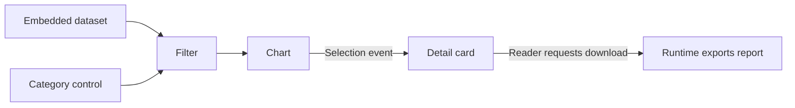

# From smart shapes to connected components

Status: draft for discussion, updated 2026-10-16. Not an implementation spec.
Baseline: `main` at [`2f534db`](https://github.com/oldwired/simplecanvas/commit/2f534db0f4d1424b5c6280c88ba9d06d0bd25be9).
For the maintainer and contributors deciding how far SimpleCanvas should grow.

## Direction

SimpleCanvas already creates portable interactive documents. An HTML export contains its
visuals, smart-shape scripts, saved state, and an isolated runtime; readers can use it offline.
The next step is to let those independently interactive shapes exchange values, consume data,
and request explicit actions.

The proposed direction is a visual authoring tool for small, self-contained interactive
HTML documents. Preserve the ordinary drawing workflow and make component authoring optional.
The existing deployment switches and Really SimpleCanvas variant provide a way to offer
simpler interfaces without maintaining a separate application.

The first milestone should be small: **one numeric control driving a separate gauge or chart,
working in both the editor and an exported HTML file**. Data tables, events, downloads, and
external integrations can follow in separate increments.

## What has landed

The smart-shape work originally discussed as PR #5 landed through the sandboxed
[PR #7](https://github.com/oldwired/simplecanvas/pull/7) and subsequent integration fixes.
Live shapes and interactive HTML followed on October 15.

| Capability | Current behavior |
| --- | --- |
| Programmable shapes | Each `smart` item carries a script, JSON state, dimensions, and styling. Scripts return drawing primitives and interactive handles. |
| Isolated execution | Each instance runs in its own Worker, managed by an opaque-origin sandboxed frame. Network access is blocked, replies are validated, and hook timeouts terminate the offending Worker. HTML exports use the same isolation machinery. |
| Live readings | `refreshMs(state)` requests redraws at intervals clamped to 100–60,000 ms. Live clock and stopwatch templates derive readings from timestamps. Refreshes do not mutate saved state or create undo entries. |
| Interactive HTML | One offline file embeds the drawing, scripts, saved state, sandbox, and runtime. Controls work directly, without entering editor edit mode. An initial SVG remains visible before startup or when JavaScript is unavailable. |
| Author and reader controls | `editorOnly` removes marked visuals and handles from exports. `exportBehavior` independently permits moving, rotating, and resizing either dimension; the default layout stays fixed. |
| Library authoring | Existing library scripts can be edited and their previews regenerated. Each new placement initializes independently. Already-placed instances retain their own script and state. |
| Library previews | Bundled PNG previews display without executing scripts. Missing smart previews use placeholders and require approval before generation. Placement still runs hooks in the sandbox. |
| Deployment variants | Settings can disable authoring, library management, workspace controls, and other features. Fixed libraries remain usable, and Really SimpleCanvas disables all optional features. |
| Practical examples | Live clock, stopwatch, chart, ruler, drilling template, and sailing shapes exercise timing, stateful controls, and physical units. Actual-size and tiled printing support physical templates. |

The current hook contract is:

```text
initState()
initStyle()
children(state, style, w, h, editing)
refreshMs(state)
exportBehavior or exportBehavior(state)
handles(state, w, h, style)
hitEdit(state, lx, ly, w, h, style)
dragEdit(state, handle, lx, ly, w, h, style)
```

Hooks return synchronously inside the Worker; requests and replies cross an asynchronous
bridge. Globals and definition-local mutations are disposable because idle Workers can be
evicted. Durable interaction values belong in returned state.

The [scripting reference](../SMART_SHAPES.md#the-script-object),
[HTML behavior](../SMART_SHAPES.md#html-export-behavior), and
[sandbox constraints](../SMART_SHAPES.md#constraints-and-sandbox) describe the supported API.
The [browser regressions](../tests/README.md) cover offline HTML execution, controls, permissions,
tab state, timing, isolation, and export fidelity.

## Current boundaries

- **Components remain independent.** Hooks receive their own state, style, size, and pointer
  coordinates. There are no declared input/output ports, bindings, shared datasets, or routed events.
- **A handle action changes local state.** There is no component API for downloading results,
  navigating the document, or calling a service. Scripts cannot fetch data directly.
- **Reader changes are temporary.** Exported HTML retains changes across its tab switches, but
  reopening restores the exported state. There is no reader save-changes facility or HTML import
  path back into the editor. Sketch/workspace JSON remains the editable format.
- **Definitions are instance snapshots.** Library edits do not propagate to placed objects.
  There is no component API version or state-migration contract. A document format version
  already exists, but serves a different purpose.
- **State is small.** Scripts are limited to 50,000 characters; state to 4,000 serialized JSON
  characters. Invalid state updates are rejected. Bulk datasets need a separate representation.
- **Composition is geometric.** A library entry can contain multiple items, but a smart shape
  cannot return nested smart shapes, tables, or asset-referencing images as children.
- **Editor interaction still uses edit mode.** Direct reader interaction exists in HTML; a
  document-wide Run/Preview mode inside the editor would be an additional feature.

## The connected document

| Part | Purpose | Example |
| --- | --- | --- |
| Inputs | Values received from another component or a document dataset | Selected category, budget, rows |
| Outputs | Values derived from inputs and local state | Calculated total, filtered rows |
| Events | A discrete occurrence with a payload | Record selected, button pressed |
| Actions | Operations requested explicitly and performed by the host | Download CSV, navigate to a sketch |
| State | Small, persistent interaction values owned by an instance | Current selection, entered amount |

A later example could connect these parts:



The runtime owns the connections and executes operations. Components receive validated data
and return values or requests; they do not locate siblings or mutate another instance directly.
The document remains usable offline when it relies only on embedded data and local actions.

## Proposed component contract

### Versioned extension

Introduce an explicit component API version, recorded with the saved definition and validated
by the runtime. Existing unversioned scripts retain today's contract. The exact field names
below are illustrative and are not supported by the current runtime.

A new version could add declared `inputs` and `outputs`, a `compute(inputs, state)` hook, and
an extra `io` argument on drawing and interaction hooks containing resolved inputs and outputs.
Begin with simple types such as `number`, `string`, and `boolean`. Table types can follow with
the dataset model. Metadata must cross the same validated sandbox boundary as hook results.

For a gauge, the proposed contract could look like this excerpt:

```js
inputs: { value: { type: 'number', default: 0 } },
outputs: { percentage: { type: 'number' } },
compute(inputs, state) {
  return { percentage: Math.max(0, Math.min(100, inputs.value)) };
},
children(state, style, w, h, editing, io) {
  // Draw using io.outputs.percentage and the existing primitive descriptors.
}
```

Keep the first milestone limited to values, but fix its interaction return contract before
shipping the new API version. For example, v2 could require an explicit `{state}` envelope
from its first release, while legacy `dragEdit` continues to return bare state. Later `emit`
and `effects` fields would require an explicitly supported contract revision. Never infer an
envelope from its keys: an existing valid state object can already contain fields named
`state`, `emit`, or `effects`.

Recognize unsupported component versions without silently downgrading them or discarding their
source. The new file format must retain enough data for recovery and show a clear incompatibility
message; older app versions cannot be assumed to understand it.

### Change-driven evaluation

Inputs and state determine computed outputs. A change invalidates downstream components, and
the host evaluates the affected graph in dependency order. Reject cycles initially. Each input
accepts one source or an explicit literal/default; multiple consumers may use an output.

Computation crosses the existing asynchronous Worker bridge. Evaluate against document,
instance, input, and state revisions, wait for upstream results, and discard stale replies after
newer edits, undo, deletion, or tab changes. Coalesce superseded drag computations while keeping
accepted user interactions ordered. Do not depend on all Workers being resident or running at once.

Treat `compute` as a pure value-producing hook. Rendering and recomputation must not trigger
external actions. Keep `refreshMs` as presentation refresh: a clock driving other components
would need an explicit time-source contract, rather than treating every redraw as a graph change.

Apply execution and value-size budgets to computations as well as drawing hooks. If a producer
fails, mark its outputs unavailable and identify affected bindings. A last valid drawing may
remain visible, but stale values must not silently drive further actions.

### Connections and authoring

Store bindings as semantic document records, for example:

```json
{
  "from": { "uid": "amount-control", "port": "value" },
  "to": { "uid": "capacity-gauge", "port": "value" }
}
```

Scope IDs to their sketch/document and keep initial bindings within one sketch. Cross-tab
connections can wait. A visible wire is an authoring view of a binding; ordinary drawing
arrows keep their existing meaning. Existing snapping provides useful geometry, but it does
not yet store component identity or port attachment.

For the first milestone, a source picker in a component's properties is sufficient. Visible
wires and richer port editing can follow. Define copy/paste, duplicate, deletion, and undo
behavior together: internal bindings should follow duplicated selections with remapped IDs,
and unresolved external references must be surfaced rather than attached to unrelated items.

An editor Run/Preview mode can later reuse the exported reader interaction behavior. Wiring
and authoring controls stay hidden there. Existing smart editing remains usable in the first slice.

### Data and persistence

Add a bounded document-level dataset store for embedded CSV/JSON and, later, reader-selected
files. Keep row data out of the 4,000-character interaction state; state should hold selections,
filters, and stable references. The existing asset pool and pruning logic are image-specific,
so generic data requires explicit schema, reference tracking, validation, and save/export changes.

Set document, dataset, computed-output, and transfer budgets before accepting tables. Resolve
references through the host, with bounded data passed into Workers; avoid copying a full dataset
into every instance's saved state or every redraw. Unsupported data must produce a recoverable
error without destroying the surrounding drawing.

Extend sketch/workspace JSON and offline HTML together. Derived outputs can be recomputed;
a saved document must retain the definitions, state, datasets, and bindings needed to do so.
Static PNG/SVG/print should capture the settled visible result without running actions.

Reader persistence is a separate product decision. A later explicit **Save results** action
could export JSON or CSV. A new HTML snapshot or full HTML-to-editor round trip requires a
complete editable document model in the export and a defined import path; the present playback
model is not sufficient on its own.

### Definition identity and updates

Keep the current snapshot semantics for the first connected components. Inline scripts can
gain API versions and ports without first moving every definition into a shared registry.

If deduplication or shared editing becomes useful, introduce document-local definition IDs,
versions, and source fingerprints. Each exported document must retain the exact definitions
it uses. Library changes should become explicit upgrades with compatible state migrations;
they must not silently change existing drawings. Source fingerprints identify content, not trust.

## Events and actions

Add events after value propagation works. An event needs a declared name/payload and a receiving
contract, such as `onEvent(name, payload, state, io)`. The receiver returns a validated state
transition and optional further events or action requests. Bound propagation depth and work per
interaction so event cycles cannot run indefinitely.

Emit events only from accepted interaction transitions, and dispatch each action intent at most
once per interaction. Worker retries, redraws, recomputation, undo/redo, opening a document,
and restoring an HTML snapshot must not replay them.
Pending actions need document/instance ownership checks just like pending state changes.

Start with a narrow host-owned action such as downloading prepared CSV/JSON. The script returns
a validated intent; the runtime checks the action type, payload, and originating interaction and
performs it. Browser user-activation rules may require a host download control after asynchronous
preparation. Downloads and navigation should not receive unrestricted permission simply because
they are local operations.

Preserve the current network restriction. Remote data and service calls belong to a later,
explicit integration design covering allowed destinations, credentials, consent, failures, and
offline behavior. Exported files must not embed secrets, and serialized permission claims cannot
authorize actions for a different reader. None of this requires giving scripts direct DOM,
storage, or network access.

## Delivery stages

The sandbox, live-shape scheduling, library source editing, and standalone HTML runtime are
already shipped foundations. Build new stages on those implementations and share trusted
runtime helpers between editor and export.

| Stage | Deliverable | Evidence that it works |
| --- | --- | --- |
| 1. Connected values | Versioned metadata, a numeric producer and consumer, one saved binding, asynchronous computation in editor and HTML | Changing the control updates the separate shape; undo and JSON save/load retain the relationship; the downloaded HTML works offline. Existing smart scripts still behave unchanged. |
| 2. Embedded data | A bounded dataset store, CSV/JSON import, typed table inputs, and simple filtering | A small table feeds a chart through a filter; export includes its data; invalid or oversized imports preserve the document. |
| 3. Events and local outputs | Explicit event reception and a validated download action | A reader chooses data and downloads the expected result exactly once. Refresh, reload, retries, and undo do not download or resend anything. |
| 4. Authoring and reader workflow | Run/Preview mode, clearer binding tools, reusable property controls, and an explicit results-saving policy | Authors can compose the example without editing scripts; readers can operate it without exposing layout controls. |
| 5. External integrations | Host-mediated remote data/actions with an authentication and capability model | A chosen integration works with explicit authorization and clear offline/failure behavior, while the script sandbox remains isolated. |

Do not require nested components, a marketplace, automatic library upgrades, a shared-definition
migration, or a complete visual programming editor to ship the first stage.

## First milestone acceptance

Use a numeric control and a separate gauge or chart, connected by one numeric output/input.
This should exercise the actual runtime rather than combine both behaviors inside one script.

- The connection updates in both the editor and a downloaded HTML opened directly from disk.
- Rapid input changes settle on the newest value; stale Worker replies cannot overwrite it.
- Undo/redo and JSON save/load restore local state and bindings; derived outputs recompute.
- Duplicate/copy/paste, source deletion, and colliding UIDs in different tabs cannot misroute data.
- Missing ports, invalid types, cycles, unsupported versions, and failed computations show useful
  errors and preserve recoverable source data.
- HTML contains the required scripts, bindings, and state, keeps author controls hidden, and
  retains the current fixed-layout defaults and reload semantics.
- Existing unversioned shapes, independent live clocks, static exports, and ordinary drawings
  keep their behavior. There are no new network dependencies or actions in this milestone.

## Decisions before implementation

1. Set the component API version marker and its serialization rules, including legacy behavior.
2. Agree on the first scalar types, missing-input behavior, and computation failure semantics.
3. Choose the smallest binding UI and define ID remapping for document edits and imports.
4. Confirm that each stage ships in both the editor and offline HTML; keep reader persistence
   changes explicit rather than introducing them as an export side effect.
5. Keep component authoring optional through deployment settings and preserve the simple drawing
   experience as the feature grows.
