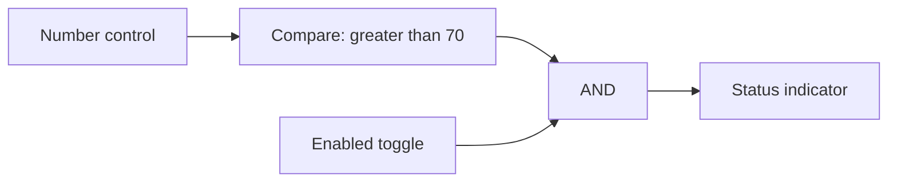
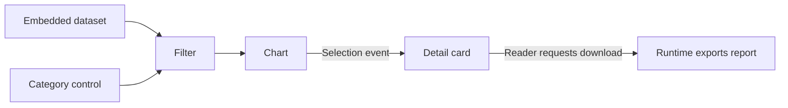

# From smart shapes to connected components

Status: stages 1–5 are complete on `feature/smart-components`, based on `main`,
with stage 3 validated 2026-10-18, stage 4 closed out 2026-10-20, and stage 5 closed out 2026-10-21.
Stage 2 includes the expanded library, logic, routing, timed signals,
the initial eight-tab example workspace, offline HTML reader, and the final authoring pass.
These additions are not yet part of the main-branch baseline below.
Stage 3's embedded-data workflow is implemented on the branch, including reader imports, sorting,
aggregation, optional transform switches, editable/dataset-driven choices and text lookup, a connected
spreadsheet with live dataset cells and editable imports, and a shared dataset model with bound-cell
editing, pulse-triggered row capture, and explicit Dataset ownership with source Replace/Append.
Dataset editor provides record editing and paging; Spreadsheet publishes evaluated table ranges.
Datasets can follow source publications in Live mode, overwriting local records on refresh.
Reload, source updates, capture, and downloads use narrow host-owned actions.
Explicit file imports can keep the current column structure or use the file's columns, with
separate author permission for column changes in HTML exports.
Visual wiring is brought forward into stage 3: the editor exposes typed flow links and distinct
Dataset associations, with drag-to-connect editing over the existing bindings. Data ports default
to left/right and control ports to top/bottom, with optional per-port side overrides.
Stage 4 adds typed submissions from Text/Number input and Memo event receivers alongside their
existing signals, with shared origins to recombine related branches. Event wiring now exposes
reception modes, recent activity, and captured payloads. Dropdown and scalar selectors support
explicit occurrences, and signal/event adapters and completion notifications extend the workflow.
Shared host-action dispatch and workspace execution complete stage 4, with the acceptance workflow,
closeout fixes, and verification evidence recorded below. Stage 5 completes Run preview with a
disposable workspace copy and the Edit/binding workflow, preserving Spreadsheet's specialized
editor. Returning to editing discards preview changes; explicit result downloads remain available.
Stages 6.1/6.2, automated HTTP reads in 6.4, and the HTTP POST portion of 6.5 are implemented on
the branch: transient host-owned results, typed/JSON hybrid outputs, bounded nonblocking requests,
explicit action/completion events, polling/change/startup policies and per-artifact credential
inclusion. MQTT Config/Subscribe (6.3) adds explicitly shared WebSocket connections, typed
readings and fresh-message events with retained-message baselines. MQTT Publish (remaining 6.5)
stays deferred. Optional authoring extensions remain proposals.
Stage 3 closes with the complete data-workflow, persistence, offline-reader, and visual-authoring pass below.
The delivery tables define their intended order and prerequisites.
The feedback and sequential-logic milestone is implemented on the same branch: bounded settling,
Pause/Step/Resume, gate-built memory, eight new storage/sequencing built-ins, and an expanded
fifteen-tab workspace. A subsequent text-passing milestone adds Text input, Number input, Text label,
Memo, and a sixteenth example tab before stage 3. Embedded data adds a seventeenth tab with
CSV/TSV/JSON imports, filtering, and a connected table/chart in the offline reader. An eighteenth
tab adds reader-selected data, aggregation, sorting, and explicit CSV/JSON downloads. A nineteenth
tab adds manual choices, automatic selection, and reverse text lookup using shared data. A twentieth
tab demonstrates spreadsheet formulas consuming and publishing signals. A twenty-first tab connects datasets
to the formula grid and demonstrates the editable-copy workflow. A twenty-second tab demonstrates
capture, editing, and several views of one shared dataset. A twenty-third tab separates incoming sources
from owned data with explicit Replace/Append pulses. The twenty-fourth tab demonstrates Live dataset
editing; the twenty-fifth separates an authored formula grid from its stored result table. The
twenty-sixth compares editable filtered/sorted views, read-only aggregates, and independently stored results.
A text-operations milestone before stage 4 adds Text compare, Text extract, Text to number,
Number to text, Text compose, Text transform, Text replace, and Text selector. The twenty-seventh
tab demonstrates native regex matching and extraction; the twenty-eighth connects parsing,
formatting, composition, selection, and replacement to editable inputs. A native-data-tools
milestone adds JSON extract/build/edit, Date parse/format/difference, URL parameter, and Go to tab. Tabs 29–31
cover JSON messages, date/time conversion, and URL-driven HTML with visible-character processing.
Native `Intl.Segmenter` now supports visible-character extraction/counting, with explicit code-point
options. A Page settings milestone adds a thirty-second tab and applies per-tab reader presentation
after dependency settlement, before revealing the destination. These additions remain separate
from later service calls. Tab 33 compares hybrid event and traditional text/pulse Memo inputs.
Tab 34 demonstrates event propagation through extraction, live parameter changes, explicit
Reprocess, and pure text sampled by a trigger. Tab 35 demonstrates shared event origins:
one submission splits into two transformations and recombines into one complete result;
independently edited fields wait for an explicit Apply/Reprocess request. Tabs 36–38 demonstrate
selection events, signal/event adapters, Counter/Timer completion, and dataset action results.
Their HTML reader opens with wiring visible so occurrences can be inspected.
Shared buses and multiple drivers are deferred;
each input retains one source.
The current main example has 38 sketches; the separate three-sketch
[workspace-runtime example](../examples/workspace-runtime.html) demonstrates hidden Services,
cross-sketch Publish/Receive, and shared dataset editing. The counts above describe how the main
example grew during each delivered milestone. The later review sections record the current
runtime, storage, export, and validation follow-up.
Original discussion baseline: `main` at [`2f534db`](https://github.com/oldwired/simplecanvas/commit/2f534db0f4d1424b5c6280c88ba9d06d0bd25be9).
For the maintainer and contributors deciding how far SimpleCanvas should grow.

## Direction

SimpleCanvas already creates portable interactive documents. An HTML export contains its
visuals, smart-shape scripts, saved state, and an isolated runtime; readers can use it offline.
On the feature branch, connected shapes exchange scalar values and table references, and a categorized browser makes
components easy to find, place, and combine. Embedded datasets support offline data tools and explicit result downloads.

The proposed direction is a visual authoring tool for small, self-contained interactive
HTML documents. Preserve the ordinary drawing workflow and make component authoring optional.
The existing deployment switches and Really SimpleCanvas variant provide a way to offer
simpler interfaces without maintaining a separate application.

The first milestone is **one numeric control driving a separate gauge,
working in both the editor and an exported HTML file**. It is implemented with API v2,
an **Edit…** source picker, saved bindings, and independent instance IDs. Open
[the connected example](../examples/connected-components.json) as a sketch to try it.
The second milestone adds a categorized library, ready-to-place default components, logic gates,
numeric helpers, typed routing, and bounded timed signals. This comes before data tables, events, downloads, and external integrations, so actual
composed documents can inform those later increments.
The [smart-components workspace](../examples/smart-components-workspace.json) and its
[offline HTML reader](../examples/smart-components-workspace.html) demonstrate these compositions.

## Current baseline: main and the feature branch

The smart-shape work originally discussed as PR #5 landed through the sandboxed
[PR #7](https://github.com/oldwired/simplecanvas/pull/7) and subsequent integration fixes.
Live shapes and interactive HTML followed on October 15.
The table distinguishes those main-branch foundations from the additions on `feature/smart-components`.

| Capability | Current behavior |
| --- | --- |
| Programmable shapes | Each `smart` item carries a script, JSON state, dimensions, and styling. Scripts return drawing primitives and interactive handles. |
| Connected scalar values — feature branch | API v2 scripts declare typed ports and compute outputs from inputs and state. Number control and Gauge templates demonstrate saved bindings, undo/redo, independent copies, and offline HTML. |
| Isolated execution | Calls run in instance-owned Workers managed by an opaque-origin sandboxed frame, with at most four resident Workers and bounded realm lifetimes. Network access is blocked, replies are validated, and hook timeouts terminate the offending Worker. Validated capability declarations may be cached without sharing mutable instance state. HTML exports use the same isolation machinery. |
| Live readings | `refreshMs(state)` requests redraws at intervals clamped to 100–60,000 ms. Timestamp-based presentation, such as Stopwatch, does not mutate saved state or create undo entries. |
| Connected wall clock — feature branch | Live clock uses API v2 transitions to synchronize timezone-aware hands/readout, four boundary-pulse outputs, and a string time output. Pure computation reads its settled snapshot. |
| Connected stopwatch — feature branch | Stopwatch accepts run/reset commands and publishes elapsed seconds on pause/reset. Its live display independently follows saved wall timestamps without updating the output on each refresh. |
| Interactive HTML | One offline file embeds the drawing, scripts, saved state, sandbox, and runtime. Controls work directly, without entering editor edit mode. An initial SVG remains visible before startup or when JavaScript is unavailable. |
| Author and reader controls | `editorOnly` removes marked visuals and handles from exports. `exportBehavior` independently permits moving, rotating, and resizing either dimension; the default layout stays fixed. |
| Library authoring | Existing library scripts can be edited and their previews regenerated. Each new placement initializes independently. Already-placed instances retain their own script and state. |
| Library previews | Bundled PNG previews display without executing scripts. Missing imported smart previews use placeholders and require approval before generation; authoring a definition already authorizes its preview. Placement still runs hooks in the sandbox. |
| Deployment variants | Settings can disable authoring, library management, workspace controls, and other features. Fixed libraries remain usable, and Really SimpleCanvas disables all optional features. |
| Component authoring switch — feature branch | `features.smartComponents:false` hides component templates, source editing, and Edit, and blocks adding component library entries. Existing drawings, copies, deployed-library placements, and HTML exports keep working. This switch depends on `smartShapeAuthoring`; it does not disable execution. |
| Library browser — feature branch | The compact Working collection shows pinned shortcuts. An optional adjacent browser provides search, multiple category memberships, a Built-in/My shapes Source filter, and direct placement. Shared Library actions manage entries and category tags; format 2 preserves IDs, metadata, category organization, and pins. |
| Practical examples | Live clock, stopwatch, chart, ruler, drilling template, and sailing shapes exercise timing, stateful controls, and physical units. Actual-size and tiled printing support physical templates. |

The original, still-supported hook contract is:

```text
initState()
initStyle()
children(state, style, w, h, editing)
refreshMs(state)
exportBehavior or exportBehavior(state)
handles(state, w, h, style)
hitEdit(state, lx, ly, w, h, style)
dragEdit(state, handle, lx, ly, w, h, style)
```

API v2 adds pure `compute(inputs, state)` and optional `publish(state)`, the stateful `transition` hook, resolved `io`
on drawing/interaction hooks, and an explicit `{state}` return from `dragEdit`. The [scripting reference](../SMART_SHAPES.md#connected-components-api-v2)
defines the implemented contract and budgets.

Hooks return synchronously inside the Worker; requests and replies cross an asynchronous
bridge. Globals and definition-local mutations are disposable because Workers expire or can be
evicted. Durable interaction values belong in returned state.

The [scripting reference](../SMART_SHAPES.md#the-script-object),
[HTML behavior](../SMART_SHAPES.md#html-export-behavior), and
[sandbox constraints](../SMART_SHAPES.md#constraints-and-sandbox) describe the supported API.
The [browser regressions](../tests/README.md) cover offline HTML execution, controls, permissions,
tab state, timing, isolation, and export fidelity.

## Current boundaries

These boundaries describe the feature branch, including feedback, shared datasets, events, and
workspace execution.

- **Cross-sketch connections are explicit.** Ordinary number, string, Boolean, and table-reference
  bindings stay local. In Whole workspace mode, Publish/Receive exposes selected values and events
  across sketches, and Dataset owners can appear in a shared catalog. Active sketch only remains
  the default; cross-sketch sources are unavailable in that mode. Tables resolve through bounded
  sketch-owned pools, with stable references preserving shared ownership. Combinational table cycles
  are rejected; a Dataset owner can explicitly apply a transformed view of its own records through
  a Replace or Append command.
- **Actions are explicit and bounded.** Validated host actions support file import/reload, table
  downloads, row capture, source-table updates, and explicit internal Go to tab requests.
  Typed events request bounded component-state changes or declared commands through a shared
  host-action dispatcher. Arbitrary script effects and network service calls remain outside the
  current contract. Scripts cannot fetch data directly.
- **Reader changes are temporary.** Exported HTML retains changes across its tab switches, but
  reopening restores the exported state. There is no reader save-changes facility or HTML import
  path back into the editor. Sketch/workspace JSON remains the editable format.
- **Definitions are instance snapshots.** Library edits do not propagate to placed objects.
  Component API v2 is explicit and separate from document format 6. There is no state-migration
  or automatic definition-upgrade contract.
- **State is small.** Scripts are limited to 64,000 characters; state to 4,000 serialized JSON
  characters. Invalid state updates are rejected. Bulk data lives in the document dataset pool.
- **No nested smart children.** A library entry can preserve several connected items, but a
  smart shape cannot return nested smart shapes, tables, or asset-referencing images as children.
- **The library saves separately in this browser.** IndexedDB retains the modified/imported personal
  library, Working collection pins, scripts, inert previews, categories, and built-in overrides for
  this browser/profile and site/application URL path. Import replaces personal entries,
  organization, and pins; built-in definitions remain. Export is for backups and sharing.
  Workspace saves/autosave retain sketch tabs and placed scripts, state, and connections, but
  exclude the library, pins, and category organization.
- **The current workspace saves atomically in IndexedDB.** One editor window can write the current
  workspace for a browser profile, origin and application path. Other windows can browse and
  download it; **Take over editing** loads the latest saved snapshot before transferring ownership.
  Save failures retain the working documents and offer a download. Unreadable saved records stay
  protected for recovery. This does not add persistence to exported HTML readers.
- **Ports remain explicitly typed.** Text input and Text label carry strings; Number input,
  Constant, and Value label carry numbers. Compare accepts two numbers and a selectable relation;
  routing has separate numeric and Boolean variants with fixed channel types.
- **Authoring and Run are separate.** Double-click a component to use its controls while
  authoring. **Run** operates a disposable workspace copy through the same reader as HTML export;
  returning to editing discards that copy's changes.

## Component index convention

All component indices are zero-based (`0…N−1`), consistently in signals, port names, controls,
and examples. Dropdown selects index 0 by default. A missing selection or lookup returns index −1
with false Valid/Found; it never aliases the first choice. Stepped switches reset to channel 0,
use `in0`/`out0` onwards, and wrap N−1 → 0. Shift, ring, and Johnson taps start at `q0`;
`value` aliases `q(N−1)` where a final-stage output exists. The LED matrix starts at `row0`,
`col0`, `r0`, and `c0`; row 0 is topmost and column 0 leftmost. Bit 7 (128) is leftmost in a
row byte and topmost in a column byte.
Counts, stage/channel quantities, durations, and ordinary tab/instruction numbering keep their
existing meanings. Stable keys survive reordered indices. There is one convention, with no
per-component base setting. The unmerged branch and bundled examples are rewritten directly;
compatibility aliases and migrations are unnecessary.
Spreadsheet notation is an explicit exception: A1 row references, VLOOKUP column numbers, and
MID character positions retain their familiar one-based meanings. This does not change signal indices.

## Stage 1 acceptance — implemented on the feature branch

The numeric control and separate Gauge exercise the actual runtime through a numeric binding.
Keep these checks as the regression baseline for subsequent stages.

- The connection updates in both the editor and a downloaded HTML opened directly from disk.
- Rapid input changes settle on the newest value; stale Worker replies cannot overwrite it.
- Undo/redo and JSON save/load restore local state and bindings; derived outputs recompute.
- Duplicate/copy/paste, source deletion, and colliding UIDs in different tabs cannot misroute data.
- Missing ports, invalid types, non-settling loops, unsupported versions, and failed computations show useful
  errors and preserve recoverable source data.
- HTML contains the required scripts, bindings, and state, keeps author controls hidden, and
  retains the current fixed-layout defaults and reload semantics.
- Existing unversioned shapes, independent live clocks, static exports, and ordinary drawings
  keep their behavior. There are no new network dependencies or actions in this milestone.

## Delivery stages

Stages 1–5, including their example workspaces and authoring closeouts, are complete on the feature
branch. The feedback milestone below follows stage 2; the text-passing milestone follows feedback.
Both precede stage 3 and reuse the scalar graph.
Stage 3 delivers the agreed data workflow, including a connected formula sheet, shared
dataset editing/capture, and visual connection authoring brought forward from stage 5. Its
closeout evidence and deferred extensions are recorded below. Stage 4 delivers hybrid value/event
ports, shared-origin routing, explicit Reprocess, selection and completion events, adapters, and
declared local actions through a shared dispatcher. Whole-workspace execution, explicit
Publish/Receive endpoints, shared Dataset discovery, and workspace/sketch settings extend that
contract across sketches while retaining all existing signals and triggers. Stage 5 completes
isolated Run preview and the Edit/binding workflow with an explicit discard/download policy.
Stage 6 delivers the shared integration foundation, manual and automated HTTP GET, and explicit
HTTP POST plus MQTT Config/Subscribe described below. MQTT Publish remains deferred. Shared buses are explicitly outside the
feedback milestone.
The stage numbers give the proposed planning order, not a requirement to finish every earlier feature before starting
the next. Embedded tables, a full Run/Preview mode, and visible wires are not prerequisites
for scalar integrations. JSON downloads can precede table support; CSV outputs use stage 3.
Share runtime helpers between editor and export throughout.

| Stage | Deliverable | Evidence that it works |
| --- | --- | --- |
| 1. Connected values — implemented on branch | Versioned metadata, scalar producers/consumers, saved bindings, asynchronous computation, and optional authoring | A numeric control drives a separate Gauge in editor and offline HTML; undo, save/load, and independent copies preserve the relationship. Existing smart scripts keep working. |
| 2. Component library and logic — complete on branch | Preserved working popup, expandable catalog, pins, categories/search, built-in/user entries, configurable scalar controls, displays, gates, numeric helpers, typed routing, bounded timed signals, an eight-tab example workspace, and clear Edit feedback | An author builds, copies, saves, and repairs the threshold-and-toggle example without editing scripts; repeated sources are distinguishable, proposed outputs/errors update before Save, library data roundtrips, and the examples work offline. |
| 2F. Feedback and sequential logic — implemented on branch | Bounded settling, simultaneous transition rounds, practical counter feedback, gate-built and dedicated latches, clocked registers, and sequencing examples | Self-reset, stop-at-zero, reset-and-latched-stop, NOR/NAND latches, shared-edge storage, and ring/Johnson/4017-style sequences work in the editor and offline HTML; non-settling loops fail visibly. |
| 2T. Text passing — implemented on branch | Text and numeric entry with accepted-submission pulses, literal text displays, and a triggered Memo | Repeated identical entries append once each, queued entries retain their values, bounded memo actions work in editor and offline HTML, and restoration never replays submissions. |
| 3. Embedded data and visual connections — complete on branch | Bounded datasets, CSV/TSV/JSON import, empty typed tables, stable row identities and revisions, filtering/sorting/aggregation, table/chart built-ins, choice mappings, spreadsheet formulas and table outputs, record editing, Manual/Live source policies, and visual wiring over existing bindings | A blank-canvas workflow is authored through the library, Edit, and visual ports, then saved, reloaded, and used in downloaded offline HTML. Shared edits, independent copies, Live refresh, result downloads, and typed connections follow the accepted lifecycle rules; closeout evidence is below. |
| 3T. Text operations — implemented on branch | Native regex comparison/extraction; strict Text to number; formatted Number to text; Text compose, transform, replace, and selector | Connected text/status displays respond in the editor and offline HTML; invalid numeric input has an explicit validity output; errors and Worker deadlines remain visible and bounded. |
| 3N. Native data and document tools — implemented on branch | Typed JSON extract/build/edit, deterministic date parsing/formatting/durations, declared page-query inputs, internal tab navigation with scalar query parameters, and visible-character text processing | Demo tabs 29–31 connect these tools to existing controls/displays in the editor and offline HTML. Missing/wrong-type JSON and invalid dates have explicit status outputs; URL data comes from the opened reader; visible-character/code-point semantics remain selectable. |
| 4. Events and local outputs — complete on branch | Hybrid typed ports, bounded atomic routing, scalar transformations, shared origins, Reprocess, selection events, signal/event adapters, and completion notifications. Wiring exposes reception, activity, and the latest payload. A shared dispatcher handles declared local actions; Whole workspace execution, explicit Publish/Receive endpoints, shared Dataset discovery, and settings inheritance extend ownership across sketches. Existing signals remain available. | Repeated equal submissions stay distinct; related branches recombine once. Current-value refreshes do not invent events. Actions and completion notifications respect ownership, simulation lifecycle, and no-replay restoration. The authored editor workflow survives save/reopen and a fresh offline HTML export; closeout fixes and verification evidence are recorded below. |
| 5. Authoring and reader workflow — complete on branch | Isolated Run preview, reusable property controls, searchable binding sources with repair feedback, and discard-on-return with explicit result downloads; initial visual wiring is delivered in stage 3 | An author places, configures and connects components, operates a preview with layout tools hidden, returns without changing the source, then saves, reopens and exports the workspace. Spreadsheet retains its specialized editor. |
| 6. External integrations — HTTP and MQTT reads on branch; MQTT Publish deferred | Shared host contracts, manual/automated HTTP GET, explicit JSON POST and MQTT Config/Subscribe | Typed/JSON hybrid outputs, completion events, independent asynchronous instances, visible failures and editor/Run/HTML behavior. Polling never overlaps; writes require explicit captured actions. MQTT connections share explicit Config references, preserve retained-message baselines, and recover with stale/reconnect status. Workers remain isolated. |

Stage 6 is deliberately split into reviewable deliveries:

| Step | Prerequisites and deliverable | Evidence that it works |
| --- | --- | --- |
| 6.1 Shared integration foundation — implemented on branch | Stage 1 value graph and stage 4 shared dispatcher; declared host operations, transient source revisions, restricted credentials, lifecycle ownership and execution/export policies | Simulated delayed sources and browser workflows exercise independent instances, stale-response rejection, no replay on restoration, and explicit credential persistence choices. |
| 6.2 Manual HTTP GET — implemented on branch | 6.1; a bounded JSON GET initiated by Refresh, one mapped scalar plus complete compact JSON text | The newest accepted result drives a display; another source, clock and slider continue during pending requests. Errors remain visible in editor, Run and downloaded HTML. |
| 6.3 MQTT Config and Subscribe — implemented on branch | 6.1; configured connections and a subscribed scalar reading, with both credential export modes | Independent Config instances and copied documents route correctly; reconnect and retained readings do not cause actions. Manual connection and explicitly enabled deployment startup work in downloaded HTML. |
| 6.4 Automated HTTP reads — implemented on branch | 6.2; bounded polling, debounced URL/pointer changes, signal/event triggers and explicit Run/HTML startup | Initial/restored values do not replay edges. Enabled gates all automatic origins, manual Refresh remains available, repeated responses emit events, and pause/visibility suspend schedules without catch-up bursts. |
| 6.5 Explicit external writes — HTTP POST implemented; MQTT Publish deferred | 6.1 and the relevant transport; captured JSON POST from Send/button/signal/event | One accepted Send produces one host intent; redraw, Undo, reload and input changes do not replay it. No automatic retries; optional server-supported idempotency, HTTP status and empty acknowledgements distinguish a write from its response. |

HTTP read/write work spans 6.1, 6.2, 6.4 and the HTTP part of 6.5. Step 6.3 now adds MQTT
readings on that shared foundation. The integration stage remains open for explicit MQTT Publish
in the remaining part of 6.5; its command delivery policy is still a separate decision.

Keep nested components, a marketplace, automatic library upgrades, shared-definition migration,
and a complete visual programming editor outside these milestones unless actual examples justify them.
Every stage must work in the editor and self-contained HTML. Local behavior works offline;
live integrations additionally require reachable endpoints and preserve readable offline fallbacks.

## Stage 2: component library and logic

Make composing a useful connected document possible directly from the library, without opening
the script editor. This milestone builds on the existing scalar API and source picker; it does
not require datasets, events, or a new execution model.

The delivery follows three steps: **2.1** library-entry identity, category/keyword serialization,
and built-in/personal entry behavior; **2.2** the expandable browser and scalar controls,
gates, and displays; **2.3** the complete example, library roundtrips, and offline HTML checks.
The input picker remains available; stage 3 adds optional visual wiring over the same bindings.

### Shipped example workspace

The [editable workspace](../examples/smart-components-workspace.json) covers **Basics**, **Threshold
logic**, **Numeric tools**, **Countdown**, **Delayed pulses**, **Routing**, **Shift memory**, and
**LED patterns**, plus seven feedback/sequential tabs: **Self-reset**, **Stop at zero**,
**Reset and stop**, **Latch laboratory**, **Shared-edge storage**, **Sequences**, and
**Delayed feedback**, followed by **Text and notes**, **Embedded data**, and **Reader data and results**. Open it with **File → Open workspace…**; this replaces all open tabs, so save
the current workspace first if it should be retained. The matching
[self-contained HTML reader](../examples/smart-components-workspace.html) works offline.

**LED patterns** demonstrates all three matrix input modes. The row-driven matrix's `c0`…`c7`
outputs feed the column-driven matrix's matching inputs, reproducing the same image. Changing
**Top row byte** updates both and demonstrates conversion from row bytes to column bytes.

Double-click controls in the editor; use them directly in HTML. Number controls also accept typed
values by clicking their displayed number. **Edit…** and **Wiring** expose the actual saved bindings;
the examples' illustrative arrows remain ordinary drawing objects. Countdown starts at 9 with **Run** off.
This catalog uses the default **Active sketch only** execution mode: each tab has independent state
and timing pauses while it is inactive. Reader tab switches retain
changes; reloading restores the exported snapshot. JSON remains the editable source.

Step 2.3 and the focused authoring pass are complete. Component discovery, placement, input
configuration, and error recovery have been checked through the workflow recorded below.
The feedback milestone extends these examples and adds Pause/Step/Resume; the text milestone
adds typed entry and stored notes. Both remain usable while authoring and in Run preview.

### Preserve the working popup

The existing popup keeps its dimensions, grid, and Add selection/Add icon footer. Its stable
**Working collection** heading identifies pinned shortcuts. **Actions** buttons in the compact
picker and expanded browser open the same **Library actions** surface on desktop and mobile.
A Browse control expands a single popover with the library browser alongside it. On narrow screens,
the browser occupies the popover. **Collapse library** closes the expanded browser.

Every browser entry supports direct placement and a separate pin. A filled pin includes the entry
in the working collection; an outlined pin leaves it in the catalog only. Unpinning removes membership,
not the definition or placed instances. Both panes use the same canonical entries. Keeping a built-in
does not create a personal duplicate; built-ins offer **Copy to My shapes**, while personal entries
offer **Duplicate**. Both create an editable personal definition. **Pin to working collection**
and **Unpin from working collection** have the same scope
as the pin icon. Info opens details without starting placement. Browsing and placing do not require
opening Library actions.

### Categories and discovery

Categories are named tags: each library entry may have several memberships. Users can create,
rename, and remove categories and organize both built-in and personal entries. Removing a category
removes its memberships, preserving shapes, pins, and other categories. Empty categories remain
registered; entries with no category tags appear under **Uncategorized**. Separate **Keywords**
support search. Canvas **groups** continue to mean objects selected and transformed together.

Bundled defaults use multiple memberships by purpose: **Numbers** and **Text** group scalar
tools, while **Data** covers tables and structured data. Numeric arithmetic is no longer filed
only under Logic; data-backed charts and grids also appear under Displays.

| Category | Built-in examples |
| --- | --- |
| Controls | Number control, Text input, Number input, Dropdown, Spreadsheet, Dataset editor, Toggle, numeric Constant, Trigger, Download table, Go to tab, Sketch settings, Workspace settings |
| Logic | Boolean gates, Tri-state buffer, Compare, Text compare, selectors, stepped switches/distributors, registers, latches, counters, pulse tools, Publish, Receive |
| Numbers | Numeric controls, Math, Inverter (×−1), Clamp, Range mapper, Number function, numeric routing/storage, text/number conversion, Spreadsheet, Table aggregate, numeric displays, and charts |
| Text | Text input, Text label, Memo, Dropdown, Text lookup, text operations, text/number conversion, JSON extract/build/edit, URL parameter |
| Displays | Gauge, numeric Value label, Text label, Memo, Status indicator, Seven-segment display, LED matrix (8×8), Chart, Data bar chart, Dataset editor, clocks, Stopwatch, Timer |
| Tools & time | Clock, Live clock, Stopwatch, Timer, Ruler, Delay, Counter, Random integer, Sample & hold (integer/Boolean), Pulse generator, Edge to pulse, Signal → event, Event → pulse, Date parse, Date format, Date difference, Sketch settings, Workspace settings |
| Data | Dataset, Capture row, Table filter, Table sort, Table aggregate, Dataset editor, Spreadsheet, Data bar chart, Download table, Dropdown, Text lookup, JSON extract/build/edit, URL parameter, Publish, Receive |
| Drawing | Rectangle, Ellipse, Arrow, Arc, Ruler, Minimal, Blank, and categorized user shapes/icons |

The latest stage 2 extension adds fifteen API v2 entries: Pulse generator, Edge to pulse, two
Selectors, four stepped switches, two Shift registers, Clamp, Range mapper, Number function,
Seven-segment display, and LED matrix (8×8). Upgrading the existing Live clock, Stopwatch, and Timer to
API v2 brings the catalog to 42 API v2 components. The extension also expands Compare, Number
control, Math, and Counter without adding another delivery stage.

All smart-shape templates are also available as built-in library entries. Adding Clock, Arrow,
Arc, Timer, Chart, Minimal, and Blank brought the stage 2 catalog to 51 entries. The feedback
milestone adds eight storage/sequencing entries, bringing that catalog to 59 entries,
including 50 API v2 components. Text input, Number input, Text label, and Memo bring that
catalog to **63 entries**, including **54 API v2 components**. Stage 3 adds Dataset, Table filter,
Data table, and Data bar chart, initially bringing the catalog to 67 entries / 58 API v2 components.
Table sort, Table aggregate, and Download table bring the catalog to 70 entries / 61 API v2 components.
Dropdown and Text lookup bring it to 72 entries / 63 API v2 components. Spreadsheet brings it to
73 entries / 64 API v2 components; Capture row brings it to 74 entries / 65 API v2 components.
Text compare, Text extract, and Number to text bring it to 77 entries / 68 API v2 components.
Text to number, Text compose, Text transform, Text replace, and Text selector bring it to
82 entries / 73 API v2 components. JSON extract, JSON build, Date parse, Date format, Date difference,
URL parameter, and Go to tab bring it to 89 entries / 80 API v2 components. JSON edit brings the
catalog to 90 entries / 81 API v2 components. Page settings brings it to 91 entries / 82 API v2
components. Signal → event and Event → pulse brought it to 93 entries / 84 API v2 components.
Workspace settings, Publish, Receive, HTTP source and HTTP POST bring it to 98 entries / 89 API v2 components.
MQTT Config and MQTT Subscribe bring the current catalog to **100 entries / 91 API v2 components**.
The additional Countdown timer source
remains a standalone example, outside the built-in catalog and demo library.
Timer now uses API v2; the other six retain their existing
API v1 behavior. Minimal is the circle starter and Blank is intentionally
empty. Authors can place or pin them offline, and the template authoring dialog remains available.
Drill template and Race start timer remain standalone examples and entries in the importable
demo library. Its thirteen-entry working collection combines eight demo-specific definitions
with five pinned canonical built-ins: Clock, Chart, Live clock, Stopwatch, and Ruler. Full snapshots
preserve portability without duplicate browser entries; category overrides preserve demo grouping.

Format 2 stores category memberships in each entry's `categoryTags` string array, a top-level
`categories` registry that retains empty categories, and `builtinCategoryTags` organization
overrides. Existing `tags` remain search Keywords. Legacy single `category` fields migrate on
import; flat libraries remain valid, and unassigned entries appear under Uncategorized.
Bundled defaults remain defaults when a built-in is pinned, exported, or restored. Explicit user
overrides (including an empty array) take precedence. The catalog audit also normalizes search
keywords and covers arithmetic verbs, regex aliases, Unicode segmentation, JSON serialization,
dataset import/export, and URL navigation. All current entries have valid, nonempty default memberships.
All category organization survives browser reloads and library export/import. Keep library-entry identity separate from
display names and from the UIDs of placed instances, so naming and organization do not change
existing connections. Live clock's connected signals use explicit state transitions; presentation
refreshes alone do not create connected time sources.

### Built-in and personal entries

The **Source** filter distinguishes **Built-in** and **My shapes**. Source and category serve
different purposes: an author can find Logic components from either source. Built-in definitions
stay read-only while their category memberships can be organized through user overrides.

Default components are ready to place, with descriptions and bundled previews. Their definitions
are included in the standalone app, available without a hosted library file or network connection.
Importing a user library does not replace built-in definitions. Format 2 exports include full
snapshots of pinned built-ins, all personal entries, ordered working-collection IDs, the category
registry, and built-in category overrides. A matching
built-in snapshot can reuse its installed definition; changed snapshots remain personal entries.
Authors can copy a built-in definition into My shapes to customize it. Preserve
existing instance snapshots: changing a library entry never silently updates placed components.

Individual entries transfer through **Export shape…** in entry details or compact Actions and
**Import shape…** under Library actions. The `name.shape.json` envelope is
`{app:'SimpleCanvasShape', version:1, shape:<complete entry snapshot>}`. It retains regular and
smart/component items, grouped internal connections, categories, keywords, description, preview,
and source metadata. Import adds and pins a personal copy with a fresh ID and unique name, even
for a built-in snapshot. **Import library…** replaces the user library; individual import adds to it.
Single-shape export does not clear the whole library’s unexported-change indicator. Transfers retain
existing authoring guards and script-preview consent; successful imports join browser persistence.

The library and authoring deployment switches still apply, including `smartComponents` and the
Really SimpleCanvas variant. A fixed deployed library remains placeable when component authoring
is disabled. Exported documents carry the definitions they use and remain independent of the
author's library. Personal library persistence is an improvement to the existing library workflow;
it does not advance phases 3–6 or add shared definitions between placed instances.

### Browser persistence for the library and Working collection

Save the full modified/imported personal library automatically in IndexedDB: definitions and
scripts, inert PNG previews, personal entries, ordered Working collection pins, the category
registry, and built-in category overrides. Store built-ins by canonical ID so restore uses the
installed definitions, while retaining actual personal scripts. Scope the record to the current browser/profile and
site/application URL path, so it survives reloads and closing the tab without mixing separate
deployments. Workspace/sketch serialization continues to exclude library data.

Restore a saved personal collection before using a hosted starter. A changed `shapes-library.json`
seed must not overwrite a restored library. An unchanged hosted seed is not cached merely by
loading it; editing/importing the library establishes the personal saved copy. With
`shapeLibraryManagement:false`, bypass personal storage and retain the fixed deployment starter;
with `shapeLibrary:false`, skip the library and its storage altogether.

Restore stored definitions and thumbnails without running scripts. Missing smart previews keep
the existing consent flow. Browser persistence must never convert an import/restore into execution
consent or regenerate a smart preview automatically.

Keep the unexported-change indicator independent of browser-save status. Leaving the page warns
only while saving is pending or has failed. A visible storage-failure banner offers Retry and
Export library, preserving the usable in-memory collection. Export remains important for backups
and sharing: site-data deletion or private browsing can remove the browser copy. It is no longer
required merely to retain a collection for the next visit.

Acceptance is covered by [library persistence](../tests/library-persistence.test.cjs): full
collection reload, category/built-in overrides and pins, inert scripts/previews, starter precedence,
URL-path isolation, fixed/disabled deployment behavior, and save-failure recovery. Keep this within
the completed library milestone; the feedback and later-phase boundaries stay unchanged.

### Logic components

Gates are normal API v2 components with declared boolean ports and pure `compute()` hooks.
AND, OR, NAND, NOR, XOR, and XNOR have two inputs; NOT and Buffer have one. NOT inverts a boolean,
while the numeric Inverter multiplies a number by −1. These remain separate typed definitions.
Tri-state buffer adds boolean data and an active-high enable input. When disabled, its output is
explicitly undriven (Z); when enabled, it follows the data. Boolean output metadata opts into this
third state with `triState:true`; ordinary booleans remain strict. A disabled buffer stays healthy,
and dependent boolean components wait without inventing false. Authors can connect a source while
it is Z, and enabling it restores the dependent chain. The triangle has a distinct enable pin and
purple Z indicator; amber still means a missing or invalid input. One source per input remains the
connection model; bus resolution and electrical effects are not included.
Compare bridges numeric controls and boolean logic with two live operands (`value` and `b`) and
selectable >, ≥, <, ≤, =, or ≠. Defaults remain > and B = 70; equality compares numbers exactly.
String/boolean constants can be added as later catalog extensions.
Math combines two required numeric inputs with a selectable +, −, ×, ÷, min, or max operation and one
numeric output. Configure the operation in Edit alongside the bindings; each instance saves
its own choice. Subtraction and division preserve operand order, and division by zero or overflow
make the result unavailable until corrected. The same computation runs in exported HTML.
Clamp limits a number to inclusive bounds. Range mapper converts an increasing input range into an
output range, supports reversed output bounds, and clamps by default; disabling clamping enables
extrapolation. Number function offers abs, round, floor, and ceil, with Math.round's half-toward-
positive-infinity rule. Invalid ranges or nonfinite results become unavailable.

Ordinary built-in numeric labels use up to eight significant digits, keeping safe integers exact.
This presentation policy applies across scalar controls, routing/storage readouts, timing captions,
dataset/chart values, and general Spreadsheet cells. Input editing, stored values, calculations,
connections, and data downloads retain the original precision. Explicit Spreadsheet formats and
dedicated time/measurement formats retain their chosen precision; strings remain literal text.
In tab 3, **Numeric tools**, input `2.8` now displays `56%` on the gauge while the connected output
retains its full floating-point value, `55.99999999999999`.

Number control exposes min/max/step inputs (defaults 0/100/1), a slider, step buttons, and direct
number entry. Negative and fractional values work. All interactions share a bounded step grid
anchored at min, with max also reachable. Direct entry uses a host-owned number dialog in the
editor and offline HTML, and creates one accepted state change.

Use declared types throughout: invalid or missing required inputs produce connection errors,
and an unavailable upstream value must not silently become `false`.

Use traditional curved gate silhouettes, including inversion bubbles, with readable names and
current input/output values. Built-in API v2 controls display their instance name as the caption,
including Number control, Constant, Gauge, and the gates. Captions fit within the shape; operation
symbols, readouts, and state labels remain separate. Spreadsheet deliberately fills its box with
cells and omits a caption; its instance name remains available in Edit and wiring. Optional
per-instance LEDs default on: green means true, grey false,
blue an available numeric value, and amber unavailable. The editor-only Indicators control toggles
the LEDs without changing computation, port stubs, or inversion bubbles; its setting survives saves
and exports. Unconnected logic components retain their silhouettes and show “—” plus an input-status
message. Other components use a named host status card when they cannot render a valid value.
Reader exports initially retain the blocks and their values;
an authoring-only display policy can be considered separately from computation.

The acceptance example is **an indicator that turns on only when a number exceeds 70 and an
Enabled toggle is on**:



Authors place these components from the library and connect them through **Edit…** or **Wiring**. Repeated
instances retain their own names, state, and bindings; duplicating the complete example creates
an independent working copy. One output may also feed several consumers.
Toggle, Value label, and Status indicator display the instance name from Edit as their caption,
separately from the current value or state. Renaming redraws the caption without changing wiring
or computation, and the caption remains visible in exports.

The drawn gate symbols have input pins on the left and outputs on the right. Their Boolean
operands and results remain data ports. Stage 3's Wiring overlay derives positions from the
component box, using declared port roles and optional side overrides. A later named-anchor API can align them
exactly with the symbol and its indicator, using component-local coordinates transformed with
the instance when moved, resized, or rotated. Bindings continue to reference instance UID and
port name; screen coordinates must never become connection identity. Edit remains an
alternative connection editor.

### Segment and matrix displays

Seven-segment display has an authoring **Input mode** setting: `number` (default) or `segments`.
Number mode takes required integer `value` in 0–9. Segments mode instead exposes boolean inputs
`a`…`g`, each default false. Both modes have boolean `decimalPoint` (default false) and `enable`
(default true). Its fixed boolean outputs `a`…`g` and `decimalPoint` reflect the segments actually
shown after applying enable; disabled outputs are all false. Switching modes changes input ports
while retaining the output contract. The drawing shows the conventional segment diagram and
instance name, with dim off segments and amber unavailable values rather than a fabricated zero.

LED matrix (8×8) has an authoring **Input mode** setting: `boolean` (default), `rows`, or `columns`.
Boolean mode exposes `row0`…`row7` and `col0`…`col7`, each default false. Row 0 is at
the top and column 0 at the left. An LED lights only when its row and column are both true;
all active crossings are shown together, without simulated scanning or retained illumination.

Rows mode instead takes numeric `r0`…`r7`, each default 0 and restricted to integers 0–255.
`r0` is the top row, with bit positions 7–0 ordered left to right (values 128–1): 129 lights both ends, 255
lights the full row, and 0 lights none.

Columns mode takes numeric `c0`…`c7`, each default 0 and restricted to integers 0–255. `c0` is
the leftmost column, with bit positions 7–0 ordered top to bottom (values 128–1). A value of 129
lights the top and bottom LEDs, 255 lights the full column, and 0 lights none.

All modes have boolean `enable` (default true) and fixed numeric outputs `r0`…`r7` and
`c0`…`c7`, reflecting the visible row and column bytes simultaneously with the same bit order
as their inputs. Disabling publishes sixteen zeros. Mode changes expose distinct input names
and must not reinterpret Boolean row/column assignments as numeric bytes. Outputs keep their
names and types across modes, and the instance name remains visible.

In Wiring, Boolean and numeric column inputs explicitly sit on top and column-byte outputs on
the bottom. Row inputs stay left and row-byte outputs right. Columns remain data ports; their
placement is a side override. The `enable` control appears on top in all modes.

Both are pure displays of current scalar inputs in editor and offline HTML. They introduce no
scanning clock, frame persistence, or feedback behavior, and do not depend on the deferred
sequential-logic backlog below. Missing/invalid inputs remain visibly unavailable.

### Typed routing and stepped switches

Selector has separate number and Boolean entries. `select=false` routes A to `value`;
`select=true` routes B. Both data inputs must be valid. Evaluation eagerly resolves every declared
input, so an unselected unavailable branch still makes the selector unavailable; selectors do
not suspend upstream work.

Stepped switch and Stepped distributor each have number and Boolean entries. Authors choose
2–16 Channels (initially 4) in **Edit…**. Channel count is saved authoring configuration that
changes declared ports, rather than a live data input. The selector routes `in0`…`in(N−1)` to `value`,
with unbound channels defaulting to 0/false. The distributor routes required `value` to one of
`out0`…`out(N−1)`; inactive outputs are numeric 0 or Boolean false. These are separate outputs, not
shared bus drivers or high-impedance outputs.

Every false → true `pulse` advances the selected channel, wraps N−1 → 0, and publishes a numeric
`position`. Holding high does not repeat. Held `reset` selects 0 while tracking the pulse, so
releasing reset during high does not step. Saved position survives reload, copy, and undo, while
fresh pulse memory prevents phantom steps. Changing Channels resets to 0 and re-primes, including
when runtime observations were cleared. Selected data remains live between pulses.

Switch visuals show the selected contact, channel values, instance name, and optional LEDs.
A Trigger or Pulse generator can drive several independent switches. Channel removal can leave
consumers referencing removed outputs unavailable until rewired; no connection is silently moved
to a different channel. All declared inputs still follow the ordinary typed availability rules.

### Shift registers

Shift register has separate Boolean and number entries in Logic. Authors set 1–16 Stages
(initially 4) in **Edit…**. Stages is durable authoring configuration that defines outputs
`q0`…`q(N−1)`; it is not a live input. The required `value` input supplies typed data; boolean `pulse`
and `reset` default to false. Number cells accept finite numbers, including fractions.

Each false → true pulse shifts one snapshot of the previous cells: input data enters `q0`, old
`q0` moves to `q1`, and so on. No value advances through multiple cells during a single shift.
The `value` output aliases current `q(N−1)`. A separate `shiftedOut` output captures old `q(N−1)`, the
value removed by the accepted edge, and holds that value between edges.

For cascades sharing one pulse, connect current `value` (or `q(N−1)`) to the next register's `value`
and share pulse/reset. All registers sample the pre-edge snapshot before any publishes its next
state, so one edge moves data exactly one cell across the boundary. `shiftedOut` remains an
observation of the last removed cell; it is not used to compensate for producer-first evaluation.
This replaces the original stage 2 cascade wiring; the bundled workspace is rewritten accordingly.

Initial high and held-high pulses do not shift repeatedly. Held reset clears every cell and
`shiftedOut` to false/0 while tracking pulse, so releasing reset during high does not shift.
Manual Reset has the same clearing behavior in editor and HTML. Changing Stages clears the
stored sequence and re-primes observation. Reload/copy/undo preserve the saved cells and last
shifted-out value while starting fresh pulse observation; fresh library placement starts empty.
Rewiring or recovery from unavailable inputs re-primes observation without shifting stored data.
Reducing Stages leaves references to removed outputs visibly unavailable until rewired.

The drawing shows each stage's value, instance name, and optional indicators. Stored outputs
are published independently of current inputs, supporting bounded feedback and shared-clock
compositions alongside the dedicated latches, flip-flops, and registers below.

### Stateful and timed signals

Stage 2 introduced the following bounded temporal components. The feedback milestone preserves
their user-facing timing behavior while giving all of them the shared settling contract:

- **Live clock:** string `timezone` input, default `local`, accepts IANA names such as
  `Europe/Berlin`, `America/New_York`, and `UTC`; invalid zones show a visible error. Five fixed
  outputs are boolean `second`, `minute`, `hour`, and `halfDay`, plus string `time` in `HH:mm:ss`
  format. On observed consecutive wall seconds, nominal 100 ms pulses mark every second,
  second 00 of each minute, minute/second 00 of each hour, and noon/midnight respectively.
  Hands, digital readout, and outputs share the same per-second transition snapshot. Fresh
  placement, reload, and timezone changes prime pulses false; missed boundaries and clock jumps
  never replay pulses. The named clock has optional LEDs labelled 1s, 1m, 1h, and 12h.
  Connect `second` to Counter's `value` through **Edit…** to count observed seconds. `time`
  is a string and cannot feed the existing numeric Value label.
- **Stopwatch:** boolean `run` and `reset` inputs, and one numeric `elapsed` output in seconds
  including milliseconds. A change of run to true starts/resumes, and to false pauses and
  publishes the accumulated duration. While running, the output holds the previous paused
  total; reset clears it to zero and stops. Manual Start/Pause and Reset remain available in
  editor and reader; the most recent action stays effective until run changes, with held reset
  taking priority. A `HH:mm:ss.mmm` display refreshes every 100 ms while running and uses saved
  wall timestamps, retaining elapsed time across tabs, backgrounding, and reload. Pure compute
  reads the stored stopped result; there is no live output, periodic transition, or tick autosave.
  A fresh placement supplies these ports and starts stopped; older instances keep their source.
- **Timer:** the red-wedge countdown retains its template/built-in identity and gains API v2.
  Unit is minutes (default) or seconds; Starting duration is 0–60, default 45. Dial-hand edits
  also set starting duration, refill, and stop; top means 0, with 60 entered through Edit.
  Unit/duration setting changes refill and stop. Boolean run/reset inputs default false; run
  changes start/resume or pause. Manual Start/Pause and Reset remain available, with the latest
  action effective until run changes; held reset overrides and refills/stops, and releasing it
  alone never starts. At zero, the timer stops with `reached=true`. Explicit Start or a new run
  rising edge refills/restarts once; held run never loops. `tick` emits a nominal 100 ms boolean
  pulse for each observed whole configured unit elapsed. Running wall time survives inactivity
  and reload; missed ticks never replay, stale tick state clears on fresh observation, and expiry
  during suspended execution becomes reached on return. Pure compute/rendering keep the last settled snapshot;
  transitions update the dial roughly once per second without `refreshMs`. The name caption and
  optional LEDs remain visible in editor and HTML.
- **Trigger:** a pushbutton in Controls with a boolean `value` output, normally false. Each
  completed click emits a 100 ms high pulse. Holding does not repeat; rapid clicks queue up to
  64 waiting presses with at least a 10 ms low gap between pulses, preserving each rising edge.
  Its transient queue never replays after reload, copying, or undo. It is a scalar signal source,
  not an external-action/event API, and works directly in offline HTML.
- **Pulse generator:** boolean output with period `seconds` (default 1, range 0.02–3,600), high
  `width` (default 0.1), and `enable` (default true). High and low time are each at least 0.01 seconds.
  Starts low, with first pulse after a full period; disabling forces low, and enabling or changing
  timing starts fresh. Late wakes advance one phase and schedule from that wake without catch-up bursts.
- **Edge to pulse:** rising, falling, or either observed boolean edge produces a configured high pulse
  (0.01–3,600 seconds, default 0.1). The initial level never triggers. Up to 64 waiting pulses have
  at least 10 ms low between them. Edge-mode or duration changes discard the queue and re-prime.
- **Delay:** boolean input/output, configured seconds (0–3,600), transport delay preserving every
  transition. Each instance queues at most 64 transitions, reports overflow, and emits at most one
  due transition per propagation round so downstream counters observe short pulses. Changing seconds resets
  the pending queue and schedules the current input relative to the current output.
- **Counter:** counts false → true edges in a selected `direction` (`up` by default, or `down`).
  Inputs include boolean `value`/`reset` and nonnegative safe integer `start`/`threshold` (both
  default 3). Up starts/resets at zero and increments; `reached` means `count >= threshold`.
  Down starts/resets at start and decrements, stops at zero, and uses `count === 0` for `reached`;
  threshold only determines completion in up mode. Initial high inputs do not count. Held reset
  keeps the mode's baseline and tracks the input, so releasing reset during high does not count.
  Manual Reset also works in HTML. Direction changes, or start changes while down, restart and
  re-prime; threshold changes and start changes while up preserve count. Reload/copy/undo retain
  saved count without phantom edges. The drawing shows an up/down arrow, the relevant target,
  and the configured start in down mode.
- **Random integer:** configurable inclusive integer bounds; produces a value immediately and
  once per second thereafter. Values may repeat; bounds and inclusive span must be safe integers.
- **Sample & hold:** separate Integer and Boolean library entries with fixed typed ports. Both
  sample at the start of each hold, beginning immediately, and hold for a configured 0.01–3,600
  seconds. Changing the duration starts a fresh hold. Integer inputs must be safe integers.

The optional v2 `transition(inputs, state, memory, {now, historical})` hook returns staged durable state,
transient per-instance memory, and an optional next-wake deadline. The host owns bounded scheduling,
validation, and ordered commits. `compute()` remains pure and sees the staged state. State and memory
have the same 4 KB limit. Only current successful nodes commit; failed branches stay unavailable.
An accepted control change settles before the next accepted change; drag previews do not consume
edges until released. Timed changes do not create an undo entry for every tick.

Interval clocks use simulation time within the active execution scope. In **Active sketch only**
mode, leaving a sketch pauses its timeline; **Whole workspace** keeps all sketches running,
including those hidden from the tab bar. Hiding the browser page or pausing simulation suspends
the scope's timeline. The editor also pauses for Edit and blocking input/import dialogs.
Delay preserves its pending queue across those pauses. Random and Sample & hold sample once after
a late wake, without replaying missed intervals. For these interval and edge components, current
outputs/counts persist, while queues, deadlines, and previous-input observations do not. Reload,
copy, undo, script/binding replacement,
or unavailable-input recovery re-primes observations without creating a false initial count.
Static exports and previews use pure computation; offline HTML uses the same temporal contract.
Live clock updates while executing and realigns to current wall time after suspension. Its pure
computation keeps the last settled snapshot for static exports; the HTML reader runs it live.
Stopwatch likewise follows wall time while running, but only commands change its durable timing
state and published result. It saves the last observed `run` level so reopening preserves manual
overrides. Its display refreshes do not advance the connected `elapsed` output.
Timer also preserves wall-time progress, including expiry during inactivity. Its transitions
settle the countdown and outputs together; static paths never advance that saved snapshot.

The feedback milestone below extends this timing foundation with loops, latches, and flip-flops.
A Boolean value remains distinct from a routed event or external-action request; remaining true
must not imply repeated external actions in later stages.

### Stage 2 acceptance

- The ordinary popup retains its placement and management flow. The expanded browser places
  entries directly; pinning/unpinning changes only working membership and survives export/import.
- Categories and search make the default controls, gates, and displays discoverable. They are
  ready to place in the standalone app without importing a file or editing a script.
- Importing a user library retains the built-in definitions. Older flat libraries still load;
  category memberships and Keywords survive export and reimport, and placed instances remain unchanged.
  Multiple memberships, built-in overrides, and empty categories roundtrip. Renaming/removing
  categories preserves entries and pins; removal leaves unrelated memberships intact.
- The complete threshold-and-toggle example can be composed through the library and **Edit…**.
  With Enabled on, 70 produces false and 71 produces true; Enabled off always produces false.
- Same-named sources are distinguishable in the input picker without changing instance names
  or UID/port bindings. Proposed source/literal changes refresh output previews and error feedback;
  rapid edits retain the latest result and keyboard focus. Cancel leaves saved state and bindings
  unchanged, while Save validates and commits. Preview never advances temporal state or consumes edges.
- AND, NAND, OR, NOR, XOR, XNOR, NOT, and Buffer satisfy their boolean truth tables; the numeric
  Inverter switches the sign of finite numbers. Type errors and unavailable inputs
  remain visible and do not masquerade as valid false outputs.
- State and wiring survive undo/redo and sketch/workspace save/load. Duplicated examples remain
  independent, and one source can correctly feed several consumers.
- Number control accepts negative/fractional ranges and direct entry in the editor and reader.
  Compare supports all six relations, Math includes min/max, and numeric helpers validate ranges.
- Seven-segment display accepts decimal digits or direct segment inputs according to its mode,
  includes the decimal point, and keeps fixed outputs consistent with its enabled visible pattern.
  LED matrix defaults to Boolean row/column intersections and validates all eight bytes in Rows
  and Columns modes. Its fixed row-byte and column-byte outputs match the visible pattern across
  all three input modes, including the transpose between the two byte representations.
  Disabled displays publish dark patterns; unavailable inputs remain distinct from valid off
  states. Instance names, mode/configuration, and connections survive save/load and offline HTML.
- Typed selectors route valid values; all declared inputs retain eager availability checks.
  Stepped switches expose the selected channel, advance once per pulse, wrap, hold reset, preserve
  independent saved positions, and re-prime on restoration or channel-count changes. Inactive
  distributor outputs are 0/false, including after copy, save/load, and offline HTML startup.
- Boolean and numeric shift registers expose each stored cell and shift once per rising pulse.
  Two cascaded two-stage registers using current `value` match a single four-stage register,
  independently of scene order. Held/reset-release-high inputs and restoration create no shifts;
  reset and stage-count changes clear storage. Saved contents survive reload/copy/undo, fresh
  library placements start empty, and the same behavior works in offline HTML.
- Trigger emits one distinct pulse per accepted click without replay on restoration.
  Pulse generator retains observable high/low phases on late wakes; Edge to pulse preserves queued
  qualifying edges without replaying initial levels or stale queues after reconfiguration.
- Live clock accepts local/IANA timezones and keeps its hands, readout, and `time` output in sync.
  Its four boundary pulses drive boolean consumers such as Counter; fresh observation, timezone
  changes, missed boundaries, and clock jumps create no replay. Invalid zones remain visible.
  Returning to a tab realigns wall time, while static export/inspection never advances the snapshot.
- Stopwatch run/reset inputs and manual controls start, pause, resume, and clear independently
  per instance; held reset wins. Its millisecond display continues while running, including
  elapsed wall time across inactive tabs and reloads, while the sole `elapsed` output updates
  only on pause/reset. Pure inspection and display refreshes do not alter state or autosave;
  bindings, stopped results, and manual/command behavior work in offline HTML.
- Timer supports minute/second configuration and dial-hand duration edits, manual and run/reset
  commands, pause/resume, and explicit restart at zero. Held run never loops; held reset and
  configuration changes refill/stop, and reset release alone never starts. Unit ticks remain
  short and do not replay after inactivity/reload; reached stays true at expiry. Static inspection
  is pure, and the settled dial, independent instances, and commands work in offline HTML.
- Delay preserves pulse order. Counter increments or decrements once per rising edge, stops at
  zero in down mode, and publishes the direction's completion condition. Reset uses the mode's
  baseline; initial high, reset release during high, restoration, and configuration restarts
  never create phantom counts. Threshold changes and start changes while up retain count.
  Repeated instances remain independent. Random stays within its inclusive bounds; both
  Sample & hold variants retain values until the next sampling boundary.
- Temporal signals pause/resume across visibility and tabs, re-prime correctly after restoration,
  and do not advance during static export, thumbnails, or Edit inspection.
- The example works in downloaded HTML without network access. Static exports capture its
  current result, and all existing sandbox and deployment restrictions remain in effect.
- Disabling component authoring hides creation/editing controls while existing drawings,
  copies, fixed-library placements, and exports continue working.

### Stage 2 closeout evidence — 2026-10-17

The phase 2 suites passed **237/237 in Chromium and 237/237 in WebKit**, with no failures or skips.
The final authoring walkthrough also passed in both engines; desktop and narrow-screen Edit
layouts were visually checked.

- [x] Build the threshold-and-toggle example from a blank canvas, distinguish repeated sources,
  and inspect proposed outputs/errors before Save. Cancel preserves the drawing; rapid edits and
  dynamic ports retain correct feedback. Coverage: [Edit](../tests/components-inputs.test.cjs)
  and [library browser](../tests/library-browser.test.cjs).
- [x] Duplicate the connected group, change one copy independently, download/reload JSON, delete
  a source, and repair its binding. Both copies respond in downloaded HTML without HTTP requests.
  The [component regressions](../tests/components.test.cjs) retain the wiring and persistence baseline.
- [x] Roundtrip category memberships, pins, library definitions, and individual grouped shapes.
  Coverage: [library organization](../tests/library-organization.test.cjs) and
  [shape transfer](../tests/library-transfer.test.cjs).
- [x] Exercise all eight shipped workspace tabs in the editor and offline reader.
  Coverage: [example workspace](../tests/example-workspace.test.cjs).

Stage 2 is complete on the feature branch. Its original acyclic execution contract is the
baseline for the implemented feedback milestone below; phase 3 remains separate.

## Feedback and sequential logic: implemented milestone before stage 3

The post-stage-2 discussion is complete and all three approved increments are implemented on the
feature branch, ready for testing together. Shared buses and multiple-output input bindings remain
deferred. This is an unmerged development branch with no users: the bundled scripts and examples
use one rewritten contract, without compatibility modes or migrations. The increment descriptions
below record the agreed design and acceptance scope.

The motivating examples are practical control loops:

| Desired behavior | Connection and expected result |
| --- | --- |
| Count down, reset, repeat | Counter `reached → reset`: one pulse takes 1 to 0, `reached` becomes true, reset restores the start value, and `reached` returns false. Every connected observer sees the completion edge. |
| Count down and stop at zero | `NOT reached → Pulse generator.enable`: reaching zero turns the generator off, including any pending high phase, and the counter remains at zero. |
| Reset the counter and remain stopped | `reached → reset` and set a Stop latch; `NOT Stop → Pulse generator.enable`. Resetting the count clears `reached` but the latch retains the stop command until explicitly cleared. |

### Increment 1: feedback runtime and counter examples

Replace unconditional cycle rejection with bounded, change-driven settling. Components read one
consistent input snapshot in a round; all accepted state/output changes become visible together
in the next round. Worker completion order and drawing order must never choose the result.
The host records every observed Boolean transition, including a high that returns low before the
next screen redraw. Settling rounds advance no simulation time; timed wakes are separate events.

A pure optional `publish(state)` hook exposes stored outputs before current inputs are resolved.
Stateful components use this to break the dependency between reading their stored value and
reacting to their current inputs. `transition` computes next state from the round snapshot; it
must not commit another component's state. Ordinary `compute` remains pure. Numeric/Boolean
controls, counters, timers, delays, registers, and editor/export execution share this model.
An unavailable input, including Z, prevents state advancement but does not hide independently
published stored outputs. Downstream consumers follow the actual published value.

A held-high pulse counts once. Reset has priority over a simultaneous clock edge. Initial
observation and restoration re-prime edge memory without creating a pulse. A disabled pulse
generator cancels its pending output activity. Positive Delay schedules changes at later active
document times; zero Delay remains part of the same bounded settling calculation.

Detect a circuit that does not settle within a finite round budget, highlight the affected loop,
stop that loop, and keep unrelated components and the editor usable. A self-connected NOT gate
must never hang the app or quietly depend on item order. Bring forward minimal **Pause / Step /
Resume** simulation controls so otherwise invisible feedback transitions can be inspected. These
controls operate the simulation independently of the document-wide Run preview workflow.
Pause and simulation time belong to the tab and survive Undo/Redo; restored objects re-prime
transient edge/deadline observation. Dependency tracking retains each script definition once and
uses compact revision keys for transitive wiring changes.

Acceptance includes the three counter circuits above, delayed feedback, visible non-settling
failure, reset priority, stale-result cancellation, save/reload/undo behavior, tab lifecycle, and
identical offline HTML behavior. Pure Edit dialog previews and static exports must not consume edges
or advance timers.

### Increment 2: dedicated and gate-built latches

Add a dedicated SR latch and corresponding cross-connected NOR and NAND examples using the same
settling runtime. Distinguish unknown startup/conflicting state **X** from high impedance **Z** and
from missing/failed connections. Boolean ports explicitly opt into X using `unknown:true`;
unknown-aware gate truth tables propagate uncertainty but still resolve controlling values
(for example `false AND X = false`, `true OR X = true`). Never coerce X to truthy Boolean true.

A gate-built latch starts unknown when neither input establishes a state. A definite set/reset
command initializes it; releasing that command retains the result. Simultaneous conflicting
controls and their release cannot choose a state based on which gate evaluates first. Document
the dedicated latch's conflict/priority rule and test the gate-built circuit's behavior explicitly.

Acceptance includes set, reset, hold, unknown initialization, conflicting controls, release from
conflict, independent copies, and the reset-and-latched-stop counter example. Both editor and
exported HTML display X visibly rather than inventing a stored bit.

### Increment 3: clocked storage and sequencing examples

Add dedicated D storage/flip-flops and registers with explicit clock, reset, and enable behavior.
Registers receiving one shared clock edge all sample the same settled pre-edge data before any
of them publishes its next state. Update the existing Boolean/number Shift registers and their
examples to that rule: cascade the current final stage into the next register's data input.
The `shiftedOut` output may remain an observation of the last removed value, but it must not be
needed to compensate for producer-first evaluation.

Add practical ring and Johnson sequences and a 4017-style decoded decade example, with explicit
seed/reset patterns, clock inhibit/enable behavior, and visible outputs. Prefer inspectable
compositions where they demonstrate feedback; built-ins may provide convenient dedicated forms.
Define invalid/unknown-state behavior instead of silently fabricating a one-hot seed. The decoded
decade model has ten selected outputs and an explicit carry contract, rather than claiming to be
an identical transistor-level model of a hardware device.

Acceptance includes shared-edge order independence, no multi-stage ripple on one edge,
reset-over-clock priority, held-high behavior, storage restoration, ring/Johnson periods, decoded
decade output sequence, and editor/offline HTML parity. Regenerate the existing eight-tab workspace
with current scripts, correct its shift cascade, and add focused feedback/sequential examples.

### Feedback delivery evidence — 2026-10-17

All three increments are implemented together. The catalog adds **SR latch**, **D latch**,
**D flip-flop**, **Register (Boolean)**, **Register (number)**, **Ring counter**, **Johnson counter**,
and **Decoded decade counter (4017-style)**. Existing timed components publish stored outputs;
Boolean gates support X; both Shift registers use simultaneous shared-edge sampling. Canvas
copies, save/reload, and exported readers retain the chosen feedback state without inventing edges.

The feedback milestone contributed fifteen tabs to the [current thirty-eight-tab workspace](../examples/smart-components-workspace.json):
the original eight examples and the seven feedback/sequential tabs described above. That subset includes all three
practical counter loops, dedicated and gate-built latches, a shared-edge flip-flop chain, a resettable
ring, an inspectable Johnson feedback register, a decoded decade, and positive-delay feedback.
Its [HTML reader](../examples/smart-components-workspace.html) is regenerated through the real editor
exporter by [the update tool](../tools/update-example-workspace.cjs); it has no HTTP dependencies.

- [Feedback runtime](../tests/feedback-runtime.test.cjs): bounded settling, observed intermediate
  signals, unknown logic, feedback memory/restoration, ordering, and independent-branch recovery.
- [Simulation controls](../tests/feedback-controls.test.cjs): editor and offline Pause/Step/Resume.
- [Review regressions](../tests/feedback-review.test.cjs): bounded retained wiring keys, stored
  outputs through Z, offline and Edit preview parity, and Pause/time preservation across Undo/Redo.
- [Deadline ordering](../tests/feedback-deadlines.test.cjs): overdue signals settle chronologically,
  so an earlier clock edge samples earlier data after a late wake; cancellation is atomic and
  positive-time feedback has a separate bounded-backlog error/recovery path.
- [Wake policies](../tests/temporal-wake-policies.test.cjs): queued/latest validation and the nine
  periodic/phase/wall-clock components preserve their no-catch-up behavior during replay.
- [Sequential contracts](../tests/sequential-components.test.cjs): all eight new built-ins,
  three-valued gate truth tables, priorities, bounded ports, source parity, and rendering.
- [Workspace](../tests/example-workspace.test.cjs) and
  [feedback examples](../tests/feedback-workspace.test.cjs): the fifteen feedback-milestone tabs, current source snapshots,
  local bindings, the original eight control workflows, counter feedback, latch initialization/hold,
  shared-edge storage, sequences, delayed feedback, and actual offline interaction.

After review fixes, the full regression run passes **470/470 in Chromium**. The WebKit full run
records **468 passes, zero failures, and two skips** for Chromium-only raw touch injection.
The four earlier WebKit geometry failures were test precision errors: native pointer injection
quantizes fractional screen positions. The tests now compare the exported drawing with delivered
pointer coordinates, preserving strict movement, rotation, anchoring, scale, and cancellation
assertions. The runtime already handled those coordinates correctly. The final import/history
checks, including the extreme-angle regression, pass **10/10 in each engine**. Worker lifecycle checks
pass **7/7 in each engine**, covering background timers, Promise/async continuations, and standalone
HTML. The eight workspace checks also pass in both browsers. Pages and tagged releases now require
both browser suites to pass, and the workspace generator stages both artifacts before publication,
with rollback on failure. Review fixes also bind sketch imports to their initiating tab and bound
imported geometry before rounding.
Visual inspection covers the new examples, including the latch laboratory layout, readable mobile
tabs, and reader controls. That feedback delivery precedes the separate phase 3 milestone below; shared buses and the later
component backlog remain outside its scope.

### Remaining component backlog

These candidates remain later work; they are not acceptance requirements for this milestone or
for stage 3. The milestone above covers the agreed practical feedback and storage scope.

| Candidate family | Decisions still needed |
| --- | --- |
| Additional latch/flip-flop variants such as JK and T | Decide active levels/edges, asynchronous control priorities, and how their observable contracts extend the implemented SR and D storage. |
| Binary/decade counters with bit outputs; ripple, synchronous, and up/down variants | Define overflow/wrap, carry/borrow, and asynchronous ripple versus simultaneous clocks. |
| Small memory blocks and register files; bounded FIFO memory | Set capacity/address limits, read/write timing and same-address collisions, reset/clear rules, and persistence. |
| Additional oscillators and timers constructed with feedback | Establish startup conditions, time boundaries, useful frequency limits, and inspection controls for real examples. |
| LFSR sequence/pseudorandom generator | Choose bounded register width, taps/seed rules, repeatability, and serial versus numeric outputs. |
| Additional floating-point support | Generalize Sample & hold (integer), add floating random values, and agree optional equality tolerance; display formatting is implemented, while counts and bit patterns remain integer-only. |
| Function generator | Define waveforms, sampling rate, frequency/amplitude/offset/phase controls, late updates, and reset/enable behavior. |
| Scope / oscilloscope | Define timestamped channels, trigger and pause, bounded history, unavailable values, and missed samples. |
| FFT / spectrogram display | Define sample rate, windows, overlap, scales, bounded histories, startup, gaps, and processing limits. |
| Audio components — even later | Define streams versus scalar controls, playback/device ownership, latency, channel formats, and saved assets. |
| Advanced mathematical components | Expand native Math-based trigonometry, powers/roots/logarithms, and polar/Cartesian conversions; define units, domains, and invalid-result behavior. |
| Locale-aware formatting and comparison | Extend native Intl-based currency/unit/percentage formatting, language-sensitive comparison, and natural sorting; define locale settings, ordering, and output contracts. Basic Number to text and deterministic date/time formatting are already implemented. |
| Text split/join producing lists or tables | Agree the collection schema, element types, bounds, and signal-flow contract before introducing collection-valued ports. Scalar Text compose is already implemented and does not decide this model. |

These floating-point improvements and signal instruments are explicitly deferred. A useful order
is component consistency, then a shared sampling/time model, then Function generator and Scope,
followed by FFT/spectrogram views. Sampling must be independent of canvas redraws, with a clear
policy for late updates, pause/resume, and changes to the sample rate. Decide whether analysis
consumes scalar samples or bounded sample blocks before extending the existing port contract.
Keep sample histories and analysis buffers bounded and separate from ordinary saved component
state; agree what, if anything, is saved or exported. Editor and offline HTML should use the same
time and sample semantics. These decisions can be discussed alongside feedback without making
all these components depend on feedback support or turning them into prerequisites for stage 3.

Schedule audio components after the Function generator, Scope, and FFT/spectrogram work. Revisit
their execution model then: audio processing needs its own timing contract, with an explicit
bridge to scalar component controls and the analysis displays. Preserve the component sandbox;
the host should own audio start/stop, device access, and document lifecycle behavior. This is a
longer-term candidate family, not an extension of the current delivery.

Terminology reference: the CD4017B is a five-stage Johnson counter with ten decoded outputs,
so “4017-style decoded decade counter” is the precise candidate label here. The user-requested
ring-counter analogy describes its sequencing role, not an identical internal design.
[Texas Instruments CD4017B documentation](https://www.ti.com/product/CD4017B).

Shared-bus support and multiple drivers on one input are explicitly deferred. They are not
needed for the approved feedback examples or a prerequisite for stage 3. Each input retains one
source or literal/default; selectors choose among sources, gates combine Boolean values, and
arithmetic components combine numbers. Revisit a Bus only when a drawing needs shared tri-state
wiring and contention diagnosis. Its potential no-driver Z / one-driver value / multiple-driver
error policy remains a proposal, not an implicit behavior of ordinary connections.

## Text passing: implemented milestone before stage 3

String ports already belonged to API v2; this milestone makes them useful through ready-to-place
controls and displays. It follows feedback and precedes embedded datasets. This original milestone
used ordinary bounded Boolean submission pulses through the existing graph; stage 4 now adds a
parallel event API without replacing those pulses or Memo triggers.

- **Text input** exposes string `value` and Boolean `submitted`. Its host-owned field appears directly
  on the control and accepts Enter or Submit, with maximum length, required-value, and placeholder settings. It preserves
  strings such as `0012`; masks, regular-expression validation, and password input remain later work.
  Its Boolean `clear` input (default false) empties the value on a rising edge, cancels pending
  submissions, and lowers Submitted without emitting a new submission. Initial high Clear primes
  the detector without erasing stored text. A self-connection from Submitted to Clear empties the
  field after consumers such as Memo have captured the accepted value.
- **Number input** exposes numeric `value` and Boolean `submitted`, with inclusive min/max and a
  positive step anchored at min. Invalid, non-finite, off-grid, and out-of-range entries are rejected.
  It uses the same inline entry interaction. The existing Number control retains its slider,
  step buttons, and dialog-based direct entry.
- **Submit-mode inline editing** keeps focus after Enter/Submit for repeated entries. Tab submits
  and follows normal focus movement. Escape or clicking outside discards an unsubmitted draft and
  exits. An outside click during an in-flight Enter submission waits for acceptance before moving
  to the next control, in both editor and HTML. Reader repaints preserve that queued click within
  the original component; removing the component never redirects the click to its replacement.
  The simulation continues while typing,
  with an existing user pause respected. Tab changes and stale gestures close the field. Optional
  Show submission state and Show hints settings start off on both input controls; validation errors
  remain visible.
- **Submission** normally emits one 100 ms high pulse per accepted entry, with at least 10 ms low
  between queued pulses, even for repeated equal values. Clear can end a pulse early and cancel
  the remaining queue. Each pulse retains its own associated value. Up to 64
  pending submissions fit within the existing state budget; a full queue rejects further entries
  visibly. Paused submissions wait for Step or Resume. Reopening, copying, or undo restoration
  preserves the latest value without replaying pending actions. Canceled drafts and failed validation emit nothing.
- **Text label** displays and republishes its string `value` input. Wrapping/truncation affects only
  the drawing; the complete output remains available. Connected text renders literally as a plain
  label without a frame. The normal stroke controls can add an outline with the selected color,
  thickness, and line style. Show name and Show hints are optional and start off.
- **Memo** takes string `content` and `line`, plus Boolean `set`, `append`, and `clear` commands.
  Commands act on rising edges, with Clear > Set > Append priority when several rise together.
  Set replaces the stored content; Append adds a logical line/block; Clear empties it. Its outputs
  are complete string `text` and numeric `lineCount`. An empty buffer has zero lines; appending an
  empty line creates one blank line. CRLF and lone CR normalize to LF. Initial high commands
  establish baselines without changing saved contents. A compact inset leaves most of its area
  for the stored text. Show counts and Show hints start off; rejected-update notices and input
  errors always remain visible. The Boolean **Show scrollbar** control input defaults to false;
  set a literal in Edit or connect a signal to show and hide a vertical scrollbar for overflow.
  Dragging the thumb or clicking its track scrolls wrapped text in editor interactive mode and
  HTML. Scrolling up preserves the reading position as lines arrive; returning to the bottom
  follows new lines. Hiding the scrollbar preserves that position; successful Set/Clear resets it.
  Scrolling changes no text, line count, or events.
  Optional **Log mode** starts off. When enabled, Append keeps the newest Maximum lines logical
  lines, removing the oldest ones as needed; this also handles multiline incoming blocks.
  Both hybrid Line events and conventional Append triggers use this behavior. Set remains a
  replacement subject to normal limits. Scrolled-back views stay anchored to the retained text,
  or the oldest remaining line when the text being read is removed.
- **Bounds** remain explicit: strings use at most 2,000 UTF-16 code units and state at most 4,000
  serialized JSON characters. Memo defaults to 100 lines and 2,000 UTF-16 units. Its optional
  character count measures visible characters separately from this storage limit. Rejected updates
  preserve the old buffer atomically and show a notice. Log-mode appends check character and
  storage limits after removing excess lines. Enabling Log mode or lowering limits alone never
  truncates existing content. Long buffers show their latest wrapped lines while retaining the complete output.

The **Text and notes** workspace tab connects Text input `value` to Text label `value` and Memo
`line`, and Text input `submitted` to Memo `append`. Separate buttons demonstrate Set and Clear;
a line-count readout and a separate Number input/Gauge pair show the two output types. It belongs
to the same editable workspace and offline HTML reader as the earlier examples.

Acceptance covers literal rendering, independent instances, accepted versus rejected submissions,
repeated equal values, queued ordering, Pause/Step/Resume, restoration without replay, Text input
Clear and clear-after-submit, Memo command priority, blank lines, and budget rejection. Inline entry
shares commit/cancel behavior between the editor and reader. Sensitive input handling for external
integrations uses step 6.1's host-owned fields and references rather than ordinary text ports.

## The connected document

This is the target model. Stage 1 implements scalar inputs/outputs and persistent instance
state; datasets, events, and actions enter in the later stages below.

| Part | Purpose | Example |
| --- | --- | --- |
| Inputs | Values received from another component or a document dataset | Selected category, budget, rows |
| Outputs | Values derived from inputs and local state | Calculated total, filtered rows |
| Events | A discrete occurrence with a payload | Record selected, button pressed |
| Actions | Operations requested explicitly and performed by the host | Download CSV, navigate to a sketch |
| State | Small, persistent interaction values owned by an instance | Current selection, entered amount |
| Runtime values — proposed | Host-owned session data, separate from saved interaction state | Live readings, pending-request status, sensitive input values |

A later example could connect these parts:



The runtime owns the connections and executes operations. Components receive validated data
and return values or requests; they do not locate siblings or mutate another instance directly.
The document remains usable offline when it relies only on embedded data and local actions.

## Component contract and future extensions

### Versioned extension

API v2 is recorded as `apiVersion:2` in the script and `componentApi:2` on the saved item,
and validated by the runtime. Existing unversioned scripts retain their original contract.

V2 adds declared `inputs` and `outputs`, a `compute(inputs, state)` hook, and an extra `io`
argument on drawing and interaction hooks containing resolved inputs and outputs plus the instance
`name` for presentation. It starts
with `number`, `string`, and `boolean`, now extended with compact `table` references in stage 3.
Metadata crosses the same validated sandbox boundary as hook results. A component declaring
outputs must provide `compute`, `publish`, or both; an input-only display is valid. `io` also reaches `exportBehavior`.

`inputs` and `outputs` can be static descriptor maps or pure `inputs(state)` / `outputs(state)`
functions. Optional `settings` metadata describes authoring fields stored in state: scalar type,
required default, optional label, numeric min/max/positive step, and string options. The Edit dialog changes
these fields and rebuilds port choices. Port-defining settings are not live ports; transitions
and reader interactions must not change the declared port layout. This supports a bounded channel
count while retaining stable names (`in0`, `out0`, etc.) for connection identity.

An optional API v2 `configure(nextState, previousState)` hook runs when an author changes a
setting in Edit, before the proposed ports are resolved. Draft-only settings, including choice
lists, also pass through the hook when Save is pressed; the author reviews the configuration
and saves again to apply it. It returns `null` to accept the proposed
state unchanged, or `{state, confirm?}` with an optional confirmation message of at most 500
characters. The host validates the state and obtains confirmation before staging it. Declining
restores the previous draft; Save applies one undoable change and Cancel preserves the original
instance. Runtime transitions and HTML reader interactions do not invoke this authoring hook.

A `kind:'number'` handle declares a finite value and optional min/max/step. A `kind:'text'` handle
declares a string and optional maxLength/required/placeholder. The host owns the entry dialog,
validates acceptance, and invokes `dragEdit` with the accepted typed value in `lx`; cancellation
makes no state change. Editor and offline HTML use this same contract. Text children can set
`plainText:true` to render connected/user-entered content literally rather than enabling Markdown.

An optional `unavailableChildren(state, style, w, h, editing, io)` view hook can retain a component's
recognizable silhouette before its inputs are connected. The host supplies empty inputs/outputs
and an `io.error` string, validates the returned primitives like ordinary children, and keeps
interaction disabled. It never calls `compute` with fabricated values. Missing or failed view
hooks fall back to a host-rendered status card in the editor and exports.

For a gauge, the contract looks like this excerpt:

```js
inputs: { value: { type: 'number', default: 0 } },
outputs: { percentage: { type: 'number' } },
compute(inputs, state) {
  return { percentage: Math.max(0, Math.min(100, inputs.value)) };
},
children(state, style, w, h, editing, io) {
  // Draw using io.outputs.percentage and the existing primitive descriptors.
}
```

The first milestone is limited to values. V2 `dragEdit` requires an explicit `{state}` envelope
from its first release, while legacy `dragEdit` continues to return bare state. Stage 4 explicitly
opts into `{state, events?}` with `eventApi:1`; future effect fields still require a supported contract revision. Never infer an
envelope from its keys: an existing valid state object can already contain fields named
`state`, `emit`, or `effects`.

The format 4 milestone preserves unsupported versions and bounded source/state/metadata for recovery, and the
runtime reports incompatibility rather than silently downgrading the script. Older app versions
cannot be assumed to preserve the new fields.

Stage 3 explicitly extends port types with compact table references and bounded runtime tables.
The narrow local-action slice adds declared host action handles. Stage 4 adds the explicit
`eventApi:1` envelope and typed hybrid value/event ports. General effect envelopes,
transient host sources, sensitive values, and connection references still need supported schema/API
extensions before implementation; do not infer them from v2 scalar values or the `{state}` envelope.

### Change-driven evaluation

Inputs and state determine computed outputs. Changes to component state, scripts, bindings, or
literal inputs invalidate the active execution graph: one sketch by default, or the connected
workspace in Whole workspace mode. During ordinary live evaluation, unchanged
script/wiring/state/query/input snapshots reuse previous outputs, including table revision
checks. Pure compute skips unaffected branches and downstream components whose inputs remain
equal; stored-output publish is likewise reused when its state is unchanged. Graph traversal
and validation still occur. Paused pure inspections may recompute, and Dataset owners remain
fresh sources. Event occurrences bypass equality suppression even when their payloads match. Stored-output `publish(state)` hooks expose state
without first resolving current inputs; pure combinational `compute` hooks resolve the remaining
signals. Each transition round reads one consistent snapshot and commits all accepted changes
together. Shared-clock storage therefore samples old values together. Every observed output change
reaches downstream transitions, including short highs within one zero-time settling event.

Queued timed events replay chronologically against the last committed scene before a later
external edit is applied. A delayed clock scheduled for 100 ms must sample the 100 ms data even
if the browser also finds a data update due at 200 ms when it wakes at 250 ms. Each timestamp
settles atomically before the next. Top-level `wakePolicy` is `'queued'` by default or `'latest'`
for periodic/phase/wall-clock sources that retain their no-catch-up behavior. Transition context
includes `historical`: true at replayed timestamps, false at current observed time. A latest-policy
component still reacts to changed inputs during replay but suppresses autonomous expiration.
At most 128 historical timestamps replay per run; a larger backlog reports a visible error on
the affected branch and can recover after an input/configuration change.

Each input accepts one source or a literal/default; multiple consumers may use an output. Bounded
feedback is supported. Unknown-aware Boolean gate cycles start X until definite inputs establish
a result; accepted combinational feedback signals are saved separately as host-owned `signalState`
to preserve gate-built memory on reload, copy, and undo. This is not a new user-script state hook.
A loop that does not settle within 256 rounds reports an error for its path/dependents without
blocking unrelated branches. Positive delays schedule later simulation events; zero-delay
loops remain subject to the settling budget.

Computation crosses the asynchronous Worker bridge. Workspace/sketch/item ownership, graph
signatures, and timeline revisions discard replies superseded by edits, undo, deletion, or a
change of execution scope. Merely changing the visible sketch in Whole workspace mode does not
invalidate its owned work.
Preserve these guarantees and accepted interaction order when optimizing evaluation. Do not
depend on Worker residency or completion order. `compute` and `publish` stay pure; rendering,
Edit dialog previews, and static exports do not consume edges or trigger external actions.
`refreshMs` remains presentation refresh. Stateful/timed execution belongs in `transition`.

**Pause / Step / Resume** controls the active execution scope and lasts for the current session.
Whole workspace mode shares one timeline across sketches. Pause retains the
current signal snapshot and stops active simulation time. Step advances one propagation round;
when already settled, it advances to the next scheduled signal event. The status reports active
simulation time, the settling round, and a recent signal change. Resume settles pending work and
continues scheduling. Step advances logical simulation time; Live clock, Stopwatch, and Timer
still read actual wall time and are not fast-forwarded. Editor and exported HTML share the same
behavior. Run preview additionally isolates interaction in a disposable workspace copy.

Apply execution and value-size budgets to all hooks. If a producer fails, mark its outputs
unavailable and identify affected bindings. A last valid drawing may remain visible, but stale
values must not silently drive later behavior. Shared-bus resolution and multiple drivers remain
deferred. Routed events and declared local host actions extend this value contract in stage 4;
network actions remain stage 6.

### Connections and authoring

Bindings are semantic records on each receiving item, for example:

```json
{
  "uid": "capacity-gauge",
  "componentApi": 2,
  "bindings": { "value": { "uid": "amount-control", "port": "value" } }
}
```

Ordinary bindings use sketch-local component IDs. Stage 4 adds explicit cross-sketch references
through Publish/Receive, and workspace-visible Dataset owners retain their originating sketch's
identity and records. Ordinary source pickers remain local; remote endpoints must be imported
through Receive.
Stage 3 brings the first visual connection editor forward from stage 5. **Wiring** starts off and
is available only when smart-component authoring is enabled. Ports and links are visible only
while Wiring is on. It adds an editor overlay derived
from identities, current port declarations, bindings, and dataset ownership. Ordinary drawing
arrows keep their existing meaning. The overlay follows component geometry without adding drawing
items or persisted wire paths; PNG, SVG, and print omit it. HTML hides wiring by default; the
Sketch settings and inherited Workspace settings provide an optional read-only reader layer
using the same conventions.
Saved connections execute in exported HTML independently of wiring visibility.

The first visual vocabulary separates two relationships without relying on color alone:

- **Flow:** directed links with Boolean, Number, Text, or Table markers. Filter, Sort, and
  Aggregate connections remain table flows. An owner's incoming Source also remains a directed
  table flow: it supplies the snapshot used by Replace/Append or Live synchronization.
- **Dataset association:** dashed links with a neutral Dataset marker when an owner publishes
  its own records directly to a consumer, or a consumer selects that owned dataset by literal
  reference. Sibling views share records without implying a direct wire between those views.
  The marker does not claim read/write access. Explicit access metadata and permission markers
  remain future work; component settings and host validation still govern mutations.

Ports show names and types. Optional descriptor metadata `role:'data'|'control'` sets the general
layout convention: data inputs left, data outputs right, control inputs top, control outputs
bottom. Omitted roles mean data. Optional `side:'left'|'right'|'top'|'bottom'` overrides the default
side, for example to put LED matrix columns on top. Roles must be declared explicitly; Boolean
logic-gate operands and results remain data. These fields govern layout only: they neither add
signal types nor prevent a data output from driving a matching control input. Positions are
distributed along component bounds and transformed with the instance; custom coordinate anchors
remain future work.

Drag either from an output to an input or from an input to an output;
only exact type matches are accepted. One output can supply many inputs, while each input keeps
one source. A compatible drop on a connected input replaces its binding in one undo step. Scalar
self-feedback is allowed under the existing settling rules. Owned dataset configuration is not
exposed as a wireable input. Select a link and use Disconnect or Delete to remove it; Escape cancels
an unfinished drag. Edit remains available for literals, settings, and the existing source picker.
Dragging an already-connected input lifts its existing wire so its destination can be moved to
another compatible input. The move and any destination replacement commit together in one Undo;
Escape, an invalid drop, or empty-canvas release retains the original connection. Dataset
associations keep their stored reference, including any row selection, when moved. Double-click
or double-tap still enters component interaction while wiring remains visible.

The former **Inputs…** command is now **Edit…**, reflecting its role as the component inspector.
The dialog separates naming and configuration, data inputs, control inputs, and output preview.
Declared port roles determine the input sections; mode settings remain configuration. A scrollable
body and fixed Save/Cancel actions keep large components manageable, with stacked fields on
narrow screens. Changes still remain drafts until Save, and Cancel preserves the original instance.

These are authoring views of the established contracts, not new transports or execution modes.
Table flow still means successive current snapshots, not arriving-row events. Visual rewiring
does not introduce multiple drivers, event dispatch, implicit dataset writes, or network access.
Acceptance covers scalar and table flows alongside shared Dataset associations, drag in both
directions, type rejection, replacing/disconnecting with Undo, component movement, and export
without authoring overlays. A future physical-port API can refine attachment locations separately.

Stage 1 provides the **Edit…** source picker. Internal bindings follow duplicated or copied
selections with remapped IDs; references outside a copied selection remain explicitly unresolved.
Deleting a source reports an unavailable binding, and undo restores it. Keep these behaviors
with visual wiring, new reference types, or richer port editing.

The stage 2 authoring pass distinguishes same-named sources with drawing-order and world-position
qualifiers, such as `#1 (left)` and `#2 (right)`. These labels do not rename instances or alter
UID/port identity. Source and literal edits refresh proposed outputs and graph/validation errors
after a short debounce; stale replies cannot replace the latest edit, and the fields retain focus.
Pending or unavailable results replace stale output values. Preview is bounded,
pure inspection of a temporary proposal: it does not run transitions, consume edges, advance
timed state, or mutate the drawing. Save validates and commits; Cancel discards the proposal.
The document-wide Run preview workflow is a separate stage 5 milestone, described below.

The Edit inspector's fixed header shows a read-only component type separately from the editable
instance name. Exact built-in scripts use their canonical catalog name even after an instance is
renamed. A unique custom-library match uses its entry name; other scripts show **Custom component**.

**Run** reuses exported-reader interaction in a separate workspace copy. Authoring controls stay
hidden, while Sketch/Workspace settings determine read-only wiring and simulation-control visibility.
Existing smart editing remains available in the authoring workspace.

### Embedded data and persistence — stage 3 implemented workflow

The initial slice is **Dataset → Table filter → Dataset editor + Data bar chart**, controlled
by a Text input and shipped as the **Embedded data** workspace tab. Import the matching
[sailing-results CSV](../examples/sailing-results.csv) or [JSON](../examples/sailing-results.json) through
**Edit…** on a table port. The same drawing and its data work in the offline HTML export.

- Each sketch stores one current immutable revision per table in `datasets`, separate from 4,000-character component
  state. A table has a name, ordered typed columns (`key`, `name`, `type`), and scalar/null cells.
  Ports carry `{datasetId, rows?}`; row selections retain source indices rather than copying data.
  Stored row IDs and revisions allow accepted edits to update all consumers without confusing row identity with position.
- CSV and TSV use a unique header row and column-wide type inference; quotes, escaped quotes, and embedded
  line breaks are supported. Physically blank records are ignored, including before the header;
  explicitly quoted empty cells, delimiter-only rows, and whitespace content remain records.
  The import delimiter is configurable as Automatic (default), Comma,
  Semicolon, or Tab. Detection respects quoted cells and warns on ambiguity; changing the choice refreshes
  the preview before Save. Delimiters do not change type inference: decimal-comma values remain text.
  Empty cells become null, and leading-zero/unsafe-integer identifiers
  remain strings. JSON accepts flat row objects with consistent non-null column types and null for
  missing fields. Unsupported structures and malformed rows reject the whole import.
- Limits are 16 active datasets per sketch, 32 columns, 1,000 rows, 2,000 characters per string cell,
  500,000 serialized characters per dataset, 2,000,000 per active pool, and 1,000,000 input-file
  characters. Worker table transfers are bounded to 2,000,000 characters per call and 16,000,000
  per evaluation. Limit errors preserve the surrounding drawing and accepted data.
- Computation receives full resolved inputs through `context.tables`. Rendering receives by default at most
  24 rows per input/output and 160 characters per text cell through `io.tables`; full row counts
  remain available. `tablePresentation:'full'` opts into complete input snapshots under the same transfer
  budget. Presentation refreshes reuse the settled graph. Combinational table feedback is
  rejected; explicit Dataset Replace/Append actions can sample a transformed view of the owner's
  records after propagation settles. Live source feedback is also rejected.
- **Edit…** previews imported column types and initial rows before Save. **New dataset…** creates
  an empty table with named, nullable typed columns. Cancel discards pending data; tab/session changes
  cancel stale imports. Existing datasets can be selected directly.
- Native sketch/workspace JSON and offline HTML retain the data and references together. Copy,
  paste, and library transfer carry referenced datasets with collision-safe IDs. Undo/redo keeps
  immutable prior data; exported files omit data reachable only from history.

Table filter supports text contains/equality, typed equality/inequality, numeric ordering, and
empty/nonempty checks. Dataset editor and Data bar chart show bounded views and disclose omissions;
filtering evaluates all accepted rows. The chart draws one bar per row with a shared zero baseline.
The earlier manually editable **Chart** template remains separate.

The **Reader data and results** tab extends this with **Dataset → Table sort → Table aggregate →
Dataset editor + Data bar chart + Download table**. It orders source rows by Boat A–Z, then totals Points
per Boat into an alphabetical report. Readers can replace the results with the matching
[CSV](../examples/sailing-results-updated.csv) or [TSV](../examples/sailing-results-updated.tsv), then
download the calculated `sailing-report`. Both transform switches can be bypassed: the table
adapts to the available columns and the chart selects its columns automatically. A **Reload file**
Trigger connects to Dataset's reload input. This eighteenth tab enables **Allow column changes in
HTML export** and its fourth instruction demonstrates loading different columns with **Use the file’s
columns**, reviewing the affected components before acceptance. The **Dataset action results** tab
retains the default restriction, providing a reader example that only permits compatible replacement.

- **File imports** are enabled per Dataset through **Allow file import and reload**. The user chooses
  a local file, inspects delimiter/type/row previews, and accepts it. **Keep current columns** is the
  default: replacement data must contain the previous column keys with the same types; reordering and
  additional columns are permitted. **Use the file’s columns** explicitly replaces the structure
  as well as the records. It is available in the editor when file import is enabled; HTML requires
  the additional **Allow column changes in HTML export** setting (`allowReaderColumnChanges`,
  default false). This permission does not enable file import on its own.
- **Column replacement** previews additions, removals, type changes, and affected components.
  The Dataset keeps its ID and connections, assigns fresh row IDs, and publishes the new structure
  to its consumers. Dataset editor follows the new columns; configured filters, sorts, aggregates,
  charts, captures, and other consumers retain their field choices for correction. A deliberate
  structure change can therefore be accepted even when it introduces downstream errors. Spreadsheet
  retains its layout and formulas; positional references may silently read a different column,
  so the preview warns authors to review them. There is no automatic field mapping or type coercion.
  Column mapping remains deferred.
- Accepted file replacements are one undoable editor change. Failure, cancellation, or a stale
  dialog leaves accepted data unchanged. Replacements in HTML stay within that reader session,
  survive tab switches, and are discarded when the HTML page reloads.
- **Dataset reload** uses a declared Boolean input, default false. A fresh false → true pulse can
  reread the last accepted Load data file using its remembered delimiter, with the same schema and
  size validation. It requires Allow file import and reload and a reusable browser file handle. Safari or
  ordinary file-input imports require reselection; missing/revoked access keeps existing data and
  explains how to choose the updated file. Handles and permissions are never persisted or exported.
  First-high, opening, Undo, rewiring, unavailable recovery, historical replay, and pure evaluation
  never replay a read. A transient queue holds at most 64 requests and dispatches only after a live
  evaluation fully settles; canceled work and unfinished Step rounds do not dispatch.
  Reload always checks the currently accepted structure, including after an explicit column replacement;
  **Allow column changes in HTML export** does not authorize schema changes during reload.
- **Table sort** uses one selected column, ascending or descending. Ties retain their input order;
  nulls sort last in both directions. Blank Column preserves the incoming order. String comparison
  is case-insensitive by default, with an optional Case sensitive setting.
- **Table aggregate** optionally groups by one column and computes Count, Sum, Average, Minimum,
  or Maximum. Count includes null rows; numeric operations ignore null values. Sum of an all-null
  group is zero, while the other numeric operations return null. Blank Group produces one summary
  row, including an empty input. Groups retain first-appearance order, with case-sensitive text keys.
  Output columns are `group` (when grouped, retaining the selected column's type and label) and
  numeric `result`.
- **Transform switches** edit the same `enabled` Boolean input used by connections; it defaults true.
  The optional Show on/off switch setting defaults on. With no binding, clicking changes the literal
  input and creates one editor undo step. With a binding, it reflects the signal and is read-only.
  Hiding it affects only presentation. Off passes through the exact incoming table, including its
  original columns; downstream configuration must handle the schema change when Aggregate is bypassed.
- Aggregate output is a bounded runtime table, carried outside component state. It participates in
  downstream filtering/sorting/rendering and downloads without becoming a saved source dataset.
  Opening or exporting a document recomputes it from the saved sources and settings. Changed
  content receives a new immutable runtime reference; prior versions remain only while current
  outputs, previous-round input snapshots, or their producing output still reference them. This
  preserves consistent snapshots through Step and replay. The runtime allows 128 distinct
  table-producing outputs and 2,000,000 serialized characters across all live versions, including
  temporary old/new overlap. Per-table limits and the 500,000-byte UTF-8 output-transfer limit also
  apply. Source and derived pools have separate budgets; budget failures remain recoverable.
- **Download table** offers explicit CSV and JSON buttons for its connected table. The host snapshots
  the current selected rows and order, validates ownership, and prepares the file. A paused graph
  must finish any incomplete propagation step before downloading. Stage 4 also accepts declared
  command events and trigger edges to prepare a result for an explicit Download button.
  Computation, repaint, restore, retry, and Undo never request a download. Preparation does not
  claim that a file was saved, and the host retains browser user-activation requirements.
  CSV defaults to Spreadsheet-safe output: formula-like text cells and column headers are prefixed
  with an apostrophe; actual numeric negatives stay numeric. The user can select Raw (exact text)
  for both manual and prepared downloads. JSON preserves the original typed values.
  Neither path grants unrestricted file/network access.

**Dropdown and Text lookup** extend the data workflow with a shared choice-list model:

- Both offer authoring **Choices from: list / dataset**. List rows have editable text and an optional key;
  the Edit dialog supports adding, removing, and reordering rows. The list is stored in instance
  state as a JSON string, bounded to 64 rows and 2,000 serialized characters, with no JSON authoring
  required. Switching to Dataset keeps the list available for switching back.
- Dataset mode declares table `data`, string `textColumn`, and optional string `keyColumn` inputs.
  It reads the whole selected table in its current order; null text becomes an empty string. Text
  and key columns must be strings. Blank Key column produces empty keys. Nonempty keys must be
  unique in either source; repeated labels are allowed. Keys identify a choice independently of
  row position.
- Dropdown declares numeric `select` (default 0), outputs numeric `index`, string `key`/`text`, and
  Boolean `valid`. A manual native dropdown edits the same unbound Select input; when connected,
  it displays the selected value read-only. **Show dropdown** can hide the interactive affordance
  to make an automatic text display. Indices start at 0; noninteger, negative, or out-of-range selections
  produce index −1, empty text/key, and false Valid, without clamping to another choice.
- Text lookup takes string `text` and outputs numeric `index`, string `key`, and Boolean `found`.
  Case sensitive defaults true and Ignore surrounding whitespace defaults false. Normalization applies
  to both the incoming value and labels, then the first matching row wins. No match returns index −1,
  empty key, and false Found. Empty text can match an empty label.
- The **Choices and text lookup** example combines an editable manual list, visible result readouts,
  and a shared state-name dataset. A Number control drives automatic selection and a Text input
  drives reverse lookup; Valid and Found indicators demonstrate missing selections/matches.
  JSON and HTML retain the lists and referenced dataset, and all three workflows work offline.

**Connected spreadsheet** adds a small authored formula grid with typed signal ports:

- New built-in instances and script initialization use an empty 6×6 grid with no formula-declared
  inputs or outputs. Demonstration values and formulas are explicit example-workspace content.
- `INPUT("name")` declares a numeric input; `INPUT("name","boolean"|"string")` declares Boolean or text inputs.
  `OUTPUT(value,"name")` publishes that argument as a numeric, Boolean, or string signal. Multiple
  OUTPUT calls in one cell publish independently, even when the cell combines their results.
- Arithmetic, comparisons, Boolean, aggregate, lookup, and text functions are evaluated by the
  bounded formula interpreter. Reference errors remain evaluable error values, so IFERROR can
  recover after a referenced row/column is deleted. Type inference caches dependency results to
  keep small shared lookup graphs within the Worker budget; unsupported/ambiguous output types
  produce clear errors. Formula declarations also populate the library's port metadata.
- Editor cell controls use the shared `inline` API in `edit` mode. Enter saves and finishes;
  clicking away saves; Escape cancels. Horizontal navigation enables Tab/Shift+Tab between cells,
  and optional reference picking inserts a clicked cell or dragged range. Context menus edit
  structure, functions, number formatting, alignment, and widths. Touch long-press interception
  applies only to components with a context menu, preserving ordinary click controls.
- Text and Number input retain `submit` mode: Enter submits and keeps focus for repeated entries,
  Tab submits and follows normal focus, and clicking away discards unsubmitted text. Both modes
  share host placement, validation, stale-edit cancellation, and editor/HTML behavior. A successful
  submission can emit a pulse even for an unchanged value; saving an unchanged cell is a no-op.
- Ordinary spreadsheet cells are editor-only authoring controls. HTML displays those cells read-only while
  connected controls continue to recalculate it offline. The **Connected spreadsheet** workspace
  tab drives a sheet from Number control and Toggle, with numeric, Boolean, and text readouts.
  Authors can change its multiplier in B3 to see a saved cell edit feed the same live graph.

**Dataset spreadsheets** support two distinct authoring workflows:

- `INPUT("data",A1:C6[,start][,access])` declares a named table input and maps it into a header/body
  rectangle anywhere on the sheet. The declaration belongs outside the rectangle, which needs a
  header row and at least one data row. Several independent, nonoverlapping rectangles may consume
  different datasets. Remaining cells retain authored values and formulas. `start` is zero-based,
  defaults to 0, and may be a literal, cell expression, or `INPUT("startRow")`. Access `0`/omitted
  is read-only, `1` permits editor writeback, and `2` also permits HTML reader writeback.
- **Insert function → Datasets** inserts a declaration for inline cell editing. Authors choose
  its cell and edit the input/output name, range, starting record, access, and output column types
  in that formula. **Edit…** retains the fixed component type, editable instance name, bindings for
  already-declared inputs, and output previews. Its Save/Cancel stages binding changes; it does not
  add a second interface for creating or editing formula declarations.
- Invalid, out-of-bounds, self-containing, occupied, or overlapping declarations report errors
  while keeping authored cells editable. They do not silently publish partial results. Insert/delete
  operations before or after linked areas update references; operations that change a linked area's
  mapped rows/columns are rejected. Authors resize the mapping explicitly in its declaration.
  Formatting, copying, and reference picking remain available. The same mappings run offline in HTML.
- `DATA("port",row,"column",type?)`, `COLUMN("port","column")`, and `ROWS("port")` declare named
  table inputs and read the complete selected table, including rows outside the visible area.
  Dataset row positions start at zero and follow the current filtered/sorted order; columns match
  by key or display name. INPUT/DATA scalar types accept `0`/omitted for number, `1` number,
  `2` string, `3` Boolean, or type names. COLUMN supplies a range to aggregate functions. These
  functions work independently of displayed INPUT rectangles and can read multiple datasets.
  `OUTPUT(value,"name",type)` gives runtime-dependent dataset cell references a stable scalar port
  type, checked against the actual result. Schema reloads do not silently change output types.
- **Copy dataset to editable cells** in Edit copies the selected or connected table, or a file
  imported through the existing CSV/TSV/JSON preview. Connected tables capture their published live
  snapshot when Edit opens, including stored and derived results. This is a one-time copy, not
  continuous recording. It replaces the sheet grid, disconnects inputs
  removed by the new state, and removes the former formula declarations. Save applies the staged copy as one undoable
  change; Cancel discards it. Copied text remains literal even when it starts with `=` or resembles
  a number or Boolean. Authors can then change values and add formulas. The source remains unchanged.
- Editable copies must fit the existing bounded grid and 4,000-character state budget. Oversized
  copies fail clearly without truncation. Live tables retain the full dataset limits; their data is
  not stored in component state. Spreadsheet opts into full input snapshots for presentation so
  displayed formulas and published outputs agree beyond the usual 24-row/160-character preview.
- The **Dataset spreadsheet** example shows live rows, a zero-based page control, whole-column
  calculations, and connected readouts. Its instructions also cover making an editable copy.

**Shared dataset model — implemented milestone**

**Storage and transforms remain separate.** Filter, Sort, and Aggregate are independent table
transforms, usable before storage or as views over stored records:

| Arrangement | Responsibility |
| --- | --- |
| Source → transforms → Dataset | Prepare incoming records before the owner stores them. |
| Dataset → transforms → views | Select, order, or calculate the records presented to consumers. |
| Dataset A → transforms → Dataset B | Materialize an independent result with its own owner and update policy. |

Filter/Sort preserve record identity, so an editable view of owned records writes edits/deletions
back to the correct source row; it does not own a copy. Adding requires the whole stored table.
Aggregate produces new calculated rows without source identities. Its direct output is read-only;
a second Dataset can store it as independently editable records. Editing that destination never
writes upstream. Manual destinations accept incoming data only through explicit actions; Live destinations replace
local edits on the next source publication. A transform's position determines its use; separate
"dataset" and "stream" versions are unnecessary.

The current flow carries successive table snapshots. Aggregation processes the current selected
rows, not individual arriving-row events; it does not imply event history or time windows. Capture
row can explicitly accumulate scalar samples in stored data before the same transforms process them.

The **Dataset** component explicitly owns one stored table. Records live once in the document's
dataset pool; Spreadsheet, table, chart, and choice components consume the owner's output. A provider
supplies incoming data and is separate from its destination owner. Services for validation, editing,
capture, replacement, and graph invalidation are shared by the editor and offline HTML; views do not
keep separate copies.
Shared state is separate from signal flow: sibling views update through their common dataset without
a direct wire between them. Compute remains read-only, and explicit host commands commit writes.
The stage 3 visual editor distinguishes Dataset associations from signal bindings with dashed
lines and a Dataset marker. It leaves read/write permission claims to a future explicit metadata
contract, rather than inferring them from a table port or component name.

- Stored datasets have stable IDs and stable row IDs. Each accepted append/update/delete/replace
  operation increments the revision and creates a validated immutable table. Update
  and delete address row IDs; replacement retains the dataset ID but allocates new row IDs.
  Current values, undo snapshots, and historical signal replay retain the correct revision separately.
  A stale edit cannot overwrite a later accepted change, and Undo preserves the tab's simulation time
  and Pause state. The Dataset editor uses the same commands for typed cell editing and adding/deleting records.
- Dataset's **Owned dataset** is configuration, not a wireable input. One live Dataset owns each stored
  table; multiple consumers share its output. Duplicating or pasting an owner creates independent stored data; a consumer-only copy within the same
  document keeps its shared reference. Cross-document and library placement carry the required tables.
  The optional **source** connection supplies incoming data. **Replace** copies selected incoming rows; **Append** adds them,
  only on explicit false → true pulses. Sources may be filtered, sorted, or derived tables. In the default **Manual** update mode, changing
  a source alone does not write to the destination. **Live** mode is specified below. Editing the destination never writes upstream.
  Missing source/action inputs do not hide already stored output. An owner → transform → source path
  samples a snapshot after that pulse's simulation instant settles, including when advancing with Step.
  Later source edits cannot change an accepted snapshot. Simultaneous Replace and Append pulses are
  rejected together. This explicit update path does not form a combinational table feedback loop.
- Source updates validate ownership, schema, revisions, and budgets atomically. Replacement preserves
  the dataset ID and assigns fresh row IDs; append preserves existing identities and allocates new ones.
  **Allow source updates in HTML export** (`allowReaderUpdates`, default false) is independent of file
  import/reload, capture, and bound-cell permissions. File import remains an owner convenience; dedicated
  table providers can follow a later extension of the HTTP source.
- Spreadsheet INPUT access `1` makes existing source rows editable in that linked rectangle;
  access `2` also permits HTML edits through per-handle `datasetCell.reader:true`. Access `0` or
  omitted remains read-only. Dataset editor retains its separate record-edit and reader-edit settings.
  A live, unique Dataset owner is required. Headers, absent rows,
  ownerless tables, and aggregate/derived results stay read-only.
  Filters and sorts preserve source row identity, so editing a reordered view updates the intended
  record. Typed validation applies at commit. Strings remain literal, including a leading `=`;
  formulas and formatting belong to the sheet's ordinary cells.
- **Capture row** takes a whole stored dataset with a live owner, a Boolean `capture` input, and up to 24 typed scalar
  fields. Authors enter one `column:type` mapping per line; the corresponding inputs are `field0`
  through `field23`. Every mapped key/type must match the destination; omitted columns receive null.
  Each accepted false → true pulse queues one sampled row for a host commit after propagation settles.
  Holding the trigger high, reopening, rewiring, Undo, and historical replay do not append again.
  Capturing through a row selection or into an aggregate result is rejected. The destination keeps
  its normal table limits and rejected appends preserve accepted rows.
- **Allow capture in HTML export** (`allowReaderCapture`, default false) controls reader capture.
  Editor changes autosave and are undoable. Reader edits, captures, and replacements remain local to
  that reader session, survive its tab switches, and reset on page reload. **Download table** saves
  current rows as CSV or JSON. File access, queued commands, and reader permissions are not inferred
  from a computation; scripts cannot write directly to the data pool.
- Tab 22, **Shared dataset**, demonstrates capture, a bound editable sheet, and connected views.
  Tab 21 continues to demonstrate the default read-only grid and independent editable-copy workflow.
  Tab 23, **Source to dataset**, separates an editable incoming table/filter from a destination Dataset;
  Replace/Append controls explicitly copy rows, then independent bound edits update its chart and totals.

**Dataset editor and Spreadsheet — implemented milestone**

The existing **Data table** becomes **Dataset editor**. Its grid follows the connected table's
schema and records, with bounded row/column pages. Read-only display remains the default; enabling
**Edit dataset records** allows typed record edits, adding a blank record, and deleting a displayed
record. A unique healthy Dataset owner is required. Filtered/sorted views preserve source row IDs:
editing or deleting acts on that source record, while adding requires the whole stored table.
Derived results remain read-only until copied into a Dataset. **Allow reader edits** separately
permits record changes in the HTML export. Each view owns its paging inputs; no shared global cursor
moves unrelated views. Counts and navigation disclose records/columns outside the current page.

**Spreadsheet** remains an authored cell layout. Its rows, columns, formulas, formatting, and
optional bounded dataset rectangle belong to the sheet instance. Incoming records do not resize or
rearrange the layout. Formulas may read the full dataset with DATA/COLUMN/ROWS, or address visible
linked cells. An A1 reference is positional: a sort, page change, or source replacement can change
which record occupies A2. Formula cells next to that area do not become record-attached calculated
fields. Dataset editor cells contain typed literal data, never spreadsheet formulas.

**Spreadsheet table output** publishes a cell rectangle through `OUTPUT(range,"name"[,type,type,...])`,
one named `table` port per declaration; multiple outputs are supported. Every range includes a header
row and at least one data row. Headers may be calculated and linked headers preserve source schema
where possible. Types are inferred, or provided per column as `0` auto, `1` number, `2` string,
`3` Boolean, or type names; a comma-separated type string is also accepted. Result keys must be
unique. Ranges follow permitted structure edits. Declaration cells remain blank in calculations,
with INPUT/OUTPUT markers shown only while editing. Only evaluated values are published. Blank cells
become null; formula errors or incompatible types
reject the result rather than publishing partial/error-text data. A Dataset can materialize that result via Replace/Append or Live mode,
and charts, downloads, and other consumers can read it directly. Formulas and formatting remain on
the Spreadsheet, including when its result is stored elsewhere.

**Live source updates** are a Dataset policy: **Source update mode: Manual / Live**, default Manual.
Live accepts a settled publication from the connected Source and replaces the destination records,
so source refresh overwrites local edits. Destination edits themselves are not a source refresh;
ordinary redraws, unrelated component edits, and opening/Undo/history replay must not erase them.
A successful same-data file reload counts as a new publication, including through filters, sorts,
and Spreadsheet result tables. Deliberately enabling Live or changing Source accepts its current
settled result once. Source failures, invalid schema, stale authority, and budget failures preserve
the last accepted destination data. Failed publications are not retried indefinitely. Self-feedback
and cycles among Live datasets are rejected; explicit manual snapshot workflows remain supported.
Live writes use the same atomic host commands and **Allow source updates in HTML export** gate as
manual source actions. Editor writes are undoable; HTML changes stay local to that reader session.

Tab 24, **Live dataset editor**, demonstrates independent source and working records, typed editing,
and refresh overwriting edits. Tab 25, **Spreadsheet result tables**, keeps formulas beside a linked
rectangle and publishes their values into a separate editable Dataset with downloads. A second
**Source_readings** output exposes the source rectangle independently. Both examples work in
the editor and offline HTML.

Tab 26, **Views and stored results**, demonstrates the distinctions on one source: an original
records view, an editable Filter → Sort view, a read-only aggregate preview, and a Manual Dataset
that copies that aggregate through **Copy current total**, which sends a Replace pulse. Editing the filtered view changes its original record
and the aggregate. Editing a copied aggregate row changes only the destination. Subsequent source
edits update the views and aggregate while preserving the copied edits until **Copy current total** is clicked again.
Together with tab 24's Live refresh, this demonstrates both destination update policies in the editor
and offline HTML.

These components share validation, stable row identity, ownership, and mutation services. They do
not share cell formulas or duplicate record stores. Spreadsheet imports remain independent cell
copies; shared bound-cell editing changes the Dataset, while copying does not. Later work may add
per-view selection/current-record controls, record-wise calculated fields, and further chart types.
HTTP table providers and POST stay in the external-integration plan; this milestone adds no network access
or general routed events.

Result downloads contain data, not the full editable workspace. A new HTML snapshot or full
HTML-to-editor round trip still requires a complete editable document model in the export and a
defined import path.

### Stage 3 closeout evidence — 2026-10-18

The full regression pass ran **909 tests per browser**. Chromium reported **907 passed, 2 failed,
0 skipped**; WebKit reported **905 passed, 2 failed, 2 skipped**. Both failures came from stale
test labels after the Edit dialog layout changed, in the shared-dataset and shift-register suites.
Their selectors now use the controls' existing accessible names. The two affected suites and the
new blank-canvas acceptance test then passed together: **14/14 in Chromium and 14/14 in WebKit**.
WebKit's two skips are the intentional
Chromium-CDP touch tests. These are the original full-run totals plus passing targeted reruns,
not a claim that the entire suite was rerun after correcting the selectors.

The new [blank-canvas closeout test](../tests/phase3-closeout.test.cjs) passed in both engines.
It places components through the real library, imports semicolon-separated data through Edit,
connects ports by dragging in both directions, rejects an incompatible link, edits shared records,
checks Undo/Redo and reload, and operates the actual downloaded HTML and result download offline.

- [x] Author a Dataset → Filter → Sort workflow with shared record views, a chart, and downloads.
  Dataset associations and typed table flows are distinct; incompatible links preserve existing
  bindings. The [wiring regressions](../tests/component-wiring-runtime.test.cjs) also cover replacement,
  disconnection, and Undo.
- [x] Keep filtered/sorted edits attached to their source records, preserve independent stored
  aggregate results, and overwrite Live working edits only on an accepted source publication.
  Coverage: [record editing](../tests/dataset-editor.test.cjs),
  [Live updates](../tests/dataset-live-browser.test.cjs), and the
  [workspace comparisons](../tests/example-workspace.test.cjs).
- [x] Preserve ownership, revisions, connections, and accepted data through copies, history,
  browser reload, and editable JSON. Coverage: [owner copies](../tests/dataset-owner-copy.test.cjs),
  [dataset history](../tests/dataset-model-runtime.test.cjs), and
  [imports and persistence](../tests/data-components.test.cjs).
- [x] Keep Spreadsheet formulas/layout separate from records while publishing evaluated table
  results. Reader import, edit, capture, and source-update permissions stay explicit; downloads
  retain current result data without saving reader changes into the HTML. Coverage:
  [spreadsheet results](../tests/spreadsheet-table-output-runtime.test.cjs),
  [data actions](../tests/data-workflow.test.cjs), and
  [capture](../tests/shared-dataset-capture.test.cjs).
- [x] Exercise all 26 shipped tabs and their offline reader. Visually inspect the newly authored
  editor/reader workflow and Wiring in tabs 17, 24, and 26. The documentation now includes a
  blank-canvas data walkthrough and consistently describes Edit, downloads, and permitted manual
  Dataset feedback.

No production defect was found in this closeout; fixes were limited to stale test selectors and
documentation inconsistencies. Physical iPad Safari, native Office paste, and physical printer
behavior still require their broader release checks; browser-engine coverage does not certify them.

Stage 3 is complete on the feature branch. Coordinated current-record controls, record-wise
calculated columns, further chart types, and explicit read/write metadata on visual links remain
extensions, not missing acceptance requirements. Shared buses and multiple drivers remain deferred.
General routed events belong to stage 4, Run/Preview and reader result-saving policy to stage 5,
and HTTP/MQTT providers and writes to stage 6. Reader changes remain session-local under the
current policy; closing this stage does not introduce an HTML-to-editor round trip.

### Spreadsheet formula integration — 2026-10-19

PR #12 adds multiple formula-defined dataset areas and named table outputs. The contributor's
formula-first workflow is retained: author declarations in cells, with **Insert function → Datasets**
as an insertion aid, then bind the resulting named inputs in **Edit…**. The integration-added table
connection form and its authoring hook have been removed. General inspector improvements remain,
including the fixed component type, editable instance name, and output previews.
Invalid ranges remain repairable and report their declaration error
before stale connection errors. Output schemas retain source keys and types, including all-null
columns; conflicting keys are rejected with an actionable message. Structural edits cannot cut
through linked areas and silently retarget formulas. Expanding inline editors preserve reference
picking and respect rotated viewport bounds. The 26-tab workspace and offline HTML use the updated
scripts and formula model.

Final integration validation: **929/929 Chromium tests passed**; **927 WebKit tests passed with
2 intentional Chromium-CDP touch skips**, and no failures. These are full runs on the final
implementation, including authoring, repair, persistence, example interactions, and offline export.

### Text operations: implemented milestone before stage 4

Text compare, Text extract, Text to number, Number to text, Text compose, Text transform,
Text replace, and Text selector add scalar string processing and conversion to the built-in
catalog. They reuse existing string ports, the native JavaScript regex engine, and the same sandboxed
Worker execution budget in the editor and exported HTML. No dependency, embedded engine, host
network access, or new event model is introduced.

- **Text compare:** string `text` and `compare` inputs, a selectable `operation` input, and Boolean
  `value` output. Operations are equals, not equals, starts with, ends with, contains, and matches
  regex. Ordinary operations use string comparisons. Regex validates the entire input, including
  trailing newlines. The **Case-sensitive matching** setting defaults on.
- **Text extract:** string `text` input and string `text` / Boolean `found` outputs. **Range**
  accepts zero-based `start` plus `length`, both nonnegative integers up to 2,000. Positions count
  visible characters by default through native `Intl.Segmenter`, preserving combined emoji,
  flags, and accented letters. **Range units** can explicitly select Unicode code points instead.
  The end clips to the text length. A start beyond the end is not found; a valid empty range is
  found. **Regex match** returns the first match; **Regex capture** selects a parenthesized capture,
  with group 0 meaning the first capture. Both accept a connected string `pattern` and optional
  case insensitivity; capture mode also accepts numeric `group`.
- Patterns are raw strings without `/…/` delimiters. Regex always uses Unicode mode (`u`) and
  optionally case-insensitive mode (`i`); arbitrary flags and all-match tables are deferred.
  A missing match or unmatched optional capture produces empty text with `found:false`.
  Invalid syntax, invalid range values, and an out-of-range capture on a matched pattern produce
  a component error. Expensive regex evaluation is subject to the existing Worker deadline.
- Both components expose their instance names and optional **Show indicators** output readouts; hiding
  indicators does not suppress errors. Inputs and outputs retain the existing typed connections.
- **Number to text:** finite numeric `value` input (default 0) and string `text` output, converted
  using `String(value)` in the default **Full precision** mode: decimal point, exponential notation
  where JavaScript uses it, and `"0"` for negative zero. **Fixed decimals** enables decimal places
  (0–20, default 2), minimum integer digits (1–20, default 1), and point/comma decimal separator.
  These three settings apply only in fixed mode. They format the resulting string without changing
  the source numeric signal, and suppress the sign when rounding produces zero.
- **Text to number:** string `text` input and numeric `value` / Boolean `valid` outputs. Select
  a point or comma decimal separator; optional whitespace trimming defaults on. Accept complete
  signed decimal/exponent representations. Empty input, grouping separators, hexadecimal, trailing
  junk, and non-finite results produce `0` with `valid:false`, without silently accepting a prefix.
- **Text compose:** two to eight string inputs `a` through `h`, producing string `text`.
  **Join** combines the enabled inputs with a connected or literal `separator`. **Template**
  substitutes `{a}` and other enabled input names in `template`; `{{` and `}}` escape braces.
  Unknown placeholders or malformed braces produce an error. Every enabled text input is hybrid:
  an event on any one emits the composition of its captured payload and the other current inputs.
  Related arrivals on several inputs from one upstream submission produce one complete result.
  A plain value source such as Live clock changes the current result without emitting. Separator
  and template remain parameters, with Reprocess available to emit from all current values.
- **Text transform:** string `text` and selectable `operation` (`trim`, `lowercase`, `uppercase`)
  produce transformed `text`, numeric `length`, and Boolean `empty`. **Character counting**
  selects visible characters (default) or Unicode code points after transformation.
- **Text replace:** string `text`, `search`, and `replacement` produce `text` and replacement
  `count`. Settings select literal/regex matching, first/all occurrences, and case sensitivity.
  Literal replacements treat dollar signs literally; an empty literal search leaves text unchanged.
  Regex replacements use native JavaScript references: `$1` means the first capture, `$0` remains
  literal, and named captures are supported. This is the regex language's syntax; Text extract's
  numeric capture selector still uses zero-based indexing. Empty regex patterns and zero-width
  matches follow native Unicode advancement; malformed patterns
  are errors. Replacement remains bounded by the same string and Worker limits as other processing.
- **Text selector:** string `a` and `b`, Boolean `select`, and string `text` output. False chooses
  A, true chooses B. A validity-driven selector gives invalid numeric input a readable fallback.
- All additions show their instance names, expose optional **Show indicators**, and preserve errors
  when indicators are hidden. Computation and conversion work in the editor and offline HTML.

Tab 27, **Text matching and extraction**, provides two editable Text inputs, case-insensitive
comparison, whole-input regex validation, a zero-based capture, and a Unicode range. Their results
feed ordinary Status indicators and Text labels. The same examples and edits work in the offline
HTML reader. Tab 28, **Text processing and formatting**, adds an editable comma-decimal amount,
trim/strict parsing, fixed formatting, template composition, and a validity-driven selector. A second
editable path demonstrates literal replacement followed by regex capture replacement.

**Deferred:** text split/join operations producing lists or tables need a defined collection schema,
element typing, limits, and flow contract. Scalar Text compose only combines strings; it does not
introduce collection-valued signals. These are focused additions after the stage 3 closeout;
general events remain stage 4.

### Native JSON, date/time, URL inputs, tab navigation, and text segmentation: implemented milestone

This focused addition follows the text-operations milestone without starting general routed events
or external HTTP/MQTT access. Eight new API v2 built-ins use native JSON, Date, Intl, URL parsing,
and a narrowly declared host action for internal tab navigation.
They keep the existing typed scalar graph, synchronous Worker budgets, optional **Show indicators**,
instance names, and offline HTML runtime. No external dependency or network request is needed.

- **JSON extract** accepts `text` and `pointer`. Empty Pointer selects the root; `/items/0/name`
  selects the first item's name. JSON Pointer escapes `~` as `~0` and `/` as `~1`. **Result type**
  selects string, number, boolean, or JSON; the last serializes a JSON value into a string signal.
  Output `value` has the chosen scalar type. `found` reports existence, and `valid` additionally
  requires a type match. Wrong-type values give Found true/Valid false; invalid JSON/pointers or
  missing fields give both false. Invalid values use `''`, `0`, or `false` without coercion.
- **JSON build** configures 1–8 unique field names and types as one `name:type` per line. Ports
  display the configured field names while connection IDs remain `field0` onward in that order.
  A same-slot, same-type rename preserves wiring. Moving/removing lines changes the fields in
  those slots; type changes can invalidate connections, so these edits require a wiring review.
  Renaming also changes the emitted JSON key; downstream JSON paths or URL parameter readers
  that name that key need updating even though the input wire remains intact.
  String, number, and Boolean fields keep their types; a `json`
  field takes a string and parses a nested JSON value. Outputs are serialized `text` and `valid`.
  Malformed nested JSON gives empty text/Valid false. Non-finite parsed numbers are invalid in
  all three JSON components; oversized serialized output is an error, never a truncated message. Existing
  string limits apply, so these tools handle bounded scalar messages, not a new bulk-data model.
- **JSON edit** accepts an original JSON string on `text`, plus 1–8 typed replacement inputs
  declared as `pointer:type` lines in **Edits** (default `/name:string`). Each field's input label
  is its JSON Pointer; stable IDs remain `field0` onward in declaration order. It uses the same
  path escaping and zero-based array rules as JSON extract. A `json` field parses a nested value;
  `:json` by itself replaces the root. Other parsed fields remain unchanged, but serialization
  normalizes original whitespace and numeric spelling.
  Every path must already exist. Missing paths or malformed source/nested JSON produce empty
  text/Valid false, with no partial result. Duplicate/overlapping paths, invalid declarations,
  and incompatible field types are configuration errors. All paths are checked before edits;
  ancestor/descendant targets cannot silently depend on declaration order. Output is bounded to
  2,000 UTF-16 units, with oversize reported as an error. A same-slot, same-type path change keeps
  its connection; reordering/removal/type changes require the same wiring review as JSON build.
- **Date parse** accepts strict ISO dates at midnight UTC or timestamps with an explicit `Z`/
  UTC offset, producing `timestamp` in Unix milliseconds and `valid`. Ambiguous local forms,
  implicit timezones, and invalid calendar dates are rejected instead of guessed or rolled over.
  Invalid values produce timestamp 0/Valid false, distinguishing them from a valid epoch.
- **Date format** takes `timestamp` and `timezone` (default UTC), publishing `text` and `valid`.
  Settings choose ISO (UTC), date, time, or date and time. Non-ISO outputs use Gregorian
  `YYYY-MM-DD` and 24-hour `HH:mm:ss` in the chosen IANA zone; ISO output stays UTC. Invalid dates
  or zones give empty text/Valid false. Locale-specific display formats remain deferred.
- **Date difference** takes `start`, `end`, and a selectable `unit` of milliseconds, seconds,
  minutes, hours, or days, publishing signed `value` and `valid`. It measures elapsed `(end-start)`;
  a day is exactly 24 hours, not a count of local calendar boundaries. Invalid timestamps give
  value 0/Valid false. All date tools respect the native Date timestamp range.
- **URL parameter** reads the host's runtime query environment through an explicit
  `queryParameters:true` capability. Its `key` (default `name`), zero-based `index` (default 0),
  and `fallback` inputs produce decoded `value`, Boolean `found`, and matching `count`. Duplicate
  keys retain URL order; a missing occurrence uses fallback, while a present empty value stays
  empty and Found true. Normal URL decoding applies, including plus as space. The component
  enforces 16,000 UTF-16 units and 128 query pairs; a selected value still fits 2,000 UTF-16 units.
- Query capability exposes only a bounded, read-only query string in `compute`/`transition`
  context, without path, fragment, DOM, or network access. Editor and reader initialize from their
  own URL when opened, then update this environment through accepted Go to tab requests. Query
  values are transient in the query source and are not baked into the HTML's initial frozen SVG
  or library thumbnails; those snapshots use an empty query. Connected storage components may
  deliberately retain received values. Reload initializes from the current URL again.
- Plain and smart HTML readers accept `?page=N` as a zero-based opening-tab index. Missing,
  invalid, or out-of-range values open the first tab. Tab clicks do not rewrite the URL.
  For example, `drawing.html?page=1&name=Anna` opens the second tab and supplies the name to
  any URL parameter instance configured for `name`. This initial selection is independent of
  subsequent Go to tab requests.
- **Go to tab** declares numeric `page` (default 0), string `parameters` (default `{}`), Boolean
  `go` (default false), and no outputs. Its on-component button or a false-to-true Go pulse requests
  `goToTab`, a host-owned action that samples the target and parameters, then dispatches after
  graph settlement. The editor follows current workspace order and a reader follows exported order.
- Parameters are a JSON object of string, finite-number, Boolean, or null values. Scalars replace
  matching query keys; null removes a key. Nested values are rejected. `page` is reserved and set
  from the numeric target. Unrelated query parameters and the URL fragment are preserved. JSON
  fits the 2,000-UTF-16-unit input bound; the resulting query fits 16,000 units and 128 pairs.
  JSON build can supply Parameters through an ordinary string connection.
- The host validates target and parameters before changing anything, then uses `history.replaceState`
  without reloading or adding a history entry. An invalid target/parameters or a browser-denied URL
  update reports an error and preserves the current tab and runtime query. An accepted update
  re-evaluates query-aware components on the destination, including same-tab updates; revisited
  tabs observe the new parameters. The current tab is a no-op only if its query is also unchanged.
  Ordinary tab-bar clicks do not rewrite the URL, and browser Back/Forward is not the navigation API.
- Initially high Go, including when revisiting a tab, establishes a baseline and cannot immediately
  bounce to another tab. **Show button** defaults on; turning it off hides reader visuals/handles
  for signal-only use while an editor-only outline/caption remains available for selection and
  configuration. Actions stay within the current document; arbitrary URLs and direct script
  access to navigation/history remain unavailable.
- **Visible characters:** Text extract Range and Text transform Length now default to native
  grapheme segmentation. Both offer an explicit Code points option. Family emoji, flags, and
  combining accents therefore count and extract as visible units by default. Regex retains its
  native Unicode semantics, including code-point matching. Text previews/captions and Label/Memo
  wrapping preserve grapheme boundaries; Memo's optional count measures visible characters.
  Text input/Memo storage and all string-port limits still count UTF-16 units. If Segmenter is
  unavailable, calculations report an explicit error with the Code points alternative, while
  previews avoid slicing clusters and Memo labels its fallback count as UTF-16 units.

The native-data milestone expanded the workspace to **31 tabs**. Tab 29, **JSON messages**, builds typed
messages, changes amount 10 through a connected JSON edit replacement while preserving name/active,
and extracts typed and nested fields. Tab 30, **Dates and timezones**, connects strict parsing, timezone formatting,
and elapsed-duration outputs, including a 23-hour interval across a daylight-saving transition.
Tab 31, **URL inputs and navigation**, accepts a name and zero-based target from
`?page=30&name=Anna&target=28`, compares visible-character and code-point lengths (3 versus 11
for `👩‍👩‍👧‍👦🇩🇪é`), and provides a Go button wired to JSON build to pass `name` and `via` to the JSON tab,
where separate URL parameter readers and labels display both received values. The JSON workspace
remains the editable source; the exported HTML uses the same components and its own URL inputs.

Validation for this milestone covers 313 passing Node contract tests, plus focused Chromium and
WebKit checks for editor/HTML parity, all 31 demo tabs, native data tools, text segmentation,
navigation and query updates, library previews, dataset actions, and feedback controls. The
closeout fixed query-cache invalidation during Pause/Step and isolated library thumbnails from
the editor's query values; the final navigation/query and Pause/Step checks pass in both engines.
The JSON edit follow-up adds 12 contract tests (24 passing across the three JSON components).
Its integration checks pass in Chromium and WebKit: seven native-data runtime tests and four
demo checks per engine, including all 31 tabs, editable path labels, stable wiring, persistence,
invalid-input recovery, and the standalone HTML example. Bundled source/port parity also passes.

**Deferred:** advanced Math functions and coordinate conversions, further Intl locale-aware
formatting/comparison/natural sorting, and list/table-producing Split/join. JSON messages remain
strings; this milestone does not introduce object/list signal types or determine collection semantics.

### Page settings: implemented milestone

This records the original milestone and its validation. The current component is **Sketch
settings**: each presentation property explicitly inherits Workspace settings or overrides it.
The accepted workspace contract below supersedes this milestone's per-tab default policy.

Page settings adds one declarative controller for an exported drawing's surrounding interface.
Its four properties can be authored as literal inputs in **Edit…** or driven through ordinary
connections:

| Input | Type and default | Reader effect |
| --- | --- | --- |
| `title` | String, empty | Set the browser/window title; empty uses the original export title. |
| `showTabs` | Boolean, true | Show or hide the tab bar, including overflow navigation. |
| `showWiring` | Boolean, false | Show or hide a read-only view of ports and connections. |
| `showSimulationControls` | Boolean, true | Show or hide Pause/Step/Resume; execution continues according to its existing state. |

The graph evaluates dependencies before these properties are applied. This is **apply before
showing**, not an out-of-order compute call: a URL parameter or Text compose feeding the title
must settle first. The destination drawing is revealed only after its settings are applied.
Connected changes remain live while the tab is active. Each activation starts from the export's
defaults; a previous tab's title or hidden controls never become the next tab's defaults. Empty
title, missing controller, or unavailable controller inputs use the safe reader defaults.

There is at most one Page settings controller per drawing. Authoring prevents a second placement
or copy, and duplicate controllers arriving through import are reported as errors rather than
choosing a winner. Its host capability is narrowly limited to these presentation properties;
scripts do not gain DOM access. The editor retains normal tabs, simulation controls, and its own
Wiring mode. The controller has an editor-only block for selection and configuration, while the
HTML reader hides the block itself.

Reader wiring uses the same data/control port sides, flow directions, scalar/table type markers,
and distinct Dataset association treatment as the editor, with no drag-to-connect editing.
This makes a teaching/debugging view possible without granting reader authoring access. Hiding
the simulation panel is purely presentational and does not pause or reset the simulation.
Authors who hide the tab bar should provide their own Go to tab buttons.

Page settings brought the catalog to **91 entries / 82 API v2 components** at that milestone. Tab 32, **Page settings**, connects
an editable title and three visibility toggles, demonstrates a numeric flow, and includes **Open
Basics** as navigation that remains available with the tab bar hidden. Basics has no controller,
so it restores the reader defaults. The editable JSON and exported HTML contain the same example.

Validation passes in Chromium and WebKit for singleton authoring, persistence, settings applied
before reveal, live title/visibility changes, invalid-input fallback, navigation, and read-only
wiring. The broader contract pass reports **357 passing checks**. The new authoring and reader
runtime suites, existing tab-overflow checks, and standalone demo checks pass in both engines.
The full Chromium workspace suite passes all 26 tests. The reader pass also fixed a shared
tab-bar ResizeObserver feedback loop when settings hide or show navigation.

**Deferred:** page background, an initial view/zoom policy (fit drawing versus actual size), and
initial keyboard focus for search/data-entry pages. These are potential Page settings extensions;
this milestone does not implement them or start general events or external service integration.

### Definition identity and updates

Stage 1 retains snapshot semantics: inline scripts carry API versions and ports without a
shared definition registry. Stage 2's library-entry IDs organize the catalog; they do not make
placed instances live references to shared definitions.

If deduplication or shared editing becomes useful, introduce document-local definition IDs,
versions, and source fingerprints. Each exported document must retain the exact definitions
it uses. Library changes should become explicit upgrades with compatible state migrations;
they must not silently change existing drawings. Source fingerprints identify content, not trust.

## Events and local actions — stage 4 complete on the feature branch

Events complement the existing value graph. A value describes the current signal; an event
records one accepted occurrence with its payload. Repeating the same submission twice produces
two events. There is no pulse width or requirement for an intervening false signal. The existing
Boolean pulses remain useful for clocking, sampling, counting, and logic; adding events does not
replace Text/Number input's value or Submitted outputs, or Memo's text and trigger inputs.

### Hybrid ports, transformations, and Reprocess

API v2 scripts explicitly opt in with `eventApi:1`. Ordinary scalar ports may declare `event:true`:
one typed port and one `bindings` connection carries a current value plus discrete captured
occurrences. There are no implicit conversions. A consumer without event support reads the value;
an event-capable input receives both by default. **Edit → Receive events** can select values only,
saved as `eventModes[input]='value'`. Wiring marks capability on the existing pin and link.
No duplicate event pin or separate event binding is needed for these built-ins.

- **Text/Number input:** each accepted entry emits through hybrid `value` with its exact typed
  payload. The existing current value and queued Boolean `submitted` output remain available.
- **Memo:** hybrid Content replaces stored text when an event arrives; hybrid Line appends one
  captured string. Values-only mode retains that text for the existing Set/Append trigger. Clear
  is a hybrid Boolean command. Both APIs call the same bounded operations, retaining newline,
  length, line-count, and state-budget behavior. Numbers pass through Number to text first.
- **Trigger:** a completed press emits `true` through hybrid Value and retains its existing pulse.
  A hybrid command connection consumes the event once, without also counting that pulse.
  Values-only mode deliberately selects the pulse path.
- **Transformations:** a declared driving input processes its captured event using one consistent
  snapshot of supporting inputs. Each declared result output forwards one typed occurrence, even
  when equal to its previous value. A component may declare several driving inputs; related
  arrivals from one source occurrence are combined before emitting once. Independent source
  occurrences remain separate. Parameter changes recalculate values without generating events.
- **Reprocess:** an explicit Boolean rising edge or command event samples all current inputs and
  emits a fresh result. An initially high signal only establishes a baseline. The host reuses the
  component's pure `compute` function; scripts do not duplicate conversion/extraction logic.

The first transformation group includes Text compare/extract/replace/transform/to number, Number
to text/function/inverter, Compare, Arithmetic, Clamp, Range map, Text compose, JSON extract/edit,
and Date parse/format/difference. All enabled Text compose text inputs (A through H) can drive
events. Related arrivals are combined, and other inputs provide their current values; separator
and template remain parameters.
Live clock's plain time value updates the composition without appending to a downstream Memo.
Arithmetic uses A; Date difference uses End. Dropdown and scalar selectors use the selection
contracts below. JSON build uses explicit Emit/Reprocess with value-only fields.
Dataset-dependent text lookup and table operations still need their own event contracts.

### One submission, one origin

One submission remains one event when it travels through several branches. A source occurrence
gets a transient host-owned origin that transformations preserve. In a Text input → two
extractors → Compose → Memo drawing, submitting `Anna;Berlin` sends the related `Anna` and
`Berlin` results to Compose. Compose processes both before emitting one `Anna / Berlin` line.
Moving components or changing branch evaluation order must not change that result.

This does not mean waiting for every connected input. A constant, clock, or input with Receive
events disabled provides its current value and does not need to emit. Pure value dependencies
changed by the same submission are updated before being sampled, including a branch with event
reception disabled. Unrelated inputs use the occurrence's input snapshot. It also does not mean
merging events within a time window: independent submissions remain separate, even when they
arrive close together or contain identical values. Each source emission is a separate occurrence,
including several emissions returned by one interaction. Pure transformations preserve an origin
across all their declared result outputs. Explicit entries emitted by a custom receiver start
child occurrences so deliberately produced bursts remain distinct. Repeated Enter therefore
appends repeated lines. Origin identity belongs to the host's in-memory dispatch; it is not a user payload field,
saved state, or a queue to replay after reopening.

For separately edited fields, authors can disable Receive events on Compose's data inputs and
connect an Apply button to Reprocess. Changes update the preview immediately, and Apply requests
one result from all current values. A dedicated “wait for an occurrence from every independent
source” component is a possible later addition; normal composition does not imply that policy.

### Delivery and persistence

An accepted interaction returns `{state,events?}`. State-changing receivers implement
`onEvent(name,payload,state,io)`. Pure transformations instead declare
`eventTransform:{input,outputs,reprocess}` or `{inputs,outputs,reprocess}`, with exactly one of
`input` or `inputs`. The latter accepts 1–15 distinct declared hybrid data inputs. A dynamic
`eventTransform(state)` can return the descriptor alongside dynamic port declarations, as Text
compose does for its enabled inputs. The host calls `compute`, replacing all inputs receiving
related arrivals with their captured payloads. General signal updates,
settings changes, and rendering never manufacture events. Connecting both a Memo Line event and
a separate Append trigger is two independent requests; values-only Line avoids that combination.

Delivery follows the active event dependencies, is bounded, and is atomic for the initiating edit and affected
states. A receiver uses staged state and a consistent input snapshot; a transformed event uses
its captured payload rather than a later source value. Bad results or exceeded budgets reject the
interaction without partial writes. Limits remain 16 events per hook, 256 emitted events, 128
receiver deliveries, and 16 hops per interaction, with an additional 256 calculation-call budget
for each transaction, within existing Worker/state budgets.
Related commands reaching several inputs of a custom `onEvent` receiver run in input declaration
order and update its staged state. Its stored `publish`/`compute` outputs stay fixed within that
origin; changed receiver state becomes visible through those outputs at the next occurrence.
This keeps other branches from sampling partially updated receiver state.
Cycles in the event or pure-value dependencies needed to deliver an occurrence are rejected
atomically. Stored state and ordinary value feedback keep their established simulation semantics.

Accepted user events work while simulation is paused; signal-origin Reprocess follows signal
Pause/Step behavior. Existing Boolean submission queues retain their timing. No event queue is
persisted: redraw, ordinary settling, Undo/Redo, reopening, copying, or restoring HTML never
re-emits a submission. Undo restores stored outcomes. Work whose source instance or workspace was
replaced is discarded; changing the visible sketch in Whole workspace mode does not invalidate
accepted service work. Local host actions use the dispatcher described below; scripts cannot
perform arbitrary effects or network access.

**Tab 33 · Events and signals** compares a single hybrid Text→Memo connection with values-only
Line plus a separate Submitted→Append pulse. Number input goes through Number to text before
Memo. Clear works as a hybrid command, including while paused. Earlier Memo demos explicitly
select values-only inputs to preserve their triggered-sampling examples.

**Tab 34 · Hybrid transformations** covers the agreed extractor behavior: Start 2 / Length 3,
submit `Hello World` then `Another Test` to append `llo` and `oth`. Changing to Start 3 / Length 5
updates the live Label to `"ther "` without adding a Memo line. Reprocess emits that new result;
a second Memo receives pure text and appends only on its own trigger. Repeated equal submissions
and paused delivery remain demonstrable in both editor and offline HTML.
Both Memos enable Log mode with Maximum lines set to 10, demonstrating rolling retention after
further appends. A shared Scrollbars toggle controls access to earlier retained text.

**Tab 35 · Shared event origins** starts with `Bob;Paris` and splits each new submission through
two regex captures into Compose. Submitting `Anna;Berlin` appends exactly one `Anna / Berlin`
line; repeating it appends another identical line. A second example keeps Name and City as
independently edited current values, with Receive events off on their Compose inputs and one
Apply/Reprocess button. Both examples work while paused and in the offline HTML reader.

### Selection, adapters, and completion

**Dropdown** exposes hybrid Select, Index, Key, Text, and Valid ports plus Reprocess. An accepted
on-canvas choice or incoming Select event captures all four result outputs under one origin.
Related downstream branches therefore compose one complete selection. Ordinary Select value
changes, editing the list, and dataset refreshes update current outputs without selecting again.
Reprocess explicitly emits the current selection. Dataset-backed choices use the table snapshot
for that occurrence; the event payloads are bounded scalar values, not table references.

**Text, Number, and Boolean selectors** forward events only from the selected A/B input. An event
from the unselected data input updates its current value without emitting a result. An explicit
Select event, including Boolean false, samples and emits the newly chosen value; a value-only
Select change simply changes the live output. Reprocess samples the current choice. The host
settles related arrivals before applying this selection policy. Stepped Number/Boolean selectors
also forward their selected channel’s event; a real Step edge emits the newly selected value,
and Reprocess samples it explicitly. Reset, channel-count changes, and restoration stay silent.
Stepped distributors, dataset row selection, and joins that wait for independent sources remain
separate contracts.

**Signal → event** has a configurable text/number/Boolean Value input, a plain Boolean Trigger,
and a matching hybrid Value output. Its current output follows the input. Each observed false →
true Trigger edge captures one event, including an unchanged value. Initial/restored high inputs
and value-type changes establish a baseline without emitting. It follows simulation Pause/Step.

**Event → pulse** accepts text, number, Boolean, or payload-free occurrences on its dedicated
Receive event input. Every occurrence, including false, empty text, or an equal repeated payload,
queues one 100 ms Boolean pulse with at least a 10 ms low gap. The bounded queue holds at most
64 pending pulses. While paused, accepted events queue until Step/Resume; reopening does not
replay old pulses. This adapter provides a deliberate bridge to ordinary Boolean counters and
logic, without making their inputs event receivers.

**Counter and Timer** retain their existing Reached signals and add captured `true` occurrences
to that same port. Counter emits only when a newly counted edge first reaches its threshold
(or zero in down mode); reset re-arms it. Initial state, configuration changes, and a held Reached
level do not emit. Timer emits once for an observed natural countdown completion; reset,
configuration changes, reopening, and inactive-tab catch-up do not replay old completions. Their
completion notifications originate in simulation transitions, so Pause/Step and the existing
Timer wall-clock policy still apply. A Reached event can drive Reprocess on a text composer to
create a labelled log entry without also consuming the accompanying Boolean signal.
Rejected completion delivery leaves all its event receivers unchanged and reports an error.
It does not reverse the accepted count/timer transition or its already-observed signals.

**Dataset action results** are dedicated scalar events emitted by the host after an accepted
operation. Dataset exposes `loaded:number` with the resulting row count for import/reload,
`replaced:number` and `appended:number` for source updates, and `failed:string` with an error message.
Capture row exposes `captured:number` with the appended
row’s zero-based index, plus `failed:string`. The current table and row-count signals remain
unchanged. Accepted replacements emit even when file contents are identical; cancellation,
stale work, redraws, restoration, and ordinary record edits do not. Source Replace/Append and
Live synchronization report their accepted resulting row counts. These notifications do
not add table/record event payloads or arbitrary script side effects.

### Event wiring feedback

Purple lightning identifies enabled event reception on hybrid ports and links. A muted crossed
lightning mark and **Values only · Receive events off** distinguish a connection whose current
value is still active but whose event reception is disabled. Successful occurrences briefly glow
amber on the source port, receiving port, and link. A rejected or cancelled transaction does not
flash. These indicators report accepted events, not animation of every value recomputation.

Select an event wire in the editor, or inspect a port, to see its session occurrence count and
safely quoted last payload. Reader wiring offers the same inspection without editing connections.
Activity records are transient: tab/runtime changes clear them, and they are never saved in a
sketch, exported as prior activity, or replayed by Undo/Redo.

**Tab 36 · Selection events** chains a city Dropdown's index into a country Dropdown and joins
their text results into one Memo entry. Its second example forwards only the chosen Text selector
input, with an explicit Reprocess button. **Tab 37 · Adapters and completion** samples a current
string on a trigger edge, converts repeated submissions into separate Counter pulses, and logs
Counter and Timer completion. **Tab 38 · Dataset action results** demonstrates the host-owned
completion/failure events described above. Each reader tab shows wiring by default.

Validation for this increment (2026-10-20): **422 contract tests passed**, with focused editor
and exported-HTML acceptance in Chromium and WebKit. All 38 workspace tabs passed import and
offline-reader traversal checks. The three new walkthroughs passed in both engines after layout
refinement. Coverage includes repeated choices, selected-input suppression, fresh paused adapters,
queue limits, completion through self-reset feedback, cancellation, Undo/reload, and notification
rejection without reversing an accepted simulation or dataset change. See the
[event built-in tests](../tests/component-event-builtins-runtime.test.cjs),
[transition tests](../tests/component-transition-events.test.cjs),
[action-result tests](../tests/component-action-events-runtime.test.cjs), and
[demo walkthroughs](../tests/stage4-demo.test.cjs). This is focused increment validation, not a
new full-project release certification.

### Deferred event extensions

These candidates are later extensions, not unfinished stage 4 requirements. Prefer occurrences
with captured data over automatic change events on every output. Dependency-based
value invalidation and event routing remain separate: unchanged values may stop propagation,
but equal event payloads must never collapse into one occurrence.

| Candidate | Useful event | Work still to settle |
| --- | --- | --- |
| Dataset row selection and lookup | Accepted row identity or matched result | Define record/table identity and lifetime before structured events. |
| Stepped distributors and joins of independent sources | Routed or combined payload | Define routing changes, suppression, and explicit waiting policy for unrelated origins. |

Ordinary live value evaluation skips unchanged computations, while graph traversal and validation
remain intact; this is not a scheduler rewrite. JSON build's explicit Emit/Reprocess and the
shared dispatcher for navigation, downloads, and dataset commands are delivered below.
HTTP/MQTT remain stage 6. Run preview is delivered by the stage 5 milestone below;
broader reader result saving remains deferred.

### Accepted workspace execution and cross-sketch contract

The delivered workspace increment separates execution ownership from the visible sketch. The default
remains **Active sketch only**; **Whole workspace** runs the connected workspace while drawing only
the visible sketch. Cross-sketch references are supported only in Whole workspace mode; inactive
sources report unavailable rather than supplying a stale value or replaying an event.
Execution mode and the initial sketch are startup configuration, not live control inputs.

**Workspace settings** is a singleton per workspace. It defines default window title, tab-bar,
wiring and simulation-control visibility, execution mode, initial sketch, and individual sketch-tab
visibility. **Page settings** becomes **Sketch settings** with explicit Inherit/override behavior
for those presentation defaults. Visibility is independent from execution: hidden tabs remain
reachable through URL parameters and Go to tab. The editor keeps every sketch accessible and marks
hidden tabs. The runtime resolves workspace defaults followed by visible-sketch overrides before
revealing the sketch.

Cross-sketch wiring is deliberate. **Publish** contains 1–16 named, typed endpoint rows, each with
a local IN snap point. **Receive** must be placed explicitly; each of its 1–16 rows selects a
published endpoint from another sketch in its Edit inspector and has a local OUT snap point.
The picker excludes the receiver's own sketch; components there connect through ordinary local wiring.
A Receive block may import selected rows from one or several publishers. Ordinary component
source pickers remain local.
One published endpoint may serve many receivers. These connectors preserve values, captured events, shared event origins and
feedback semantics without adding a delay or an extra occurrence. The inspector identifies the
source sketch/component and provides Go to source and Used by. Stable IDs identify connections;
renaming and reordering cannot reconnect or break them. Each row has a stable ID separate from
its name, type and description. The persisted reference is keyed by the receiver's local row ID
and includes the source sketch ID, component ID and published port ID. Removing a published row
breaks its references visibly; creating another row does not silently reconnect them.
Changing a row's type keeps its identity and requires incompatible connections to be repaired.
Rows are independent routes: a chain may leave one row and return through another without
creating artificial feedback. An unavailable row does not block unrelated healthy rows.
Live Dataset source tracking follows the selected table row; changes on another row do not
refresh the Dataset or overwrite its edits.
Boolean, number and text endpoints carry current values and events; table endpoints carry current
table values without events. Event-only endpoints retain the bounded scalar/null payload contract.
Publishing a filtered or aggregated table is a flow and does not replace shared Dataset links.

Dataset owners offer **Show in workspace catalog**. Local pickers include their sketch's own
datasets and opted-in datasets from other sketches; a remote selection refers to the same owned
records, not a copied table. The switch controls discovery only: turning it off preserves existing
references. Intermediate/local datasets therefore need not clutter other sketches' catalogs.

The shared host action dispatcher captures each request's arguments once and reports completion
or failure. Accepted service work belongs to its originating workspace/sketch/component, and
switching the visible sketch only cancels unfinished UI interactions. Deleting that component,
replacing the workspace, or explicit cancellation invalidates its pending work. Buttons, Boolean
edges and command events are alternative request sources; ordinary evaluation never invents an
action. Downloads retain browser user-activation handling. HTTP/MQTT remain stage 6.

`event:'action'` on an existing Boolean action trigger accepts scalar/null occurrences alongside
its rising-signal API. Boolean `false` is ignored; zero, empty text and null still request the
action. Payloads do not replace parameters: the request samples the settled typed inputs.
The host reports `loaded`, `replaced`, `appended`, `captured`, `arrived`, `prepared` and `failed`
through the corresponding declared component outputs. An automatic download prepares content and
offers an explicit Download button; `prepared` never claims that a file was saved. JSON build uses
an explicit Emit/Reprocess command to capture its value-only fields, avoiding implicit submissions
while the author edits separate values.

Lifecycle rules follow copying a group of components. Deleting a sketch breaks external references
visibly. Duplicating a sketch assigns a new sketch ID and new component IDs, remaps its internal
connections, gives owned datasets independent copies, and preserves references to external
publishers/datasets. Existing consumers elsewhere remain attached to the original. The duplicate
omits Workspace settings with an explanation, preserving the workspace's one settings owner.
Copying a selected Publish/Receive pair likewise reconnects the copied receiver to the copied
publisher; local and published endpoint IDs stay unchanged. A receiver copied by itself retains
its explicitly selected external endpoints.
Single-sketch export includes the sketch and its external references; import leaves missing
references visibly unresolved without matching names. Whole-workspace transfer preserves or
remaps included identities together. Workspace-wide transactions must undo as coherent changes
even when several sketches are affected.

The workspace contract above is implemented. Validation covers identity remapping, workspace
history, action/failure bounds, execution ownership across navigation, and Dataset replacement
across multiple sketch pools. The multi-endpoint extension passes 514 pure contract checks,
16 workspace browser checks in each of Chromium and WebKit, and 59 event regressions in each
engine. The main demo's 29 Chromium checks and both engines' built-in source/preview checks also pass.
Independent-row tests cover reconvergence, genuine feedback faults, broken-import isolation,
healthy feedback-state retention, Live Dataset source revisions, and large table previews.
The separate demo has been exercised in the editor and offline reader and visually checked
in all three sketches. These results close the workspace increment and precede the overall
stage 4 closeout evidence below.

The workspace runtime has its own small
[editable example](../examples/workspace-runtime.json) and
[offline reader](../examples/workspace-runtime.html), rather than adding more tabs to the
component catalog. Hidden **Services** owns the shared clock, Dataset, row capture and message log;
**Dashboard** publishes fruit submissions and quantity in one block, and receives UTC time and
second ticks in another. Services captures the latest quantity when the submission event arrives.
**Data editor** imports only the submission endpoint, edits the same
records and receives the same submissions. Startup opens Dashboard, and the Data editor overrides
the title while inheriting workspace presentation defaults. A private scratch Dataset demonstrates
catalog opt-in. Regenerate the pair with `node tools/update-workspace-runtime-example.cjs`.

### Stage 4 closeout acceptance — 2026-10-20

The integrated acceptance workflow uses the actual editor controls to import another published
endpoint into Receive, edit a shared Dataset record, and submit a new captured row. It then saves
workspace JSON, reloads browser autosave, reopens the saved workspace, and produces a fresh
standalone HTML export. Restored documents retain the edited records and endpoint identities
without replaying prior events. In the offline reader, repeated equal submissions append distinct
rows and Memo entries across sketches; hidden Services keeps processing, inherited presentation
settings apply, and no network requests are needed. See the
[workspace authoring acceptance](../tests/workspace-runtime-authoring.test.cjs).

The closeout also fixes Capture row's editor-side dispatcher rejection path: a request rejected
by the action queue now emits its declared Failed event without appending a record. The regression
queues 65 requests and verifies 64 accepted appends plus one failure, rather than silently losing
the rejection. The [action-result tests](../tests/component-action-events-runtime.test.cjs)
cover this alongside accepted completion and failure notification behavior.

The closeout fixes a tab-bar scrolling race in the editor and HTML reader. Arrow scrolling now
uses cancellable animation frames so an earlier scroll cannot later move a newly selected tab
partly out of view. Selecting a tab reveals it fully, and pointer or wheel scrolling takes over
from the animation. The [tab-bar tests](../tests/tabbar-overflow.test.cjs) cover interruption and
selected-tab visibility in both runtimes. Both bundled HTML workspaces were regenerated through
the real exporter after the fix.

Static SVG and PNG exports now freeze the source state and geometry before asynchronous rendering.
A clock tick or other live update during export can no longer invalidate the captured scene or
mix its earlier values with later geometry. The [workspace runtime tests](../tests/workspace-runtime.test.cjs)
exercise the actual downloads while the live source changes, including the PNG's captured pixels.

The closeout validation combines full-suite runs with focused reruns after the final corrections:

- **Chromium full suite:** 1,399 passed and one test failed because its observation read was
  cancelled by a running clock. The test now uses the bounded accepted-graph read helper;
  it never retries the action. The affected workspace-action suite then passed **3/3 in both
  Chromium and WebKit**.
- **WebKit full suite:** 1,396 passed, one static-SVG test exposed the live-source export race
  fixed above, and three Chromium-only CDP touch tests were skipped.
- **Final export/workspace regressions after that fix:** **181/181 passed in Chromium**;
  **179 passed and two expected CDP touch tests skipped in WebKit**, with no failures. These
  checks include actual SVG/PNG downloads during source updates, rotated groups, isolated copies
  and legacy component instances, clipboard, geometry, the offline reader, and hidden-sketch exports.
- The integrated author/save/reopen/offline-HTML workflow passed in both engines. Capture row's
  affected action-result checks passed **8/8 in each engine**; tab-bar checks passed **5/5 in each**,
  with a further **16/16 repeated Chromium checks**. Main-demo acceptance passed **29/29 in each**.

These are the recorded broad runs and subsequent verification of affected paths, not a claim that
the full suite was rerun cleanly after every correction. Physical iPad Safari, native Office paste,
and physical print behavior remain manual checks; browser automation does not certify them.
Stage 4's agreed scope is complete. Structured dataset events, stepped-distributor event policy,
and joins waiting for independent origins remain the deferred extensions listed above.

### Stabilization after review — 2026-10-20

The stabilization pass preserves stage 4's event and workspace contracts while correcting runtime,
editing, and durability issues. Validated capability declarations are shared only for the same API
marker, script and state, with fresh copies returned to callers. The cache is bounded to 1,024 entries
and four million retained characters; cancellation and timeout cooldown still apply on a cache hit.
The four-Worker limit and 250 ms realm lease remain unchanged. Accepted drawings can finish while
unchanged graph work is pending, and the reader reuses unchanged drawings/handles until their
declared refresh deadline. Neither optimization suppresses occurrences or changes event ordering.

Feedback faults remain attached to the affected graph group across unrelated edits. A relevant
definition/configuration change or changed external input permits recovery in the same evaluation;
a reset or new timeline clears the retained fault. Timeout diagnostics remain visible through the
three-second cooldown. The reader waits for a graph change before retrying a permanent graph or
configuration error; transient Worker failures and drawing-hook errors retain their retry behavior.
See the [runtime-stability regressions](../tests/runtime-stability.test.cjs).

Reader readiness now belongs to the requested graph revision and
completed drawing. Step clears readiness before evaluation begins, and an older asynchronous paint
cannot mark a newer round ready. An unchanged validated drawing can be reused for the new revision;
the intermediate completion/reset states remain inspectable. The deterministic
[simulation-control tests](../tests/feedback-controls.test.cjs) hold evaluation and actual drawing
replies separately rather than relying on timing sleeps.
Ignored or rejected reader controls restore live evaluation and paint readiness after their
temporary gesture state ends. Simulation status updates preserve the Pause button's click target.

Editor history now keeps drawing gestures and other mutations in separate transactions. Mutating
shortcuts and paste cannot replace an active drag's history entry; deferred text alignment is
cancelled before a new gesture or conflicting edit. Polygon drafts, anchor drags and rotated-group
erasing preserve undo state and group geometry. Native select controls retain their keyboard input.
See the [editor-history regressions](../tests/editor-history.test.cjs).

Workspace autosave uses one atomic IndexedDB snapshot of all sketches, image assets, datasets and
editor state. Each application path has one current workspace and one writable editor window;
other windows stay read-only. **Take over editing** loads the latest saved snapshot before enabling
edits, and the old writer cannot overwrite it. Reload and graceful close/reopen retain editing
availability; small ownership handoff receipts contain no drawing data. Different URL paths
remain independent. Writes that fail leave the prior saved snapshot intact and keep the current
working documents available for download. When browser storage is unavailable, session editing
remains possible with an explicit unsaved warning and workspace-download fallback.

Unreadable workspace records are preserved instead of silently replaced with a blank drawing.
The user can download recovery data and explicitly start fresh; recovery retains the original
record in the browser. Legacy localStorage documents are imported when no IndexedDB snapshot exists
and remain as a backup; a missing legacy index with remaining documents also enters recovery.
Personal library definitions, pins and organization still use a separate
database. Exported HTML readers keep their existing session-local behavior. These boundaries are
covered by the [workspace-storage tests](../tests/workspace-storage.test.cjs).

Both demo generators retain stable sketch identities. The main catalog assigns missing IDs once;
renaming, reordering and later exports preserve them. The separate runtime example keeps its
explicit Services/Dashboard/Data editor IDs and their references. JSON and HTML are still published
together only after the real exporter succeeds; each HTML artifact remains self-contained.

### Review follow-up — 2026-10-21

An accepted event owns its captured payload and baseline graph until its bounded transaction
finishes. Becoming hidden after that capture does not discard part of the occurrence: temporary
execution owners allow the accepted transaction to finish. Hidden pages still suspend interval
clocks and new actions; queued follow-up host actions wait until the page is active again.
Entering pagehide (including back/forward cache entry), replacing the document, changing its scene,
or losing editor ownership invalidates stale work; events are never replayed after reopening.
In Whole workspace mode, switching the visible sketch leaves an accepted transaction intact.
Active sketch only mode cancels it atomically when its owning sketch is left.
Both editor and HTML reader now enforce this distinction; regression tests hold an accepted
receiver call across navigation and verify completion or cancellation in the selected mode.

CSV parsing now distinguishes physically blank records from explicit empty records, including
leading blank lines during delimiter detection. CSV downloads default to Spreadsheet-safe output,
with an explicit Raw choice when original text is required; numeric values are not converted to
strings. Both editor and reader use the same options, including prepared downloads. XML exports
remove characters disallowed by XML 1.0 and escape attributes consistently; valid Unicode remains
intact. Font names resolve only through declared own keys. Imported component/group identifiers
retain valid Unicode and punctuation; only empty or control-character identities require repair.

Generated-reader dependencies are checked structurally with a development-only JavaScript parser
and scope analysis. The contract parses fresh exports and shipped readers, including dormant
branches, so an unexecuted reference to an editor-only helper cannot hide behind a passing browser
example. Existing named-function contract fixtures use AST declarations instead of neighboring
function text. The app and exported readers still require no runtime dependencies or build step.

Native sketch/workspace format 6 stores each distinct script once in a top-level `scripts` pool.
Items refer to deterministic encounter-order keys (`s0`, `s1`, …) through `scriptRef`. IndexedDB's
record remains version 1 and holds the pool on its workspace snapshot; HTML similarly shares one
pool across its exported sketches and hydrates before runtime startup. Instance state, geometry,
styles and connections remain independent. Live documents, clipboard and individual library
transfers keep inline scripts. Pooling only touches known item arrays, never arbitrary state.

Older inline-script files remain readable. Malformed source strings/keys, missing references,
non-smart references, conflicting inline source plus reference and unused pool entries are
rejected atomically; the per-script 64,000-character bound still applies. Corrupt autosaves remain
protected. This is representation sharing, not a change to library updates or instance ownership.

Each scripted built-in identifies its canonical example source in the catalog. Authoring templates
reuse that catalog definition. Both demo generators read canonical example scripts: the main demo
uses source metadata, and the workspace-runtime builder explicitly names its source files.
Regular templates also have standalone example scripts. Inert bundled previews retain
the PNG format with smaller palette-encoded images; browsing does not execute component scripts.

The catalog updater (`node tools/update-builtin-catalog.cjs`, or `--check`) verifies source parity
and synchronizes matching built-in source/preview snapshots in the shipped demo library, preserving
custom entries. This keeps inert browsing from requesting preview generation for unchanged built-ins.
Main-demo smart items name their script through validated `exampleSource` filenames, replacing the
UID-to-source map; runtime normalization removes this generator-only metadata. Optional PNG
optimization uses a separate Pillow development tool and preserves dimensions and inert previews.
The main demo also assigns stable sketch-qualified dataset IDs when local IDs collide. Only declared
dataset reference locations are rewritten; arbitrary state, cell values and external references stay
unchanged. Its fourteen datasets now have globally unique identities. Two independent real generator
runs produced byte-identical JSON and HTML, with self-contained output preserved.

All image-asset transfers enforce 16 MiB per image and 64 MiB per sketch, counting each referenced
asset identity once. The complete incoming clipboard set is checked before committing either the
asset pool or the drawing. New image insertion additionally rejects images over 40 megapixels and
reduces accepted large images to a maximum dimension of 1,800 pixels; existing serialized assets
retain their resolution. Sketch and library-entry names are limited to 120 characters. Invalid imports leave the current drawing/history unchanged.
Iconify search keeps at most 960 results; individual icon bodies are limited to 65,536 characters,
and the cache to 1,024 entries/eight million body characters. Streamed search and icon-set responses
are bounded to 512 KiB and 2 MiB respectively, independently of Content-Length. These bounds apply
to editor resource acquisition without adding network permissions to components or readers.

Browser launch configuration is shared across suites; disjoint catalog batches retain every
eligible built-in's caption assertions without reevaluating the whole library after each rename.
Feature-branch pushes and pull requests run Chromium and WebKit with bounded file concurrency and
30-minute installation/execution headroom. Pages watches relevant example, generator and test
inputs, and publication remains gated on both engines. The [testing guide](../tests/README.md)
contains the commands; its [coverage catalog](../tests/COVERAGE.md) retains the detailed scenarios.
The user-facing component reference now lives in [docs/components.md](components.md), linked from
the shorter README. Physical iPad Safari, native Office paste and physical printing remain manual
integration checks.

The regenerated main HTML example is approximately 1.65 MB, down from 3.50 MB; the editor's gzip
size is approximately 506 KB, down from 781 KB. These are observed artifact sizes, not new runtime
budgets. Repository object packing reduced approximately 144 MiB to 13 MiB with no pruning or
reflog expiry; history and reflogs were preserved.

The warmed-paint benchmark against `0e557fe` recorded medians of 74.6 ms for the baseline and
74.5 ms for the working tree across 200 paints, with unchanged measured work counts. These local
timings are observations, not a performance guarantee or a substitute for the correctness checks.

Final verification on 2026-10-21: the complete WebKit run passed 1,486 tests with zero failures and
three expected Chromium-only touch-test skips. The complete Chromium run passed 1,488 of 1,489 tests. The one
failure was a test helper reading a wire's geometry after a repaint detached its SVG path; the
helper now reacquires detached geometry and confirms the selected wire before pressing Delete.
The complete affected suite then passed 23/23 in Chromium and 23/23 in WebKit; a forced repaint
also reproduced the old helper's failure and verified the correction. This follow-up changes test
synchronization only; it does not retry a canvas edit or alter application behavior.

The visibility/navigation suite passed 10/10 in each engine. Canonical catalog/source checks and
AST dependency checks for fresh exports and both shipped readers passed. Both self-contained demos
were regenerated; 256 local documentation links and anchors resolve, and `git diff --check` is clean.
The full Chromium suite was not repeated after the test-helper correction; the complete affected
suite supplies the follow-up evidence above.

### Existing narrow host actions and future effect boundaries

Download table provides a host-owned CSV/JSON action from an explicit click. Dataset declares a
bounded session-file reload trigger and explicit Replace/Append actions; Capture row appends
sampled scalar fields on a Boolean edge. Bound dataset edits use the same mutation service.
Go to tab supports an explicit button or primed rising edge with bounded scalar query-parameter
updates. Their declared command inputs also feed the shared dispatcher from accepted events.
There is no general script-returned effect or arbitrary URL navigation in this milestone.

The runtime validates each existing host action against the declared capability, current data,
instance ownership, and its allowed origin. Event-driven host intents capture their parameters
once and must not replay on redraw, recomputation, retry, Undo/Redo, or restoration. Browser
user-activation rules may require a host download control after asynchronous preparation.
Stage 6 adds separately enabled host triggers for network reads and connection lifecycle; track
their cause and revision so a derived recomputation cannot become another authorized request.

Preserve the current network restriction. Remote data and service calls require the later
integration design covering destinations, credentials, consent, failures, and offline behavior.
Credentials are session-only by default; an author may explicitly include selected credentials
in a saved document or HTML export under the shared policy below. Importing a document does not
enable its external operations. Prepared deployment exports need a separate startup policy.
Component scripts retain their lack of direct DOM, storage, and network access.

## Authoring and reader workflow — stage 5 complete on branch

Run reuses the exported reader to operate a separate copy of the current workspace.
Authoring is suspended while that copy runs. Returning to editing discards preview changes and
restores the authoring workspace; there is no implicit merge or **Keep results** action. A fresh
preview starts from a fresh authoring snapshot. The toolbar's **Run** action opens **Workspace
preview**, with a visible discard notice and **Return to editing** outside the reader's own chrome.
Run remains available when component authoring is disabled or the source is read-only; disabling
workspace controls narrows it to the current sketch.
An active pointer gesture or unfinished polygon must be finished or cancelled first. Ordinary
text editing commits and unsubmitted smart-input drafts cancel before capture. Unfinished native
file imports, late image decodes and deferred editor clicks are cancelled at the Run boundary;
parent paste cannot change the suspended source. Already released component actions and placements
settle before the authoring runtime is suspended. Those accepted authoring edits remain authoring
edits, distinct from the subsequent disposable preview session.

The reader runs in an opaque-origin iframe using the same self-contained HTML output. It cannot
access the parent editor's DOM or storage. The parent editor is inert while preview is open, and
its simulation retains its prior running/paused status for return. Escape in the outer header
returns or cancels startup; Escape inside the reader remains a local interaction. Wall-clock
components retain their existing real-time semantics; pausing evaluation does not freeze wall time.
Startup failures
show an error while keeping Return to editing available. Cancelling startup stops its temporary
rendering jobs as well as preventing a late reader from reopening.

Preview follows exported-reader permissions and execution settings: components work directly,
authoring-only controls stay hidden, and changes to data or layout require their existing reader
permissions. Result controls can still download CSV or JSON through the existing host actions.
Downloaded files survive returning to editing; the preview's component and dataset changes do not.
A result download is not an editable workspace or HTML round trip. Reader behavior, including
Whole workspace processing, explicit cross-sketch endpoints, and session-local file selection,
uses the same component contracts as a fresh HTML export. The isolated frame uses a regular file
chooser: disk changes require choosing the file again, because native file handles are unavailable
there. Standalone exports retain native Reload support where the browser permits it. Existing
Markdown links open separately with `noopener`, outside the preview sandbox.

The initial query is copied from the editor URL. A valid zero-based `page` parameter selects the
opening sketch, otherwise the configured initial sketch applies, with the first sketch as fallback.
Go to tab can update preview-local parameters without changing the editor's browser URL. Preview
navigation and hidden-tab settings never remove the outer Return to editing control. Reader title
changes appear in that header, without changing the editor's browser title.

Acceptance covers entering preview, interacting with controls and shared data, navigating sketches,
downloading results, returning without altering authoring history or autosave, and starting another
fresh copy. The benchmark records snapshot/launch cost and steady reader behavior separately;
timings are observations rather than hardware-independent limits. The
[benchmark guide](../tests/README.md#generated-examples-and-benchmarks) records the fixture,
commands and measured comparison with `0e557fe`.

Milestone verification on 2026-10-21: all 15
[Run preview regressions](../tests/run-preview.test.cjs) passed in both Chromium and WebKit.
They cover copy/discard and downloads, source history/autosave isolation, simulation pause/resume,
read-only and feature-disabled sources, hidden-sketch navigation, query/title isolation, cancelled
startup and late imports, regular file import on HTTPS, and separate Markdown links. Startup
cancellation also aborts the old build signal; a later Run uses a fresh signal. Preview layout was
visually checked. The Edit/binding pass and closeout below complete the stage.

The interaction follow-up covers continuous slider painting, connected displays and unrelated
timer activity in Run and HTML, plus smart-shape resizing in the editor. Completed intermediate
frames remain distinct from a drawing verified against the latest graph. Dropdown selections
finish before a queued next click proceeds; leaving the editing context still cancels pending
work. Regression coverage includes cancellation, final values, and resize Undo/Redo.

### Edit and binding workflow

The existing **Edit…** inspector and visual wiring remain the two ways to author connections.
Input rows identify their source, paused value or diagnostic, and hybrid value/event mode.
Source dropdowns filter compatible outputs within their opened menu. Typing or cancelling
retains the current choice; choosing a result updates the draft. Broken components, missing outputs and incompatible types have local repair feedback.
**Disconnect** stages removal of a binding; scalar inputs return to their local values. Save applies
the draft and Cancel discards it. Dataset references report their table and offer navigation to an
owning component when available.

**Go to source** and **Disconnect** are compact square icons with tooltips beside the dropdown.
A Receiver uses the same controls for its imported endpoints; its source icon switches to the
publishing sketch, selects the Publish component and remembers that sketch across reloads.
**Go to source** closes Edit and selects the producer. If the inspector has unsaved changes, it
asks before discarding them; **Used by** navigation follows the same rule. Configuration and
literal inputs share typed property controls, including declared choices, Boolean values,
numeric bounds/steps and multiline fields. Errors appear beside their fields and Save focuses
the first invalid field. The preview remains paused and does not trigger timers, events or actions.

Spreadsheet retains its specialized cell/formula editor and cell context menu. Its compact
inspector identifies the component, edits the instance name, binds declared inputs and previews
outputs. It does not duplicate formula, range or layout authoring.

### Stage 5 closeout

Closed on 2026-10-21 with the disposable Run copy and explicit result-download policy. The
[authored workflow regressions](../tests/phase5-closeout.test.cjs) cover library placement,
configuration and binding through Edit, Run interaction and discard, autosave reload, workspace
file reopen and self-contained offline HTML. The second workflow exercises Spreadsheet's
inline formulas and compact inspector throughout the same sequence. Both workflows pass in
Chromium and WebKit.

The initial closeout's full Chromium suite passed **1,533/1,533** after its fixes. The
[inspector UX regressions](../tests/component-inspector-ux.test.cjs) pass in each browser,
covering source search and stable selection, disconnection, broken-source repair, guarded
navigation, table/event inputs, accessible validation and narrow layouts. The focused WebKit
inspector checks, including Spreadsheet, workspace bindings and export dependencies, pass 37/37.
Stopwatch, Run preview, reader-slider and authored workflow checks pass 24/24 in each browser.
The closeout fixes Escape during a held reader drag: focus enters the reader and Escape cancels
the interaction locally, while native reader dialogs still dismiss and the outer preview header
still returns to editing. It also fixes stale reader artwork after graph settlement changes a
component's state without changing the graph revision: cache reuse now checks the current view
snapshot. The existing Stopwatch regression caught this restart/display mismatch and passes
without a timeout increase. Desktop and 390-pixel inspector layouts were visually checked. Both
self-contained demo HTML files were regenerated successfully, with 38 catalog sketches and
three workspace-runtime sketches.

The compact-dropdown follow-up passes all 15 inspector and workspace-authoring checks in both
Chromium and WebKit, including pointer/keyboard filtering, cancellation without changing a
connection, tooltip icons, Receiver disconnection and cross-sketch source navigation that
persists after reload. Existing binding, Spreadsheet and authored Run/export checks also pass.

### Deferred after stage 5

The completed results policy is discard-on-return with explicit downloads. Keeping or selectively
merging preview results, and saving a modified reader as an editable workspace or HTML, remain
separate extensions. There is no HTML-to-editor round trip in this stage.

Sketch settings already applies title, tab bar, read-only wiring and simulation-control visibility
before tab reveal. Page background, initial fit/zoom and initial keyboard focus remain optional
extensions. Read, write or read/write Dataset markers first need explicit access metadata and
rules for per-instance editing and reader permissions; the existing neutral Dataset association
does not promise any of those rights. These additions are outside the closed stage 5 scope.

## Shared integration foundations — step 6.1 implemented on branch

These contracts are shared between the editor, Run and exported runtime. HTTP GET/POST and
MQTT Config/Subscribe use host-owned services with the same ownership and credential rules.
Scalar transports do not require table datasets or visible wires.

### Initial manual-read delivery and shared contracts

`integrationApi:1` declares a validated `httpSource` capability. Its host-owned service starts
GET requests without awaiting their network completion in the graph, gesture or action queue.
The request's asynchronous completion invalidates transient source results; clocks, other sources
and ordinary interactions continue while it is pending. Each source owns an independent request
revision. Refresh supersedes its previous request, and changes to its URL, mapping, credentials
or execution ownership prevent an obsolete reply from being published.

The source provides one mapped number/string/Boolean `value`, complete compact JSON text on
`json`, and availability/loading/error/last-updated status. JSON Pointer matches JSON extract's
existing convention. Response bodies are bounded to 64 KiB and compact JSON to the 2,000-character
text-port limit. A configurable 1–30 second timeout and no automatic retry keep the first delivery
predictable. Invalid JSON, wrong-type mapping, missing properties, HTTP failures and size limits
report errors. Unavailable `value` and `json` ports are withheld by the runtime even if a consumer
does not connect status outputs. Status ports stay available for loading/error presentation.

Results do not enter component state, history or ordinary autosave. Credentials are host-owned
and scoped to a source/origin; they never travel through ordinary ports or Worker arguments.
The Connection dialog supports no authentication, Bearer tokens and HTTP Basic. Session-only is
the default. JSON saves and HTML exports can explicitly include selected sources' credentials in
that artifact. Imports restore credentials through the host store without changing trigger policy.
`features.networkIntegrations` controls execution independently of `smartComponents`. The initial
delivery used manual Refresh only; the implemented 6.4 settings below add polling, debounced
changes and Run/HTML startup separately. Credential inclusion alone enables none of them.

Run inherits current session credentials into a separate host store and service lifetime;
returning cancels its pending requests and does not change the authored workspace or credentials.

The [separate example workspace](../examples/http-integrations.json) and
[self-contained HTML](../examples/http-integrations.html) contain three sketches: manual reads,
automatic reads with a completion log, and JSON build → explicit POST → response log. The first
uses two supplied JSON files, mapped gauges, JSON extract, a clock and a local slider.
`node tools/serve-http-example.cjs` serves the repository root so
`/examples/http-reading.json` and `/examples/http-reading-alternate.json` resolve in the editor,
Run and reader. A deployment in a subdirectory needs the corresponding URL prefix. Opening the
HTML offline still shows the drawing and local controls; Refresh reports unavailability.
The development server enables CORS only for its two public JSON files and demo API endpoints. Run keeps its opaque
sandbox origin, so its endpoints must permit `Origin: null` (or `*` for public responses).
Browser local-network permissions remain separate. Run delegates the browser's network
permission to its isolated frame so Chromium can ask for access, without enabling
`allow-same-origin`; the user or deployment policy can still deny it. The helper does not bypass
these permissions, and local endpoint testing may need the editor or exported reader.
`/examples/api/reading` changes on each GET. `/examples/api/echo` stores POST acceptances only
in server memory, returning a JSON echo plus a record ID. Its last 256 idempotency keys deduplicate
same-body submissions; a different body with the same key returns 409. Restarting clears records.
`?delay=2500`, `?status=503` and POST `?status=204` exercise latency, failure and empty success.
This development helper is not a production API. The example has no third-party endpoint. Tests
use controlled responses to verify that pending requests do not block the workspace.

Validation on 2026-10-22: the 1,568-test Chromium regression run found four failures in
catalog metadata, the minimal deployment's new feature flag, and a Step test hook. All were
fixed and rechecked; the final integration/catalog/export/feedback run passed **55/55**, and
the minimal-deployment check passed in both engines. The HTTP browser suite passed **16/16**
in Chromium and WebKit, with an additional real-network Run check passing in each engine.
That check grants native local-network permission in the isolated test context, retains the
opaque sandbox, and verifies interaction during a held response and discard on return.

The following shared rules also apply to subsequent transports and write operations:

- **Transient sources and status.** Host results and incoming messages live outside saved
  interaction state. Define how validated scalar readings enter the graph, invalidate consumers,
  and carry document/instance/revision ownership without adding undo entries or autosaving each
  reading. Availability and freshness must be enforced by the runtime, not depend on authors
  wiring an optional status output correctly. A labelled last-known display may remain visible;
  an unavailable or stale reading cannot silently become an input to an external write.
- **Intents and triggers.** Extend stage 4's shared dispatcher with declared network operations
  and their authorization/lifecycle rules. Record whether a change
  came from a user, an enabled timer/input trigger, a live response, or restoration. Initialization,
  undo, reconnection, and retained readings establish baselines rather than replay actions.
  Define the supported API/schema extensions before exposing host sources or new trigger types.
- **Configuration and references.** Persist operation definitions and instance-scoped references,
  never live clients or request handles. Define copy/remapping, deletion, and missing-reference
  behavior. Reference validity does not itself authorize an operation.
- **Reusable input fields.** Text and number entry already share host-owned keyboard, commit/cancel,
  and validation behavior in editor and exported HTML; Toggle is also available. Reuse those
  contracts for configurable connections, and design password entry and sensitive-value handling
  separately from ordinary property editing and Run preview.
  Sensitive values use a host-managed session store and restricted references to approved
  configuration consumers, not ordinary persisted string outputs visible to arbitrary scripts.
- **Execution policy.** Keep network execution separate from `smartComponents`, which only hides
  authoring. Define disabled, interactive, and explicitly prepared deployment behavior before
  allowing automatic startup. Imported/restored values establish trigger baselines and never
  replay a Send. Authored polling starts after its interval in an active execution scope; an
  immediate opening read requires the explicit Run/HTML startup flag. Credential inclusion,
  field visibility and startup remain separate choices. MQTT Config likewise requires explicit
  Connect or its opt-in Connect on opening in Run / HTML policy; editor restoration never connects.

For every added transport, verify these contracts with a simulated source and a recorded
intent sink: repeated instances stay isolated, stale responses are rejected, restoration causes
no actions, and sensitive inputs obey every persistence path. Real endpoint tests then validate
each transport's own behavior.

### Shared credential and deployment export policy

For HTTP and MQTT, support both interactive configuration and deployment to an HMI-like device
that should work as soon as its HTML document opens.

| Export mode | Credential values | Reader behavior |
| --- | --- | --- |
| **Ask on use** (default) | Credential fields are exported empty. | The reader enters the required values and connects. |
| **Ready to use** | The author explicitly selects which configured credentials to include in the HTML. | HTTP follows its separately selected manual/polling/startup policy; MQTT Config follows its manual or opt-in Connect on opening policy. Including credentials never enables startup, and POST still requires Send. |

A password input needs both masked presentation and a persistence policy. By default its
value exists only for the current session and is excluded from autosave, sketch/workspace
JSON, clipboard/library copies, and HTML export. Binding it to configuration must not silently
copy it into ordinary persisted state. Sensitive runtime values must also stay out of saved
previews, status messages, and diagnostic output.

Allow an explicit **Include configured credentials** choice when saving a document or exporting
HTML. The choice identifies the credential fields and the artifact receiving their values;
including them in an HTML export must not silently enable their inclusion in ordinary autosave.
On loading an explicitly credential-bearing artifact, restore those values through the host's
sensitive configuration path, never into ordinary script state. An HMI-style HTTP document can
carry its explicit polling/startup choices separately; MQTT Config's Connect on opening setting follows the same separation.
Hiding the input fields changes their reader presentation while preserving
their configuration and bindings. Embedded credentials remain readable from the file even if
their fields are masked or hidden; the export UI should state this plainly. Saving or exporting
a credential-bearing document asks again for each artifact; previous inclusion never
becomes an autosave default. Component, library and sketch duplication copies configuration
without credential values, so the copied source requires its own credentials.

## HTTP requests and triggers — 6.4 and HTTP portion of 6.5 implemented on branch

The shared `integrationApi:1` host service now supports **HTTP source** GET automation and a
separate **HTTP POST** built-in. Both use bounded typed/JSON results and the editor/Run/HTML
runtime. Worker network access stays blocked; neither operation waits for its response in the
workspace action queue. MQTT Config/Subscribe use the same host boundary with their separate
connection/subscription lifecycle described below; MQTT Publish remains deferred.

### GET trigger policies

| Trigger | Author configuration | Semantics |
| --- | --- | --- |
| Direct Refresh button | Always present on HTTP source | One accepted explicit read, even when Automatic reads enabled is false. |
| Polling | Refresh at intervals, with Interval input | From 1 to 86,400 seconds, default 5. Starts after the interval in editor/Run/HTML. One pending poll at most; no overlapping or catch-up burst. |
| Input changes | Refresh when URL or JSON pointer changes | Waits for the configured 0–10 second debounce, default 0.25. Reads the settled configuration, not intermediate graph evaluations. |
| Boolean Refresh input | A false → true pulse | One read per rising edge. An initially/restored high value establishes a baseline. |
| Refresh event input | An accepted scalar action event | One explicit occurrence, including repeated equal payloads. The payload is a command occurrence, not the URL. |
| Reader startup | Refresh on startup in Run / HTML | One immediate read per source/reader session. Does not run on editor import, reload or Undo. |

The Boolean **Automatic reads enabled** input gates polling, change/startup reads and connected
Refresh pulses/events. The direct Refresh button remains available. `features.networkIntegrations`
is the stronger host-level switch and disables all network operations. The automation settings
default off; importing a component does not manufacture an edge, although an explicitly authored
polling schedule starts after its interval when that execution scope is active.
Automatic origins are limited to 30 requests per instance in a 10-second window; direct manual
Refresh is separate from that automatic-request budget.

Polling/change schedules pause while simulation is paused or the browser page is hidden, then
resume without replaying missed intervals. Changing the visible sketch in Whole workspace mode
keeps the source active; leaving Active sketch only scope invalidates its pending work. Export
construction, static artwork and library thumbnails never perform network requests.

`compute()` remains pure, and `refreshMs` remains a drawing refresh hint. Host scheduling owns
automation, input baselines, deadlines and request revisions. Undo/restoration re-prime edge and
change detection rather than recreating previously accepted requests. New polling can continue
on its configured schedule afterward; it is not a replay of an earlier action.

### Captured completion events

Successful mapped responses publish current `value` and `json`, and emit captured occurrences
through both hybrid ports. A dedicated `completed:string` event carries compact JSON text;
`failed:string` carries safe error text. Equal responses produce separate events, allowing
`HTTP source.completed → Memo.line` to log each accepted completion. Consumer state may
deliberately retain those payloads; the source's transient response snapshot remains outside
history and autosave.

The hybrid outputs and completion event from one response share one occurrence origin. When
the value and JSON branches meet again in a Compose or another pure transform, that transform
observes both updated values and emits once. Separate responses remain separate occurrences.

Each instance owns independent request revisions. Manual Refresh supersedes an earlier GET;
URL/mapping/credential changes, deletion or scope replacement stop obsolete delivery. Response
bodies stay bounded to 64 KiB, compact JSON to 2,000 characters, and timeouts to 1–30 seconds.
There is no automatic retry. A configured polling interval can start a later, independent read
after failure. Stale/unavailable mapped values cannot silently drive downstream data operations;
status outputs remain available independently.

### Explicit POST and acknowledgement

**HTTP POST** takes URL, JSON Body, response JSON Pointer, optional Idempotency key, and a Send
input. **Send** on the component, a Boolean rising edge, or an accepted action event captures one
request's current URL/body/mapping/credentials/key. Draft fields may come from JSON build and
ordinary bindings. Changing them, starting polling, opening the document, Undo or redraw never
submits a write. POST has no startup, polling or on-change mode.

The body must be valid JSON text within 2,000 characters with finite numbers. The host compacts
it and sends `Content-Type: application/json`. An optional key of at most 200 printable ASCII
characters is sent as `Idempotency-Key`. Server-side support is required to deduplicate logical
writes; the client neither retries automatically nor promises exactly-once execution.

Both built-ins expose numeric `httpStatus` (zero before any response), alongside loading,
availability, error, last-updated and lifecycle status. A 204/205 POST response is an explicit
success without mapped data: `status:'ready'`, `available:false`, empty `json`, no scalar value,
and one `completed` event carrying empty text. The card shows **Sent**. Other successful HTTP
responses must still pass JSON/type/mapping validation. A response error after HTTP 2xx does not
mean the write was rejected; the HTTP code remains visible.

Cancellation, timeout, disconnecting a binding or returning from Run can stop local delivery,
but cannot undo a request already processed by the remote server. Authors need to distinguish
an accepted host action, a received HTTP response and application-specific acknowledgement.
No queued write is replayed on reconnect, reload or page visibility changes.

### Shared export and acceptance

Run uses a disposable runtime with inherited session credentials. Saved JSON/HTML contains
request definitions and trigger choices; credentials remain omitted unless selected for that
particular artifact. Credential inclusion does not select startup or authorize a Send. Requests
still obey endpoint authentication/CORS, including POST preflight and Run's opaque origin, and
browser local-network permissions. Static export generation never contacts endpoints.

The dedicated three-sketch HTTP example demonstrates independent manual reads, enabled polling,
URL changes, Refresh events, repeated completion logging and JSON build → explicit POST. It
uses local fixtures and an in-memory test endpoint. Its offline drawing remains usable, with
visible network errors; saved last-known snapshots and table response mapping stay deferred.

Acceptance covers editor, Run and downloaded HTML: pending requests leave controls/timers
responsive; sources do not overlap polls; rapid changes select the latest result; restored high
triggers do not replay; repeated equal responses append separately; captured POST bodies remain
stable; and no write retries occur after errors/timeouts. Empty successful responses and errors
after HTTP 2xx preserve the distinction between server-side writes and their returned data.

Increment verification on 2026-10-23: the HTTP automation/write browser suite passed **17/17**
in Chromium and WebKit; the shared foundation and deterministic scheduler suites passed **29/29**.
The complete focused HTTP browser set passed **34/34** in WebKit. Component/example/local-server
contracts passed **11/11**, covering the three-sketch artifact, bounded server fixtures, idempotency
and empty-response presentation. Actual loopback smoke checks showed changing GET results in
the completion Memo and one explicit JSON POST/response, without uncaught browser errors.
The final full Chromium regression suite passed **1,609/1,609**. The pass also corrected a
catalog port-metadata mismatch and synchronized the Live Dataset browser test with its
committed action and accepted graph, without replaying mutations. All three self-contained
HTML demos were regenerated and checked against the shared HTTP runtime.

## MQTT connections and readings — step 6.3 implemented on branch

MQTT Config and MQTT Subscribe use the same host-managed integration boundary as HTTP. Workers
remain network-blocked; neither a socket nor credentials enter component scripts. Browser MQTT
uses a broker WebSocket endpoint (`ws://` or `wss://`). The bundled MQTT.js browser client and
adapter are included in the editor and exported HTML, without a CDN, deployment plugin or runtime
build step. Live telemetry still requires a reachable broker. MQTT Publish remains deferred.

### Components and deliberate connection references

| Component | Configuration | Result |
| --- | --- | --- |
| **MQTT Config** | Broker URL, optional client ID, session credentials, explicit Connect and opt-in reader startup | One host-owned connection, with connected/status/error outputs. |
| **MQTT Subscribe** | Explicit Config reference, topic/filter, text/JSON format, JSON pointer and scalar type | Typed `value`, complete `json` in JSON mode, availability/stale/error/status, last topic and timestamp. |
| **MQTT Publish — later** | Explicit Config reference, topic/payload and accepted Send | One write intent and its result; broker acknowledgement must remain distinct from device execution. |

The Subscribe Edit inspector selects a Config by sketch and component name. The saved reference
contains stable sketch/component IDs, not display names or arbitrary string values. It is a
host relationship separate from ordinary signal/event wiring. A copied connected selection or
workspace remaps references to Configs that travel with it. Missing/deleted Configs remain broken
until the author selects a replacement. Cross-sketch references are supported only when Whole
workspace execution keeps the owning Config active.

Subscribers referencing the same Config share its socket/subscriptions. Different Config instances
remain independent. Empty Client ID generates a fresh identity per Config in each document session;
independent Run/exported copies cannot accidentally reuse the default ID. Duplicate explicit IDs
among active Configs in one document are rejected. Authors supplying an explicit client ID across
separate documents remain responsible for the intended broker identity.

### Agreed connection and event defaults

- **Manual connection:** Apply / Connect captures the current URL/client ID and connects. Typing or
  changing a bound input only edits the draft. Disconnect retires the connection intent and stops
  reconnect attempts until another Connect.
- **Startup:** Connect on opening in Run / HTML is an explicit option, off by default. Editor import,
  reload and Undo do not initiate a connection. Startup and credential inclusion remain separate choices.
- **Reconnect:** use increasing delays bounded at 30 seconds, with visible connecting/reconnecting/error
  status. Old generations cannot deliver into replacement Configs, subscriptions or documents.
- **Reading freshness:** disconnection marks an accepted reading stale and unavailable; status and the
  last timestamp remain visible. It must not silently become a fresh zero/empty downstream value.
- **Initial/retained messages:** the first valid message after subscribing/reconnecting and every retained
  message establish current readings without emitting events. Adding a Subscribe or changing its
  payload mapping requests a retained baseline even when its Config already subscribes to that filter;
  this retained delivery does not invent actions for existing consumers. Later live messages emit
  captured hybrid events, including equal values. One JSON message gives `value`/`json` the same origin.
- **Execution scope:** Whole workspace retains a connection across visible-sketch changes. Leaving an
  Active sketch scope retires its Config and requires Connect when returning. Pausing or hiding the
  browser suspends sockets while retaining connection intent for resume. Closing/replacing the workspace
  and returning from Run retire its connections.
- **Delivery:** version 1 uses MQTT 3.1.1, clean sessions and QoS 0 subscriptions. There is no offline
  message queue, command publishing or queued-command replay.

Text and JSON payloads map to bounded number/string/Boolean values. JSON mode also exposes the whole
compact JSON string; text mode leaves `json` empty and emits only its typed value. The limits are
16 connections per runtime, 64 KiB transport/payload buffering, 2,000-character text/JSON outputs and
60 messages per second per connection. A rate-limit violation disconnects visibly and requires
manual Apply / Connect. Malformed payloads show an error without corrupting the document. Network
results remain transient: no source undo entries or autosave on every message. Consumers such as
Memo can deliberately retain accepted payloads.

The runtime captures one integration snapshot for each resolved source request in a graph pass.
New packets are picked up by the next pass, rather than repeatedly invalidating an accepted gesture
or mixing readings between settling rounds. Shared HTTP/MQTT redraws coalesce through the gesture
queue. MQTT skips captured-event preparation when no enabled event receiver needs it; value-only
Gauges still receive current readings. Event consumers retain the message's original topic and
timestamp alongside its payload, even when later wildcard messages arrive before delivery.

### Credentials, editor, Run and HTML

The Config's Credentials dialog stores username/password in the host-owned session store. It does
not expose them through ordinary inputs, output ports, Workers or component state. Autosave and
component/library copies omit credentials. Saving JSON or exporting HTML asks which Config credentials
to include in that artifact; omitted values are requested for the session when needed. Included values
are readable from the artifact. Run inherits the session configuration into its own service and
credential store, uses fresh default client IDs and discards its live results on return.

The WebSocket broker/proxy must permit the document's origin, including Run's isolated origin when
using it. Browser local-network permissions and secure-page mixed-content rules still apply.
`networkIntegrations:false` disables MQTT as well as HTTP. Static rendering, thumbnails and export
generation do not connect. The bundled client keeps HTML self-contained, but this increment does
not persist offline reading snapshots; explicitly saved last-known snapshots remain a follow-up.

### Example and acceptance

The separate [MQTT workspace](../examples/mqtt-integrations.json) and
[self-contained reader](../examples/mqtt-integrations.html) contain two sketches. One Config feeds
numeric/JSON and text subscribers, a Gauge, a status label and a fresh-message Memo log; a second
sketch selects that same Config for another view. A local development helper,
`node tools/serve-mqtt-example.cjs`, serves the editor/reader and a broker at
`ws://127.0.0.1:8001/mqtt`, with retained baselines and a new reading/status every second.

The closeout checks cover editor/Run/HTML manual connections, shared versus independent Configs,
reference transfer, missing targets, startup opt-in, credential inclusion, stale/reconnect state,
retained/initial message suppression, fresh equal messages, payload/rate bounds and generation
cleanup. A continuous-telemetry browser regression drives 80 Gauges while accepting a released
control click; another queues wildcard messages and verifies each value keeps its original topic.
`mqtt-event-receivers.test.cjs` covers receiver discovery and stable per-pass integration snapshots.
The existing HTTP and component tests remain regression gates.

Validation on 2026-10-23: MQTT foundation checks passed 25/25, and real-broker browser checks
passed 18/18 in Chromium and 18/18 in WebKit. Catalog and bundled-client parity checks passed;
all four self-contained readers were regenerated and passed the export dependency audit.
The final full Chromium run passed 1,666/1,669. Two failures were assertion reads racing a
replaced graph in the choice-list and Memo tests; those tests now await the existing accepted-graph
helper without repeating edits. The third was an intermittent Playwright “Resulting promise was
garbage collected” failure in the existing cross-sketch export test; it passed unchanged on rerun
and remains unexplained. The combined follow-up covering those files, HTTP automation and export
dependencies passed 28/28. This is separate focused verification, not a claim of a wholly green
full-suite rerun. HTTP request assertions also now wait for the test route to capture the request
body, correcting a race found in the earlier full run.

Additional broker compatibility validation on 2026-10-23 used Mosquitto 2.1.2, with native TCP
publishers feeding a real WebSocket listener. All four scenarios passed in Chromium and all four
in WebKit: editor/shared typed and JSON readings, retained/live event behavior and broker restart;
isolated Run and freshly downloaded self-contained HTML; opt-in startup; and password authentication
with explicit credential inclusion in HTML. No application changes were needed. The optional
`mqtt-mosquitto-browser.test.cjs` suite creates and cleans up localhost-only brokers when executable
paths are supplied; it does not enable a system service. This verifies `ws://`, not deployment TLS
certificates, `wss://` reverse proxies or their origin policies.

### Remaining 6.5: explicit MQTT Publish

Publishing starts with explicit Send only. Opening, redraw, Undo, retained readings and reconnect
must never publish or replay earlier commands. Decide publish QoS, retain, acknowledgement and
retry/duplicate handling separately from the reading policy. A broker acknowledgement cannot
prove that a device applied a command. Keep Publish on the existing Config/reference/credential
contract; it does not require redesigning Subscribe or HTTP.

## Decisions before each stage

1. **Stage 2 — established:** Format 2 defines category-tag memberships, a named category registry,
   built-in organization overrides, Keywords, stable library-entry identity, catalog definitions,
   and ordered working membership; flat and legacy single-category imports remain supported.
2. **Stage 3 — established workflow:** Compact references, typed nullable columns, stable dataset/row
   identities, immutable revisions, storage/transfer budgets, atomic imports, bound-cell edits, and
   captured rows are defined above. Dataset owns records, Dataset editor follows records/schema, and
   Spreadsheet owns its layout/formulas and publishes evaluated results. Manual and Live source
   policies are explicit. Visual wiring distinguishes typed flows from Dataset associations and
   edits the existing bindings; access-permission metadata remains deferred. Coordinated current-record controls and record-wise calculated columns
   remain follow-ups.
3. **Stage 4 — complete on branch:** `eventApi:1` declares typed
   hybrid ports, unified bindings, captured occurrences, receiving hooks, scalar transformations,
   shared origins, Reprocess, and bounded atomic dispatch. Wiring feedback, selection events,
   signal/event adapters, and completion notifications extend the workflow while retaining existing
   signal APIs. The shared dispatcher unifies declared downloads, reload/capture triggers, tab
   navigation and dataset commands. Whole-workspace execution, explicit Publish/Receive endpoints,
   settings inheritance and shared Dataset discovery extend their ownership across sketches.
   The 2026-10-20 closeout covers the authored save/reopen/offline workflow, lifecycle regressions,
   and corrected action rejection, tab scrolling, and static export behavior. Deferred event
   extensions are outside this completed scope.
4. **Stage 5 — complete on branch:** Run preview uses a separate workspace copy and discards it
   on return, with explicit result downloads still available. Edit provides source discovery,
   repair feedback, shared typed controls and guarded navigation while preserving Spreadsheet's
   specialized editor. The 2026-10-21 closeout covers authored configuration/binding, Run/discard,
   save/reopen and offline export. Optional settings, Dataset access metadata, Keep results/merging
   and a full HTML-to-editor round trip remain outside this completed scope.
5. **Steps 6.1/6.2/6.4 and HTTP 6.5 — implemented on branch:** Shared transient results,
   independent requests, credentials and explicit artifact inclusion underpin manual/automated
   GET and captured JSON POST. Polling/change/startup policies stay separate from Send; completion
   events preserve repeated responses. Object/table response contracts and offline snapshots remain extensions.
6. **Step 6.3 — implemented on branch; remaining MQTT 6.5 deferred:** Config/Subscribe establish
   client IDs, reconnect, QoS 0 readings and retained-message baselines. Decide publish acknowledgement,
   retain and retry/duplicate handling before adding commands. Keep execution settings separate from
   optional authoring, and the runtime independent of the deployment-plugin experiment.
